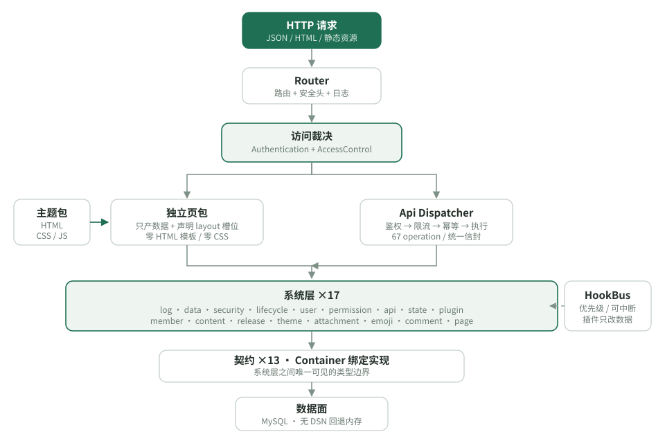

# Mini Blog


一个零依赖的 PHP 博客框架：把博客拆成系统核心、系统层、承载包与主题四层，核心只做装配与调度，能力、呈现、接口全部可插拔。

> 设计信条：高度自定义，万象皆接口。
> 仓库：<https://github.com/Lisir2002/Mini_Blog>（`main`，Public）

## 简介

Mini Blog 用原生 PHP 8.1+ 写成，没有 Composer、vendor、模板引擎与 ORM。18 个系统层各自声明 `system.json` 并由内核按依赖装配；主题包是 HTML/CSS/JS 的唯一合法住所；92 个接口由 `api/registry.json` 单向生成文档与 OpenAPI。新增系统层或接口均无需改动 `core/`——它固定 24 个 PHP 文件，不写一条 SQL，也不输出任何标签或样式。

默认状态是 Headless 数据服务（`theme.active = null`），接入主题后成为站点。当前为可运行的内核原型，部署配置见 [`docs/DEVELOPMENT.md`](docs/DEVELOPMENT.md)。

## 特性

| 特性 | 说明 |
| --- | --- |
| 四层模型 | 系统核心 / 系统层 / 承载包 / 数据与呈现，层间只通过契约、事件、装配清单与数据接口通信 |
| 可插拔系统层 | 18 层覆盖日志、数据、安全、权限、内容、评论、附件、表情、状态、版本、统计等，各带 `system.json` |
| 呈现归主题 | 无主题或主题缺布局时一律退化为纯 JSON，框架不兜底 HTML/CSS/JS |
| 接口清单驱动 | 92 个接口 = 92 份文档 = 92 个 operation，全部由 `api/registry.json` 生成 |
| 内容与交互 | 文章、评论树、SHA-256 内容寻址附件、表情 token、五态状态反馈 |
| 呈现接线 | 归档 / 标签 / 分类、统计看板（窗口链接组）、文章页点赞 / 举报 / 编辑入口与附件区块；`pages/*` 只产数据，标签全归主题 |
| 后台闭环 | 评论审核队列、内容管理台（列表 / 状态迁移 / 回收站）、站内搜索、RSS / sitemap / robots；写路径一律「GET 签票据、POST 验签」 |
| 能力兑现证据 | `tools/consumers.php` 输出「接口 → 消费方」矩阵，把「零消费」列成可查清单，而不是靠人肉翻接口清单 |
| 数据平面 | 事务会话、查询观测、严格 `sql_mode`、显式出站字段白名单、只读孤儿巡检 |
| 统计与可观测 | 计数器 / 仪表 / 直方图三类指标，按小时聚合；HTTP、接口、SQL、业务事件自动埋点，四个只读接口回答「现在发生了什么」 |
| 账号体系 | 注册（默认关闭）、改密、登出、改资料；禁用 / 启用 / 改角色 / 重置口令；登录失败锁定、禁用即吊销全部令牌 |
| 内容生命周期 | 四态状态机、回收站（软删除 / 恢复 / 彻底删除）、定时发布、置顶推荐位；分类与标签的多对多绑定 |
| 安装与版本 | 五步安装向导、迁移台账与 checksum、按版本快照升级与回退 |
| 出厂元主题 | `Glass`（后台面）/ `GlassFront`（前端面）：半透明磨砂玻璃质感，同材质家族、可独立启用 |
| 可重跑证据 | 全量自动化守卫、单文件职责审计、出厂主题复核、应用层与部署层性能基准 |

## 安装

| 组件 | 要求 |
| --- | --- |
| PHP | 8.1+，需 `pdo_mysql` / `mbstring` / `openssl` / `json` |
| 数据库 | MySQL 8.0+ 或 MariaDB 10.6+；无库时回退内存适配器 |
| Web 服务器 | 文档根指向 `public/` |
| Node.js | 仅生成文档时需要，运行时不依赖 |

```bash
git clone https://github.com/Lisir2002/Mini_Blog.git
cd Mini_Blog

mysql -uroot <<'SQL'
CREATE DATABASE IF NOT EXISTS wx_blog CHARACTER SET utf8mb4 COLLATE utf8mb4_unicode_ci;
CREATE USER IF NOT EXISTS 'wx'@'127.0.0.1' IDENTIFIED BY 'wx_pass_2026';
GRANT ALL PRIVILEGES ON wx_blog.* TO 'wx'@'127.0.0.1';
FLUSH PRIVILEGES;
SQL

php -S 127.0.0.1:8080 -t public public/index.php
```

`public/index.php` 同时作为内置服务器路由脚本。生产部署使用 `/install` 五步向导，细节见 [`docs/DEVELOPMENT.md`](docs/DEVELOPMENT.md)。

## 快速开始

无主题时首页返回结构化数据：

```json
{
  "title": "站点首页",
  "items": ["第一篇文章", "第二篇文章", "这一行由插件系统通过钩子注入"],
  "page": "home"
}
```

在 `config/app.php` 接入主题：

```php
'theme' => ['active' => 'bare'],       // 语义 HTML + style.css
'theme' => ['active' => 'bare-html'],  // 零 CSS 的裸 HTML
'theme' => ['active' => 'glass'],      // 磨砂玻璃 · 后台面（仪表盘）
'theme' => ['active' => 'glass-front'], // 磨砂玻璃 · 前端面（访客门户）
```

调用接口（统一信封 `code / message / data / request_id / meta`）：

```bash
curl -s http://127.0.0.1:8080/api/v1/system/info
curl -s 'http://127.0.0.1:8080/api/v1/content/posts?limit=1'
curl -s http://127.0.0.1:8080/api/v1/emojis
```

受保护接口的令牌获取、错误码、分页与二进制通道约定见 [`docs/api/SPEC.md`](docs/api/SPEC.md)；元主题与主题启用见 [`docs/THEMES.md`](docs/THEMES.md)。

## 架构



| 层 | 内容 | 约束 |
| --- | --- | --- |
| L0 系统核心 | Kernel / Container / HookBus / Router / Config / 13 个契约 | 24 个 PHP，0 CSS/JS，0 SQL |
| L1 系统层 | 18 层，按 `priority` 与 `requires` 装配 | 每层自带 `system.json` |
| L2 承载包 | 主题包、插件包、独立页包 | 模板与静态资源只允许出现在这里 |
| L3 数据与呈现 | MySQL 表、主题布局与资源 | 表归各系统层自持，呈现归主题 |

四张接口网：契约面（`core/Contracts/*`）、事件面（`HookBus`）、装配面（`system.json` / `page.json` / `theme.json`）、数据面（`DatabaseInterface`）。完整设计与逐版本决策见 [`docs/ARCHITECTURE.md`](docs/ARCHITECTURE.md)。

## 项目结构

```
Mini_Blog/
├── public/index.php          唯一入口
├── core/                     24 个 PHP：装配与调度
├── systems/                  18 个系统层，各带 system.json / migrations
├── themes/                   Bare · BareHtml · Glass · GlassFront（磨砂玻璃元主题）
├── plugins/                  Hello · Performance（默认关闭）
├── pages/                    Home · Links · Post · Console · Toolbox · Install
├── api/registry.json         接口清单（唯一事实源，92 条）
├── config/app.php            装配清单
├── docs/                     架构、规矩、专题与 92 份接口文档
├── tests/                    守卫分组（见 tests/groups/）
├── tools/                    文档生成 / OpenAPI / 审计 / 基准 / 旅程 / 故障旅程 / 事实对账 / 签名
└── storage/                  运行时产物
```

## 验证

```bash
php tests/run.php                    # 全量守卫（分组见 tests/groups/）
php tools/theme.php verify           # 出厂元主题契约复核
php tools/audit-responsibility.php   # 单文件职责审计
php tools/data.php verify            # 只读孤儿巡检
php tools/journey.php                # 全链路旅程（隔离站点 / 真实请求管线）
php tools/faults.php                 # 故障旅程（依赖缺失 / 凭据过期 / 并发 / 越界 / 启动期真实 SAPI）
php tools/facts.php verify           # 计数唯一真源对账（含错误码表）
php tools/bench.php                  # 应用层 / 部署层 / 稳定性代价对比
php tools/scale.php run              # 规模验证（万级数据下的分页 / 索引 / 读取上限）
php tools/gen-api-docs.php           # 重新生成 92 份接口文档
php tools/export-openapi.php         # 导出 OpenAPI 3.1
```

当前基线：php tests/run.php 全绿、0 职责违规 / 0 孤儿协作、18 系统层、92 接口、29 张业务表、`core/` 24 文件。均为可重跑的文本证据，不依赖截图。

## 文档

| 文档 | 内容 |
| --- | --- |
| [`docs/ARCHITECTURE.md`](docs/ARCHITECTURE.md) | 按版本追加的架构设计与版本决策 |
| [`docs/CONVENTIONS.md`](docs/CONVENTIONS.md) | 工程规矩 A–T 全文与运行记录 |
| [`docs/DEVELOPMENT.md`](docs/DEVELOPMENT.md) | 本机环境、安装与部署配置 |
| [`docs/THEMES.md`](docs/THEMES.md) | 元主题契约、前端 / 后台磨砂玻璃主题 |
| [`docs/api/SPEC.md`](docs/api/SPEC.md) | 接口规范：信封、错误码、鉴权、分页、二进制通道 |
| [`docs/STATE.md`](docs/STATE.md) | 五态状态系统 |
| [`docs/CONTENT.md`](docs/CONTENT.md) | 评论树、附件、表情的边界与取舍 |
| [`docs/CONTENT-LIFECYCLE.md`](docs/CONTENT-LIFECYCLE.md) | 文章状态机、回收站、定时发布与分类标签的取舍 |
| [`docs/COMMENT-INTERACTIONS.md`](docs/COMMENT-INTERACTIONS.md) | 互动主体、幂等点赞 / 举报、编辑窗口与审核队列的取舍 |
| [`docs/ARCHIVE-PAGES.md`](docs/ARCHIVE-PAGES.md) | 归档 / 标签云 / 分类页的呈现链路、显式状态、筛选分页与主题契约 |
| [`docs/POST-INTERACTIONS.md`](docs/POST-INTERACTIONS.md) | 文章页点赞 / 举报：PRG、匿名主体与「失败不 303」 |
| [`docs/STATS-BOARD.md`](docs/STATS-BOARD.md) | 统计看板：四态判定、纯 CSS 图表与「0 不冒充健康」 |
| [`docs/SEARCH.md`](docs/SEARCH.md) | 站内搜索：四态、`%` / `_` 字面量匹配与 GET 表单 |
| [`docs/CONTENT-ADMIN.md`](docs/CONTENT-ADMIN.md) | 内容管理台：票据写路径、权限裁剪、回收站语义 |
| [`docs/FEED.md`](docs/FEED.md) | 订阅与收录：`layout=raw` 与「非 HTML 响应」的第一条路径 |
| [`docs/CONSUMERS.md`](docs/CONSUMERS.md) | 接口消费方矩阵：怎么读、为什么零消费不都是缺陷 |
| [`docs/DATA.md`](docs/DATA.md) | 数据层四个维度与巡检 |
| [`docs/PERFORMANCE.md`](docs/PERFORMANCE.md) | 性能治理判断、部署清单与对比数据 |
| [`docs/METRICS.md`](docs/METRICS.md) | 统计系统：三类指标、采集链路、基数治理与失败模式 |
| [`docs/ACCOUNTS.md`](docs/ACCOUNTS.md) | 账号模型、登录判定顺序、口令策略与令牌吊销语义 |
| [`docs/api/README.md`](docs/api/README.md) | 92 个接口索引 |
| [`docs/api/openapi.json`](docs/api/openapi.json) | OpenAPI 3.1（84 路径 / 92 操作） |
| [`docs/architecture.html`](docs/architecture.html) | 可视化架构总览 |
| `tools/journey.php` · `tools/facts.php` | 全链路旅程 · 计数唯一真源对账 |

## 贡献

欢迎 Issue 与 PR。分支以 `feat/` / `fix/` / `docs/` 开头；改代码需同时补守卫，新增接口需更新 `api/registry.json` 并重新生成文档；提交前跑 `php tests/run.php` 与 `php tools/audit-responsibility.php`。探针脚本写 `/tmp`，不入库。完整约定见 [`docs/CONVENTIONS.md`](docs/CONVENTIONS.md)。

## 维护者

[@Lisir2002](https://github.com/Lisir2002)

## 致谢

- [Standard Readme](https://github.com/RichardLitt/standard-readme)：文档结构依据
- [Flyway](https://documentation.red-gate.com/flyway)：迁移台账与 checksum
- [Deployer](https://deployer.org/)：多版本目录与保留策略
- [Shields.io](https://shields.io/)：徽章

## 许可

[MIT](LICENSE) © 2026 Lisir2002
