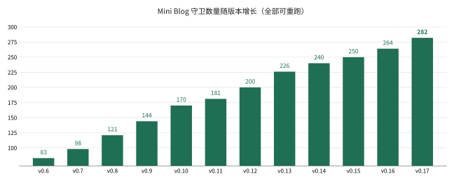

# Mini Blog _(Mini_Blog)_


零依赖、全自研的 PHP 博客框架：核心只做装配与调度，能力、呈现、接口全部可插拔。

Mini Blog 不是又一个 CMS。它把「博客」拆成四层——系统核心、系统层、承载包、主题/插件/独立页——层与层之间只通过契约、事件、装配清单和数据接口通信。框架本身不输出一个 HTML 标签、不含一行 CSS；默认状态下整站就是一个纯 JSON 服务，接入主题之后才成为你看到的博客。

它用原生 PHP 8.1+ 写成，没有 Composer、没有 vendor、没有模板引擎、没有 ORM。所有能力都是可装卸的系统层，所有样式都归主题包，所有交互都是登记在册的接口。**新增一个系统层不需要改内核一行代码。**

> 设计信条：**高度自定义，万象皆接口**。
> 仓库：<https://github.com/Lisir2002/Mini_Blog>（`main`，Public）

---

## 目录

- [安全](#安全)
- [背景](#背景)
- [安装](#安装)
- [使用](#使用)
- [架构](#架构)
- [质量与验证](#质量与验证)
- [工程规矩](#工程规矩)
- [项目结构](#项目结构)
- [文档地图](#文档地图)
- [路线图](#路线图)
- [贡献](#贡献)
- [维护者](#维护者)
- [致谢](#致谢)
- [许可](#许可)

---

## 安全

Mini Blog 是一个**可运行的内核原型**，不是开箱即用的生产 CMS。部署前请至少完成：

- **删除或改密演示账号** `admin / admin123`，它只用于本地验证。
- **数据库口令、签名密钥由环境注入**，不要提交到仓库。
- **写接口默认只允许本机来源**（`40302`），公网部署须显式配置并配合鉴权。
- 真实配置写入 `config/local.php`（已被 `.gitignore` 忽略），不要改带注释的主配置。

发现安全问题请不要开公开 Issue，直接通过 GitHub 私信维护者。

---

## 背景

现成 CMS 的扩展点通常绑死在模板语法或插件 API 上：想改后台布局要动主题引擎，想加一种内容类型要装插件再写钩子，想替换存储要顺着框架的 ORM 走。扩展越多，内核越重，最后没人敢升级。

Mini Blog 的出发点是相反的：**内核只保留「装配 + 调度」两件事**，其余全部下沉为可替换的单元。

| 决策 | 做法 |
| --- | --- |
| 能力不是内核的一部分 | 日志、用户、安全、内容、评论、权限、成员、版本都是 `systems/` 下的系统层 |
| 呈现不是框架的一部分 | 零主题时输出纯 JSON；HTML/CSS/JS 只允许存在于 `themes/` |
| 扩展不是改代码 | 新建目录 + `system.json`，内核零改动；接口在清单登记后自动生成文档 |
| 升级不是重装 | 迁移台账 + checksum 校验 + 版本快照 + 健康门禁，可升级也可回退 |
| 质量不是口头承诺 | 250 项自动化守卫 + 单文件职责审计 + 可重跑性能基准，违规即失败 |

**它不做什么**：不内置页面构建器，不绑定某个前端框架，不提供多站点与云托管，不在核心里写 SQL。

> 命名空间 `Wx\` 是项目早期（「万象」）的缩写，为兼容已部署实例而保留；品牌与包名已统一为 **Mini Blog** / `miniblog-core`，不影响自动加载。

---

## 安装

### 依赖

| 组件 | 最低版本 | 说明 |
| --- | --- | --- |
| PHP | 8.1+ | 需 `pdo_mysql`、`mbstring`、`openssl`、`json` |
| MySQL / MariaDB | 8.0+ / 10.6+ | InnoDB、`utf8mb4`；无库时可回退内存适配器 |
| Web 服务器 | 任意 | Nginx / Apache / Caddy，文档根指向 `public/` |
| Node.js | 18+ | **仅**生成文档与截图时需要，运行时不依赖 |

没有 Composer 安装步骤，也没有 `vendor/` 目录。

### 开发模式（3 步）

```bash
git clone https://github.com/Lisir2002/Mini_Blog.git
cd Mini_Blog

# 1) 建库
mysql -uroot <<'SQL'
CREATE DATABASE IF NOT EXISTS wx_blog CHARACTER SET utf8mb4 COLLATE utf8mb4_unicode_ci;
CREATE USER IF NOT EXISTS 'wx'@'127.0.0.1' IDENTIFIED BY 'wx_pass_2026';
GRANT ALL PRIVILEGES ON wx_blog.* TO 'wx'@'127.0.0.1';
FLUSH PRIVILEGES;
SQL

# 2) 启动（public/index.php 同时作为内置服务器路由脚本）
php -S 127.0.0.1:8080 -t public public/index.php
```

打开 <http://127.0.0.1:8080/>，你会看到**纯 JSON，一个 HTML 标签都没有**：

```json
{
  "title": "站点首页",
  "items": ["第一篇文章", "第二篇文章", "这一行由插件系统通过钩子注入"],
  "page": "home"
}
```

这是刻意的默认状态：`theme.active = null`，框架退化为 Headless 数据服务。文章标题来自内容系统层的 `ContentRepositoryInterface`（真实 MySQL），首页包自身不持有任何内容数据。

### 生产模式：五步安装向导

把 Web 根指向 `public/` 后访问 `/install`，向导会依次完成：**环境检查 → 数据库连接 → 管理员账号 → 建表与迁移基线 → 完成并加锁**。

| 约束 | 表现 |
| --- | --- |
| 只写覆盖层 | 生成 `config/local.php`（0600），删除即回默认，主配置一字不动 |
| 一次性令牌 | `storage/install.token`（0600），写动作必须携带，且只对本机来源返回 |
| 装完即锁 | 生成 `storage/install.lock`，此后 `/install` 整体返回 404 |

### 不重装升级与回退

版本系统是第 14 个系统层 `release`，文件替换委托给元层 `lifecycle`：

```bash
# 预检：会执行哪些迁移、升级哪些单元
curl -s -X POST -H "Authorization: Bearer $TOKEN" -H 'Content-Type: application/json' \
  -d '{"source":"/path/to/miniblog-package"}' http://127.0.0.1:8080/api/v1/release/plan

# 升级：迁移 → 系统层 → core → 健康门禁（失败自动逆向回退）
curl -s -X POST -H "Authorization: Bearer $TOKEN" -H 'Content-Type: application/json' \
  -d '{"source":"/path/to/miniblog-package"}' http://127.0.0.1:8080/api/v1/release/upgrade

# 回退：先预检 down 脚本是否齐备，缺则拒绝且不动任何文件
curl -s -X POST -H "Authorization: Bearer $TOKEN" -H 'Content-Type: application/json' \
  -d '{"version":"0.10.0"}' http://127.0.0.1:8080/api/v1/release/rollback
```

---

## 使用

### 接入主题

```php
'theme' => ['active' => 'bare'],       // 带样式，原生 PHP 模板，CSS 逐字来自 themes/Bare/style.css
'theme' => ['active' => 'bare-html'],  // 零 CSS 的裸 HTML 主题包
```

| 主题包 | 输出 | 用途 |
| --- | --- | --- |
| `themes/Bare` | 语义 HTML + 一个 `style.css` | 演示「样式完全归主题」 |
| `themes/BareHtml` | 语义 HTML，零样式声明 | 演示「框架不兜底任何 CSS」 |

### 独立页只产数据

**呈现权完全归主题**（规矩 J）：独立页包零 HTML 模板、零 CSS、零 JS，只在 `page.json` 声明 `layout` 槽位并产出结构化数据。

| 路径 | 包 | 布局槽位 | 说明 |
| --- | --- | --- | --- |
| `/` | `pages/Home` | `site` | 首页，数据来自内容层 |
| `/links` | `pages/Links` | `site` | 普通独立页 |
| `/console` | `pages/Console` | `admin` | 控制台，只读 + 令牌查询 |
| `/toolbox` | `pages/Toolbox` | `tool` | 文本小工具，交互脚本来自主题 |
| `/install` | `pages/Install` | `install` | 五步安装向导，装完 404 |

无主题、或主题缺少对应布局时，全部退化为纯 JSON——**框架绝不兜底输出标签或样式**。

### 调用接口

```bash
curl -s http://127.0.0.1:8080/api/v1/system/info
curl -s http://127.0.0.1:8080/api/v1/system/health
curl -s 'http://127.0.0.1:8080/api/v1/content/posts?limit=1'

# 受保护接口：先用演示凭据换令牌
TOKEN=$(curl -s -X POST -H 'Content-Type: application/json' \
  -d '{"username":"admin","password":"admin123"}' \
  http://127.0.0.1:8080/api/v1/auth/token | php -r '$d=json_decode(stream_get_contents(STDIN),true); echo $d["data"]["token"] ?? "";')
curl -s -H "Authorization: Bearer $TOKEN" http://127.0.0.1:8080/api/v1/lifecycle/units
```

统一信封 `code / message / data / request_id / meta`，错误额外带 `errors`。**67 个接口 = 67 份文档 = 67 个 operation**，全部由 `api/registry.json` 单向生成，不手写。

### 状态与反馈

错误有业务码，但用户看到的应该是**态**。v0.12 把反馈统一成五态；「等待」与「交互」不是两个并列相位，而是 `waiting` 的两种持有者：

| 状态 | `phase` | `held_by` | 说明 |
| --- | --- | --- | --- |
| 进行态 | `running` | — | 正在执行，不要重复提交 |
| 完成态 | `done` | — | 已结束且成功 |
| 错误态 | `failed` | — | 已结束且失败，带 4xx / 5xx 业务码 |
| 等待态 | `waiting` | `system` | 等队列、网络或第三方回调 |
| 交互态 | `waiting` | `user` | 等人确认、授权或补输入 |

每个状态都带三件套：**说明**（`title / message / hint`）、**出路**（`actions`，最多 4 个真实链接或表单）、**证据**（`code / trace_id / retryable`）。页面级与动作级状态随响应返回；安装、迁移、发布这类长任务落 `wx_state_tasks`，用 `revision` 做乐观锁，终态不可回退。未捕获异常由 `kernel.exception` 接住，走同一套状态与主题渲染；状态系统被停用时，核心只输出纯文本 500。

文案是「键 + 默认中文」，主题可经 `state.copy` 钩子覆写；可访问性由主题负责（错误 `role="alert"`、其余 `role="status"`、进行态 `aria-busy`）。细节见 [`docs/STATE.md`](docs/STATE.md)。

### 评论、附件、表情

三者的共同点是「都会挂到内容上」，但它们的**生命周期完全不同**，所以各立一层：

| 系统层 | 拥有 | 关键设计 |
| --- | --- | --- |
| `comment` | 评论关系、审核状态、可见性 | 邻接表 + 物化路径；深度上限**拒绝**而非静默改挂；软删保留占位与子回复；审核状态机白名单 |
| `attachment` | 元数据 + 字节 | 元数据入库、字节按 SHA-256 内容寻址；文件名不进路径；四道校验；下载每次授权 |
| `emoji` | 短码 → 字形 / 图片 | 只产出 token 不产出 HTML；自定义只引用本站附件；存原文、渲染时解析 |

几个具体取舍：

- **评论树序由父子关系决定，不由 `path` 字符串排序**。路径段位数不等时字典序会把 `10` 排到 `2` 前面，所以 `path` 只用于取子树，同层恒按 `id` 升序。
- **文件名不进入存储路径**。`../../etc/cover.png` 落盘时路径是 `storage/attachments/aa/bb/<sha256>`，展示名另存；路径穿越、双扩展名、同名覆盖、目录执行四类问题一并消失。
- **上传下载复用同一套守卫**。二进制通道不是「第二套接口」，而是 registry 里的两个 operation，限流 / 写边界 / 鉴权 / 权限 / 参数校验与 JSON 接口完全一致。
- **表情删了不改写历史**。正文存 `:shipit:` 原文，删除表情后读者看到字面量，而不是空白；未知短码永远原样显示。

`pages/Post` 是第一个同时消费三者的页面：正文 + 评论树 + 评论表单，走「表单 → 同页 POST → 303」的 PRG 路径，**无 JavaScript 也能评论与回复**。细节见 [`docs/CONTENT.md`](docs/CONTENT.md)。

### 数据层：第 8 层原位升级（v0.14）

用户问「数据系统是否单独写一个」。核查发现升级前 `systems/Database` 只有 194 行、4 个方法，是插座不是系统；而数据平面约 1,522 行分散在 12 个仓储。**答案不是再开第 18 层，而是把第 8 层 `database` 原位升级为 `data`**——系统层仍 17 个、`core/` 仍 24 个文件、业务表仍 24 张。

| 边界 | 落地 |
| --- | --- |
| 物理列不出站 | `present()` 显式白名单，`ip_hash` / `path` 等内部字段永不出站 |
| 多语句必进事务 | `DataSession` 事务 / 嵌套 savepoint / `afterCommit`，评论「插入 + 路径回填」同生共死 |
| 列表查询必须有上限且必须批量 | 表情 `findMany` / `parseMany` 消除 N+1，`QueryProfiler` 让「几条 SQL」可断言 |

另有显式 `sql_mode` 严格模式、关系登记 + 只读孤儿巡检（`php tools/data.php verify`）、结构指纹冷启动去重。规矩 **S** 与四个维度的反例列见 [`docs/DATA.md`](docs/DATA.md)。

### 性能治理：不新增第 18 层（v0.15）

用户问「是否该按服务器性能动态分配核心、调度 CPU 与线程来加速网站」。用同一组三问筛，三条全不成立：它随**部署环境**而非应用演化、CPU 配额是环境事实不是被调用的能力、关掉它业务语义不变说明没有契约。**权限缺席会改变「能不能做」，性能缺席只改变「多快」——改变语义的才配有一层。**

更关键的是 PHP 每请求重建内核、不持有线程池；worker 归 FPM master、线程归内核调度器。本机 `nproc` = 32 而 cgroup 配额只有 4 核，应用按可见核数「动态调核」只会开出一堆抢配额的进程。因此服务器参数写成 [`docs/PERFORMANCE.md`](docs/PERFORMANCE.md) §3 的**部署清单**，不进代码；`core/` 24/24 已满、系统层仍 17。

应用层只补三道边界（规矩 **T**）：不越界、不猜（结论只认可重跑基准）、不隐形（`Server-Timing` + 预算留痕 + 开关语义等价）。可选增强包 `plugins/Performance/` 默认关闭，只做 ETag / 304 / gzip 与观测，`core/` 零改动。

| `php tools/bench.php` 对照 | 之前 / 关闭 | 之后 / 开启 |
| --- | ---: | ---: |
| 60 请求传输字节 | 190,908 | **26,450（−86.1%）** |
| 同组 SQL 条数 | 2,520 | 2,520（服务端计算未变） |
| 4 并发 worker：1 核 → 4 核 | 970.16 ms | **343.08 ms（2.83×）** |
| 钉在固定 4 核 → 放开可见核 | 343.08 ms | 294.09 ms（绑核反而更慢） |

诚实标注：这一组优化的是**传输与可观测**，不是服务端计算；opcache 在 CLI 模型下差异落在噪声内，已明确不纳入结论。完整口径见 [`docs/PERFORMANCE.md`](docs/PERFORMANCE.md) §6。

### 两个扩展动作

**新增系统层**：建 `systems/<X>/`，写 `system.json`（`name / class / requires / priority`）和一个 `extends AbstractSystem` 的类。内核零改动——`Data`、`Lifecycle`、`Api`、`Content`、`Release`、`State` 都是这样接进来的。

**新增接口**：在 `api/registry.json` 追加定义 → 系统层 `boot()` 里 `registerOperation()` → 跑 `tools/gen-api-docs.php` 与 `tools/export-openapi.php` → `php tests/run.php`。缺任何一环，守卫会失败。

---

## 架构


主题包只提供 HTML/CSS/JS，独立页只产数据并声明 layout 槽位；无主题时页面分支直接返回 JSON，框架不兜底任何标签。

### 四层模型

| 层 | 内容 | 约束 |
| --- | --- | --- |
| **L0 系统核心** | `Kernel / Container / HookBus / SystemRegistry / PackageLoader / Router / Config` | 24 个 PHP，已达上限；0 个 CSS/JS、0 条 SQL |
| **L1 系统层** | 日志、数据库、安全、装卸、用户、权限、接口、状态、插件、成员、内容、版本、主题、附件、表情、评论、页面 | 每层自带 `system.json`，按 `priority` 与 `requires` 装配 |
| **L2 承载包** | 主题包、插件包、独立页包 | 全部资源（CSS/JS/模板）只允许出现在这里 |
| **L3 数据与呈现** | MySQL 表、主题布局、主题资源 | 表归各系统层自持；呈现归主题 |

### 四张接口网

| 网 | 载体 | 作用 |
| --- | --- | --- |
| 契约面 | `core/Contracts/*`（13 个） | 系统层之间唯一可见的类型；容器运行时绑定 13 个实现（含状态层 3 个内部契约） |
| 事件面 | `HookBus` | 优先级 + 可中断；插件只能改数据，不能改装配 |
| 装配面 | `*/system.json`、`page.json`、`theme.json` | 声明依赖、优先级、路由、权限、布局槽位 |
| 数据面 | `DatabaseInterface` | 事务 / 观测 / 严格模式 / 巡检归 `data` 层；核心不认识 MySQL，无 DSN 时各层自动回退内存实现 |

实测装配顺序：

```
log → data → security → lifecycle → user → permission → api → state → plugin
    → member → content → release → theme → comment → page
```

---

## 质量与验证

所有结论都是**可重跑的文本证据**，不依赖截图。



| 版本 | 守卫数 | 增量 | 主题 |
| --- | ---: | ---: | --- |
| v0.6 | 83 | — | 呈现权归主题 + 权限三层模型 |
| v0.7 | 98 | +15 | 角色继承、决策缓存、字段级权限 |
| v0.8 | 121 | +23 | 页面身份清单化、契约覆盖鉴权 |
| v0.9 | 144 | +23 | 用户组、页面会话、可换缓存后端 |
| v0.10 | 170 | +26 | 头衔 / 经验 / 等级，身份与授权解耦 |
| v0.11 | 181 | +11 | 五步安装向导、不重装升级与回退 |
| v0.12 | 200 | +19 | 五态状态系统、长任务与异常边界 |
| v0.13 | 226 | +26 | 评论树、附件内容寻址、表情 token |
| v0.14 | 240 | +14 | 数据层原位升级（事务 / 批量 / 出站裁剪 / 巡检）、规矩 S |
| v0.15 | 250 | +10 | 性能治理：不新增层、规矩 T、可重跑基准与部署清单 |

| 指标 | 当前值 | 验证方式 |
| --- | ---: | --- |
| 守卫 / 分组 | **250 / 50** | `php tests/run.php` |
| PHP 文件 / 有效行 | **268 / 16,747** | `php tools/audit-responsibility.php` |
| 最大单文件 | **187 行** | 同上（预算 190，超限即失败） |
| 职责违规 / 孤儿协作 | **0 / 0** | 同上，非 0 退出 |
| 系统层 | **17** | 装配顺序断言 |
| 接口 / 文档 / operation | **67 / 67 / 67** | 清单四方 1:1 比对 |
| 数据表 | **24** | 各系统层 migrations |
| 权限点 | **44** | 各层 `permissions.json` 自报 |
| 运行时依赖 | **0** | 无 composer / vendor |

```bash
php tests/run.php                    # 250 项守卫，50 个文件
php tools/audit-responsibility.php   # 单文件职责审计
php tools/bench.php                  # 性能对比：应用层开关 + 部署层 opcache / CPU 核数
php tools/data.php verify            # 只读孤儿巡检 / stats 表体量
php tools/gen-api-docs.php           # 重新生成 67 份接口文档
php tools/export-openapi.php         # 导出 OpenAPI 3.1
php tools/sign-package.php <目录> <密钥>   # 源包签名
```

守卫覆盖六个面：**存在性**（文件 / 契约 / 清单是否齐）、**一致性**（四方 1:1、文档与码表同源）、**运行时贯通**（真实 HTTP + MySQL 读写）、**故障注入**（拔 DSN、撤销许可、无效令牌、篡改包）、**协作矩阵**（C1–C9）、**项目树纪律**（脚本 / 临时文件 / 日志不入库）。

---

## 工程规矩

20 条规矩全部配有可执行守卫，完整文本见 [`docs/CONVENTIONS.md`](docs/CONVENTIONS.md)。核心几条：

| 规矩 | 内容 |
| --- | --- |
| **B · 纯原生栈** | 禁 Twig / Blade / Smarty / Composer / vendor / ORM；模板是原生 `.php` |
| **D · 核心轻量** | `core/` PHP ≤ 24，当前 24，新增能力只能进系统层或走钩子 |
| **G / J · 呈现归主题** | CSS/JS 只允许在 `themes/`；后台布局同样过主题系统，缺布局退化为纯 JSON |
| **H · 单文件不臃肿** | 行数 / 主体数 / 公开方法 / 扇出 / 职权跨度五指标分层预算，静态审计 |
| **I · 协作全方位验证** | 8 类协作矩阵 + 存在性 / 一致性 / 贯通 / 故障注入四维 |
| **K · 权限三层** | 用户 RBAC + 文章 ACL + 系统自报权限点；三态决策、fail-closed、不可提权 |
| **N · 身份与授权解耦** | 头衔 / 等级 / 经验只描述「是谁」，零权限；授权入口只有权限系统一个 |
| **O · 验证脚本不入项目** | 探针脚本只写 `/tmp`；项目内只允许 `tests/` 与 `tools/` |
| **P · 安装与版本可逆** | 安装五步 + 一次性令牌 + `install.lock`；升级必留快照，缺 down 拒绝回退 |

<details>
<summary>其余规矩（A / C / E / F / L / M）</summary>

| 规矩 | 内容 |
| --- | --- |
| **A** | 验证性截图不存活三轮对话，复核一律用可重跑文本 |
| **C** | 一接口一文档，清单驱动生成，禁止手写 |
| **E** | 新规矩必须同时提交条目 + 守卫 + 全绿记录 |
| **F** | 写接口必须鉴权，且默认不暴露公网 |
| **L** | 页面访问分级在 `page.json` 声明，裁决统一走 `route.access`，策略只能收紧 |
| **M** | 主体可扩展但凭据单一来源；页面会话与 API 令牌同表同撤销 |

</details>

---

## 项目结构

```
Mini_Blog/
├── public/index.php          唯一入口：引导 + run()
├── core/                     系统核心 24 个 PHP：Kernel / Container / HookBus / Router / 13 个契约
├── systems/                  17 个系统层，每层自带 system.json + migrations + lifecycle
│   ├── Log/ Data/ Security/ User/ Permission/         （能力）
│   ├── Content/ Comment/ Member/ Release/             （业务与版本）
│   ├── Theme/ Plugin/ Page/                           （承载）
│   ├── Api/                                           （接口面）
│   └── Lifecycle/                                     （元层：装卸 / 快照 / 版本切换）
├── themes/                   Bare（带样式）· BareHtml（零 CSS）
├── plugins/                   Hello（示例）· Performance（可选性能治理包，默认关闭）
├── pages/                    Home · Links · Console · Toolbox · Install
├── api/registry.json         接口清单（唯一事实源，67 条）
├── config/app.php            装配清单
├── docs/                     架构 / 规矩 / 环境 / 性能 / 67 份接口文档 / OpenAPI
├── tests/                    run.php + 夹具 + 50 个守卫文件
├── tools/                    文档生成 / OpenAPI 导出 / 签名 / 职责审计 / 性能基准
└── storage/                  运行时产物（仅骨架入库）
```

| 目录 | 职责 |
| --- | --- |
| `core/` | 只做装配与调度；0 CSS/JS、0 SQL、24 个 PHP |
| `systems/` | 一切能力；新增目录即新增能力，内核零改动 |
| `themes/` | 一切呈现；HTML / CSS / JS 的唯一合法住所 |
| `pages/` | 路由 + 数据 + 布局槽位声明，不含样式 |
| `docs/` | 架构设计与接口契约；`docs/api/` 全部由清单生成 |
| `tests/` | 可重跑的守卫，不是示例测试 |

---

## 文档地图

| 文档 | 内容 |
| --- | --- |
| [`docs/ARCHITECTURE.md`](docs/ARCHITECTURE.md) | 31 章架构设计与每个版本的决策记录 |
| [`docs/CONVENTIONS.md`](docs/CONVENTIONS.md) | 工程规矩 A–T 全文与运行记录 |
| [`docs/DEVELOPMENT.md`](docs/DEVELOPMENT.md) | 本机环境、SSH 接入、浏览器配置 |
| [`docs/api/SPEC.md`](docs/api/SPEC.md) | 接口规范：信封、错误码、鉴权、分页、幂等、二进制通道例外、出站字段裁剪 |
| [`docs/STATE.md`](docs/STATE.md) | 状态系统：五态、文案、长任务与可访问性 |
| [`docs/CONTENT.md`](docs/CONTENT.md) | 评论树、附件内容寻址、表情 token 的边界与安全取舍 |
| [`docs/DATA.md`](docs/DATA.md) | 数据层：四个维度、三道边界、关系巡检与明确不做 |
| [`docs/PERFORMANCE.md`](docs/PERFORMANCE.md) | 性能治理：三问法判断、部署清单、对比数据与明确不做 |
| [`docs/api/README.md`](docs/api/README.md) | 67 个接口索引 |
| [`docs/api/openapi.json`](docs/api/openapi.json) | OpenAPI 3.1（60 路径 / 67 操作） |
| [`docs/architecture.html`](docs/architecture.html) | 可视化架构总览 |

---

## 路线图

**v0.15 已完成**：性能治理不新增第 18 层——三问法判断「动态调核」归部署层；可选增强包做 ETag / 304 / gzip 与预算留痕；`tools/bench.php` 给出应用层与部署层的真实对比数据；规矩 T 与 3 组守卫。

**v0.14 已完成**：第 8 层 `database` 原位升级为 `data`——事务会话、查询观测、严格模式、孤儿巡检；表情批量取数消除 N+1，评论写入事务包裹与出站白名单；新增规矩 S 与 4 组守卫。

**v0.13**：第 16 / 17 系统层 `attachment` 与 `emoji`，评论升级为评论树（回评 / 软删 / 审核），附件按 SHA-256 内容寻址，表情只产出 token。

**v0.12**：第 15 系统层 `state`——五态反馈（进行 / 完成 / 错误 / 等待 / 交互）、文案键与主题覆写、长任务乐观锁、未捕获异常边界。

**v0.11**：五步安装向导、迁移台账、checksum 校验、安装基线、健康门禁、按版本快照回退。

**v1.0 之前**：

- [ ] 在线源包下载与包仓库协议（当前 `source` 必须是已就位目录）
- [ ] 升级并发锁与灰度 / 分批发布
- [ ] 匿名评论验证码、跨实例反垃圾、附件字节回收任务
- [ ] 多实例共享的限流与幂等存储（当前为文件实现）
- [ ] 控制台从只读升级为完整写操作（走受保护 API）
- [ ] 经验流水归档、排行榜游标翻页、等级变更通知
- [ ] 跨请求共享缓存（当前只做无状态协商缓存）
- [ ] 把 API 信封的 `request_id` 移到 `X-Request-Id` 响应头，让接口响应也能参与协商缓存

**明确不做**：内置页面构建器、绑定前端框架、核心内写 SQL、多站点托管、应用内动态调核 / 绑核 / 自适应 worker 池。

---

## 贡献

欢迎 Issue 与 PR。

1. Fork 并以 `feat/`、`fix/`、`docs/` 前缀开分支。
2. 改代码必须同时补守卫：新增规矩要提交条目 + 断言；新增接口要改清单并重新生成文档。
3. 提交前本地必须全绿：

```bash
php -l 每个改动文件
php tests/run.php
php tools/audit-responsibility.php
```

4. 提交信息用 `type: 说明`（`feat` / `fix` / `docs` / `test` / `chore`）。
5. 探针脚本写在 `/tmp`，不要提交进仓库（规矩 O）。

**好 PR 的样子**：说明「改了什么、为什么、怎么验证」，附上守卫运行结果；不夹带无关格式化。

问题讨论请开 Issue，不要私信堆料。

---

## 维护者

- [@Lisir2002](https://github.com/Lisir2002)

---

## 致谢

- [Standard Readme](https://github.com/RichardLitt/standard-readme)：本 README 的结构依据。
- [Flyway](https://documentation.red-gate.com/flyway)：迁移台账、checksum 校验、baseline 的实践来源。
- [Deployer](https://deployer.org/)：多版本目录与保留策略的启发（本项目用「快照 + 整体替换」实现同等效果）。
- [Shields.io](https://shields.io/)：徽章。

---

## 许可

[MIT](LICENSE) © 2026 Lisir2002

MIT 是 OSI 认可的最宽松许可之一：可商用、可修改、可闭源分发、可再许可，唯一义务是保留版权与许可声明。选它而不是 Apache-2.0，是因为后者附加专利与变更声明义务；比 MIT 更彻底的只有公有领域奉献（Unlicense / CC0），但那会放弃全部著作权且与部分组织的合规政策不兼容。**如果要的是「最开放且仍能被正常采用」，MIT 就是答案。**
