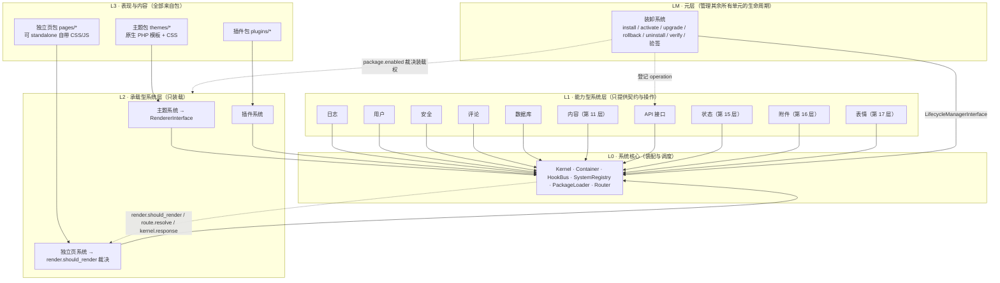

# Mini Blog 架构设计（v0.14）

> 第一性原理：**高度自定义，万象皆接口**
> 技术栈：**纯原生** PHP 8.1+ / MySQL 8.0+（PDO，实测 MariaDB 10.11）/ 原生 HTML + CSS + JavaScript
> 代码全数自研，设计上借鉴成熟博客项目与公开规范，但落点全部回到上面这条原理。
> v0.4 把此前提出的**全部建议一次落地**：内容系统、MySQL 全量实现、接口鉴权执行、幂等/限流/游标分页/OpenAPI 3.1、可卸载控制台、自包含独立页、裸 HTML 主题、安装向导、包签名验签、命名与版本定案。
> v0.5 立下两条元规矩：**单文件职责预算**（H）与**协作全方位验证**（I），把超重文件真实拆分，并把 8 类协作关系做成可重跑的运行时守卫。

---

## 0. 一句话概括

**核心只做「装配与调度」；一切能力是系统层，一切呈现是承载包，一切交互是接口，一切单元的生老病死由元层管辖。**

核心不认识「文章」「评论」「登录页」「升级」「令牌」这些词，它只认识 `SystemInterface`、`PackageInterface`、契约（接口）和钩子（事件）。删光所有系统层与承载包，框架依然能启动——只是什么都不做，且**一个字节的样式都不会输出**。

---

## 1. 把第一性原理拆成可验证的硬约束

「高度自定义」如果只停留在口号，最后一定会退化成「加个配置项吧」。所以这里把它拆成五条**有测试守卫**的约束：

| 编号 | 硬约束 | 可验证方式 |
| --- | --- | --- |
| **H1 零呈现** | 核心永不产出 HTML / CSS / JS；未接入主题时全站零样式 | 运行时断言响应体无标签、无 `style`；静态扫描 `core/` 无 `.css/.js`、无 HTML 痕迹 |
| **H2 零业务** | 核心不写 SQL、不建表、不实现任何业务功能、不内置任何路由与默认页面 | 核心目录无 SQL 语句；首页本身是独立页包；核心 PHP 文件数设上限 |
| **H3 一切可换** | 任何能力都通过契约绑定，实现可被显式、可追溯地替换 | 容器覆盖留痕；同级冲突 fail-fast，不静默覆盖 |
| **H4 纯原生栈** | 禁止 Twig / Blade / Smarty 等模板引擎，禁止任何 PHP 框架、ORM、`composer`/`vendor` | 静态守卫扫描全项目文件名与源码用法；主题模板必须是原生 `.php` |
| **H5 操作皆接口** | 程序各项操作规范化为接口，**一个接口对应一份规范化操作文档** | 清单驱动生成 + 守卫测试检查 1:1、章节齐全、无孤儿文档 |

另有两条工程规矩同样带守卫：**F** 写接口必须鉴权且默认不暴露公网；**G** CSS/JS 只存在于承载包。完整口径见第 11 节与 `docs/CONVENTIONS.md`。

四条推论，决定了后面所有设计：

1. **系统层是一等公民，且一律平等。** 官方自带的日志系统和站长三年后自己加的「AI 摘要系统」，走的是同一个 `SystemInterface`、同一份 `system.json`、同一套装配流程。v0.4 新增的 `content` 正是对这条能力的真实检验：一个目录 + 一份清单，内核与其它 10 个系统层零改动。
2. **能力型 ≠ 承载型 ≠ 元型。** 日志/用户/安全/评论/数据库/内容/API 提供**契约与操作**；主题/插件/独立页负责**装载包**；装卸系统作为**元层**管理前述所有单元的生命周期。三者都不产出任何 HTML。
3. **「无主题」不等于「无样式的 HTML」。** 若核心保留一份裸模板，它仍然拥有 markup，仍然越权。所以本框架把「无主题」定义为**退化为纯数据服务（Headless）**：输出结构化 JSON，零 HTML。想要裸 HTML？正确做法是装 `bare-html` 主题包（v0.4 已提供）。
4. **身份来自清单，不是目录名。** 单元标识取自 `*.json` 里的 `slug` / `name`；目录只是物理位置。否则「停用一个插件」会和「装载它的过滤钩子」对不上。

---

## 2. 借鉴什么，超越什么

WordPress 的 Action / Filter 与优先级机制证明了「钩子 + 精简核心」的生命力；Typecho 用 7 张表、不足 400KB 代码实现了完整的插件与模板机制，是 PHP 轻量的标杆；Halo 则把插件做成可动态加载卸载的一等扩展单元 [^1][^2][^3][^4]。

| 项目 | 值得借鉴 | 我们不打算继承的部分 | 我们的超越点 |
| --- | --- | --- | --- |
| WordPress | Action 广播 / Filter 链式改值、priority 排序、核心保持精简 [^3][^5] | 核心自带默认主题与 `wp-admin` 全套样式；插件与核心同进程无边界，插件实质是「半个 core」[^4] | 把「系统层」也变成可插拔的一等公民；后台 UI 做成可卸载包；契约替换显式化、可追溯、冲突 fail-fast |
| Typecho | 极致轻量、PHP 原生模板主题、结构清晰 [^1][^2] | 主题之外框架仍持有后台界面与基础样式 | 零兜底模板：卸载主题后连一个标签都不剩；裸 HTML 也要靠主题包 |
| Halo | 插件动态装载 / 卸载、包有自己的生命周期 [^2] | Java 技术栈、核心承担较多业务 | 保持 PHP + MySQL，核心零业务、零表、零路由 |

### 2.1 接口规范的借鉴

「规范化接口」不是自己拍脑袋定字段，而是对齐公开规范后做取舍。完整对照见 [`docs/api/SPEC.md`](api/SPEC.md)：

- **OpenAPI 3.1 / 3.1.1** [^oas]：`info` 元数据、稳定 `operationId`、参数必填性与示例、请求/响应 schema、统一错误 schema、operation 级安全声明、弃用标记、清单随代码评审。v0.4 已由 `tools/export-openapi.php` 直接导出标准 3.1 文档。
- **RFC 9457 Problem Details** [^rfc9457]：机器可读错误、稳定 type、字段级明细、扩展字段前向兼容。
- **Microsoft Azure REST API Guidelines** [^ms]：复数名词资源、路径不放动词、层级要浅、GET/PUT/DELETE 幂等、状态码语义。
- **Google AIP-190 / AIP-136 / AIP-158** [^aip]、**Zalando** [^zalando]：术语一致、自定义动作显式化、kebab-case、游标分页、429 与废弃期。
- **Stripe 幂等键** [^stripe]：`Idempotency-Key` 让重试安全，校验失败不入缓存。

取舍：**借鉴的是约束，不是依赖**。全部用原生 PHP + 一份 JSON 清单落地，没有引入 YAML 解析器、Schema 库、API 框架或 SDK 生成器。

### 2.2 包生命周期的借鉴

WordPress 的 `register_activation_hook` / `register_deactivation_hook` / `register_uninstall_hook`、`upgrader_pre_install` / `upgrader_post_install`、`validate_file` 防目录穿越、解压到临时目录再替换、`attempt_rollback` [^wp][^wphook]——这些机制验证了「状态机 + 暂存区 + 备份 + 钩子」的必要性。我们把同一套模型统一到 **core / system / theme / plugin / page 五类单元**，把每次操作都登记为规范化接口，并在 v0.4 补上 **HMAC-SHA256 签名验签**。

一句话：**它们把「内容」和「扩展」分层，我们把「框架本身」也拆成了接口。**

---

## 3. 五层模型



层间**只允许通过接口通信**，不允许跨层直接 `new` 具体类。核心甚至不知道「文章」「升级」这两个词的存在。

**元层的特殊之处**：它由内核在装配期直接实例化，自身不可被卸载（否则没人能恢复它）；但站点程序 `core` 的升级同样由它执行，只是默认关闭、需显式开启。

---

## 4. 「万象皆接口」= 五张接口网

| 接口网 | 载体 | 解决什么 | 站长可以怎么改 |
| --- | --- | --- | --- |
| **契约面** | `Container` + `core/Contracts/*`（13 个） | 实现可替换 | 用更高 `priority` 重新绑定任意契约，把日志换 Syslog、用户换 LDAP、鉴权换 SSO |
| **事件面** | `HookBus`（action 广播 / filter 链式改值） | 流程可拦截 | 在任何内核节点插入逻辑；业务钩子由系统层自己声明，核心不管 |
| **装配面** | `system.json` / `theme.json` / `plugin.json` / `page.json` | 单元可插拔 | 丢一个目录即接入新系统层；改配置即可停用任意自带系统 |
| **数据面** | `DatabaseInterface` + Headless JSON | 数据可读写 | 连接与严格模式 / 事务 / 观测 / 巡检归 `data` 层，表结构与 SQL 归各系统层自持；无主题时整站就是一套 JSON API |
| **接口面** | `api/registry.json` + `ApiRegistry` + 统一信封 | 操作可规范化 | 69 个操作各有编号与文档；替换执行者只需重新 `registerOperation` |

核心只定义内核级钩子（`kernel.*` / `route.*` / `system.*` / `render.should_render`），像 `comment.before_save`、`theme.context`、`content.before_save`、`lifecycle.before_upgrade` 这类业务钩子全部由对应系统层自行声明。核心的钩子清单不会因为新增业务而膨胀。

---

## 5. 系统核心的职责边界

**白名单（只做这 8 件）**

1. 引导与自动装载
2. 生命周期：`kernel.booting → system.registered → system.booted → kernel.ready → … → kernel.shutdown`
3. 契约容器（绑定 / 覆盖仲裁 / 解析）
4. 事件总线
5. 系统层发现、依赖拓扑排序、两阶段装配
6. 承载包统一装载协议（含 `package.enabled` 裁决点）
7. 请求分发、HTTP 抽象（含 JSON 请求体、来源 IP 判定）与异常边界
8. 配置读取与运行期覆盖（多站点 / 嵌入 / 测试）

**黑名单（写进代码评审清单）**

> 任何 HTML / CSS / JS、任何内联样式、任何 `<link>`、任何默认模板或兜底模板、任何默认主题、任何管理后台 UI、任何登录页、任何默认路由、任何首页、任何 SQL、任何建表语句、任何业务表、任何菜单 / 面包屑 / 分页 HTML、任何 `echo` 标签、**任何模板引擎与第三方框架**。

`core/` 目前 **24 个 PHP 文件**（其中 13 个契约接口），**已达规矩 D 的 24 上限**：后续新增能力必须进系统层或走钩子，不得再加契约文件。核心变胖，就是原理被破坏的第一个信号。

---

## 6. 契约清单

| 契约 | 默认实现 | 谁可覆盖 |
| --- | --- | --- |
| `SystemInterface` | 18 个系统层 | 未来任意新系统层 |
| `PackageInterface` | 主题 / 插件 / 独立页包 | 任意包 |
| `RendererInterface` | **仅主题包**（核心无实现） | 高 priority 主题 / 插件 |
| `LoggerInterface` | 日志系统 → `FileLogger` | 任意系统层 / 插件 |
| `UserProviderInterface` | 用户系统 → **`PdoUserProvider`**（无库回退 `SessionUserProvider`） | 任意系统层 / 插件 |
| `SecurityGuardInterface` | 安全系统 → `DefaultGuard`（CSRF 落库 + 过期） | 任意系统层 / 插件 |
| `CommentStoreInterface` | 评论系统 → **`PdoCommentStore`**（无库回退 `MemoryCommentStore`） | 换实现只改一行绑定 |
| **`ContentRepositoryInterface`** | **内容系统 → `PdoContentRepository`**（无库回退 `MemoryContentRepository`） | 任意系统层 / 插件 |
| `DatabaseInterface` | 数据系统 `data` → `PdoDatabase` | 可换其它 PDO 数据源 |
| **`ApiAuthenticatorInterface`** | **安全系统 → `DbApiAuthenticator`**（令牌落库 + 角色） | 可换 OAuth / 签名 / 企业 SSO |
| `LifecycleManagerInterface` | 装卸系统 → `LifecycleManager` | 可换成带远程仓库的实现 |
| `ApiRegistryInterface` | API 系统 → `ApiRegistry` | 可换成带额外策略的注册表 |

**双实现是刻意的**：`systems/Data/Db::connected()` 惰性探测 MySQL，接上库走 PDO 实现，拔掉库自动回退内存 / 会话适配器。主题、插件、首页包、核心四者零改动——这就是「契约与实现可分离」的兑现，也由守卫测试逐条验证。

---

## 7. 生命周期与冲突策略

**装配期（两阶段是关键）**

```
discover()              扫描 systems/*/system.json，读 requires / priority / enabled
  ↓ topologicalOrder()   依赖拓扑排序 + 成环检测 + 缺失依赖报错
register() × 11         所有系统先绑定契约、订阅钩子（此阶段禁止解析他人实现）
  ↓
boot() × 11             契约已全部就绪，安全地建表、装载包、登记 operation
  ↓ kernel.ready
```

两阶段保证了「系统 A 在启动时能用到系统 B 的契约」，同时避免装配顺序耦合。实测顺序：
`log → data → security → lifecycle → user → api → plugin → content → theme → comment → page`。

**请求期**

```
route.resolve（priority=5 API 先声明；10 独立页/插件）
  → 匹配接口 → 429 限流 → 写接口公网边界 → 鉴权执行 → 参数校验
  → 幂等去重 → 唯一 operation → 统一信封
  → kernel.response（安全头 / 可选 CSP）
  → kernel.response.filter（插件改写数据）
  → render.should_render（独立页可声明绕过主题）
  → renderStage（只有主题绑定 RendererInterface 才渲染；否则输出纯数据）
  → kernel.shutdown
```

**冲突策略**：两个实现绑定同一契约时，`priority` 更高者胜，并记入 `Container::overrides()`；相同或更低则抛 `RuntimeException`。接口的 `id`、`method+path`、`operation` 三者同样各自全局唯一。不搞「最后注册者静默胜出」——那会让站点的自定义行为变得不可推理，这是从 WordPress 插件冲突里学到的反面经验 [^4][^5]。

---

## 8. 「无主题零样式」是怎么被结构性地保证的

不是靠约定，是靠四处代码结构 + 两层测试：

1. `Response` 默认 `body = ''`，默认 `Content-Type: text/plain; charset=utf-8`（绝不是 `text/html`）。
2. `Kernel::renderStage()` 是**全站唯一的表现层入口**，且它自己不渲染：先询问 `render.should_render` 裁决钩子，只有容器里存在 `RendererInterface` 且裁决为 true 才把响应交给主题；否则调用 `asData()` 输出 JSON（仅在 body 为空时，因此 API 与 standalone 响应都不会被覆盖）。
3. `RendererInterface` 在核心里**只有接口、没有任何实现类**，也没有 `default` 主题目录。主题包自己读取自己目录里的 `style.css`，并用**原生 PHP 模板** `include` 渲染。
4. `themes/BareHtml` 证明「裸 HTML」也是主题包的职责：它只输出语义标签，不持有任何 CSS 文件。

**双层守卫测试**（`tests/run.php`，共 55 项）：

- *静态守卫*：`core/` 无 `.css/.js`、源码无 HTML 痕迹、核心 PHP 文件数 ≤ 24；全项目无 `composer.json` / `vendor/` / `.twig` / `.blade.php` / 模板引擎用法；CSS/JS 只存在于承载包。
- *运行时守卫*：未启用主题时不绑定 `RendererInterface`；响应 `Content-Type` 不含 `html`、响应体无标签 / 样式 / 脚本；启用 `bare` 后页面样式与 `themes/Bare/style.css` 逐字一致；启用 `bare-html` 后输出 HTML 但零 CSS / 零 class / 零脚本。

默认配置 `theme.active = null`——**全新安装开箱即零样式**。实测：

```http
HTTP/1.1 200 OK
Content-Type: application/json; charset=utf-8
X-Content-Type-Options: nosniff
X-RateLimit-Limit: 120

{"title":"站点首页","items":["第一篇文章","第二篇文章","这一行由插件系统通过钩子注入"],"page":"home"}
```

> **已解决的衍生问题**：管理后台若写死在核心里必然带上硬编码样式，直接违反 H1。因此后台做成**可卸载的独立页包** `pages/Console`（见第 15 节），核心与系统层零样式。

---

## 9. 装卸系统（元层设计）

### 9.1 层次定位

装卸系统是**元系统层**：它不产出内容、不提供业务数据，只管理其余所有系统层与承载包的生命周期。它与核心同处装配期（由 `LifecycleSystem::register()` 直接实例化），但对外只暴露 `LifecycleManagerInterface`。

### 9.2 五类被管单元

| 类型 | 目录 | 清单 | 说明 |
| --- | --- | --- | --- |
| `core` | `core/` | `version.json` | **站点程序本体**；只能升级 / 回滚，不可安装、卸载、停用 |
| `system` | `systems/<X>/` | `system.json` | 系统层（含第 11 层 content 与未来新增的） |
| `theme` | `themes/<X>/` | `theme.json` | 主题包 |
| `plugin` | `plugins/<X>/` | `plugin.json` | 插件包 |
| `page` | `pages/<X>/` | `page.json` | 独立页包 |

**身份取自清单的 `slug` / `name`**，目录名只作物理路径记录在状态里。状态与操作历史持久化在 `storage/lifecycle/state.json`，可审计、可回溯。v0.4 新增**版本对账**：已登记单元若磁盘清单版本与状态不一致（如人工改了 `version.json`），自动同步为磁盘版本；有备份的升级中间态不覆盖，避免破坏回滚链路。

### 9.3 状态机

```
absent ──install──▶ installed ──activate──▶ active
                        ▲                      │
                        └────deactivate────────┘
        installed / active ──upgrade──▶ installed / active（版本提升，状态保持）
        installed ──uninstall──▶ absent
        installed / active ──rollback──▶ installed / active（版本回退）
```

非法转换直接抛 `40901`，不做「尽力而为」的隐式修正。停用**不清数据**（借鉴 WordPress：deactivation 只清临时态，uninstall 才彻底清理）[^wp]。

### 9.4 操作矩阵

| 操作 | 前置 | 关键动作 | 失败处理 |
| --- | --- | --- | --- |
| `install` | absent、目标不存在 | 路径/依赖/哈希/签名校验 → 暂存区 → 目标写入 → `on_install` → 状态落盘 | 删除目标与暂存，广播 `lifecycle.failed` |
| `activate` | installed | 状态 → active；`package.enabled` 钩子据此决定装载 | 状态不变 |
| `deactivate` | active | 状态 → installed；文件与数据保留 | 状态不变 |
| `upgrade` | installed/active、新版本严格更高 | 备份当前 → 暂存替换 → `on_upgrade(from,to)` → 记录 backup | 自动从备份恢复 |
| `rollback` | 有可用备份 | 当前移入暂存 → 备份复制回目标 → 回写版本 | 自动还原回滚前现场 |
| `uninstall` | installed、无反向依赖 | `on_uninstall` → 删除目录 → 状态 absent | 状态不变 |
| `verify` | 目录存在 | 按 `manifest.sha256` 逐文件比对 SHA-256 | 返回 mismatch 列表 |

### 9.5 事务性：暂存区 → 原子替换 → 备份回滚

借鉴 WordPress upgrader 的「解压到临时目录再替换」与 `attempt_rollback` [^wphook][^wpup]：所有写操作先落到 `storage/lifecycle/staging/`，校验通过才写入目标；升级前**必留备份**到 `storage/lifecycle/backup/`；文件替换或迁移钩子抛错时自动恢复。不会出现「半升级」状态。

### 9.6 安全边界

- **路径穿越防护**：`slug` 必须匹配 `^[A-Za-z0-9][A-Za-z0-9_-]{0,63}$`，拒绝 `..` 与空字节（对应 WP 的 `validate_file`）[^wp]。
- **源包越界防护**：`realpath` 后必须位于站点根目录内，否则 `40301`。
- **完整性**：源包可带 `manifest.sha256`；`config.lifecycle.require_checksum=true` 时强制要求。
- **依赖 / 反向依赖**：安装前校验 `requires`；卸载前扫描所有清单，仍被依赖则拒绝；当前启用的主题也拒绝卸载。
- **站点程序**：`core` 不可安装 / 卸载 / 停用；升级默认关闭，须显式设 `allow_core_update=true`。

### 9.7 生命周期钩子（纯原生 PHP）

包可自带 `lifecycle.php`，返回一个闭包数组——**没有模板引擎、没有 DSL、没有注解**：

```php
<?php
return [
    'on_install' => function (array $ctx): void { /* 建表、写默认配置 */ },
    'on_upgrade' => function (array $ctx): void { /* 执行 migrations */ },
    'on_uninstall' => function (array $ctx): void { /* 清表、清配置 */ },
];
```

装卸系统只负责在约定时机 `include` 并调用，不解释闭包内容。`Content` / `User` / `Comment` 三个系统层各自带 `lifecycle.php`，卸载时清理自己建的表。

### 9.8 与核心、接口系统的关系

- 核心只认 `LifecycleManagerInterface`，不认任何文件系统操作。
- 装卸系统通过 `package.enabled` filter **裁决装载权**：仅 `active`（或未登记的旧包）会被 `PackageLoader` 装载。
- 装卸系统把 8 个操作登记为 `lifecycle.*` operation；接口系统只认 operation 名，不认装卸系统。任一方被停用，另一方仍可独立工作（守卫测试验证停用后返回 `50101`）。

### 9.9 包签名验签（v0.4 新增）

`tools/sign-package.php <目录> <密钥>` 生成 `manifest.sha256` 与 `signature.json`：

```json
{
  "algorithm": "HMAC-SHA256",
  "signature": "<对规范化文件清单的 HMAC-SHA256 摘要>",
  "signed_at": "2026-11-08T23:40:55+08:00"
}
```

待签串是「相对路径 → SHA-256」按键排序后的 JSON（`Fs::canonical()`），签名文件与哈希清单自身被排除以避免自指。验签用 `hash_hmac` + `hash_equals`，**纯原生 PHP，无第三方依赖**。任何文件改动都会让 HMAC 不匹配；`require_signature=true` 时缺签名直接拒绝。守卫测试验证「正确签名通过 / 篡改后重算清单但保留旧签名仍被拒 / 强制缺签名被拒」。

---

## 10. API 接口系统与「一接口一文档」

### 10.1 清单是唯一事实源

`api/registry.json` 定义 **92 个接口**：`API-CORE-001~004`、`API-LOG-001`、`API-LC-001~009`、`API-AUTH-001~004`、`API-USER-001`、`API-CONTENT-001~005`、`API-COMMENT-001~005`、`API-ATTACH-001~005`、`API-EMOJI-001~003`、`API-PERM-001~014`、`API-MEMBER-001~010`、`API-REL-001~005`、`API-STATE-001`。每条必须声明 `id / name / system / method / path / operation / auth / idempotent / side_effects / since / summary / scenario / params / response_fields / errors / example_request / example_response / notes / changelog / doc`。

`ApiRegistry` 构造时强校验：ID 唯一、`method+path` 唯一、`operation` 唯一；`registerOperation` 拒绝重复执行者。

### 10.2 统一信封与错误码

```json
{
  "code": 0,
  "message": "ok",
  "data": {},
  "request_id": "16 位十六进制",
  "meta": {"api": "API-CORE-001", "version": "v1", "system": "core"}
}
```

错误码 5 位，前两位对齐 HTTP 状态；错误响应带 `errors` 字段级明细，`data` 恒为 `null`，**禁止 200 里塞错误**。表定义在 `systems/Api/Envelope.php`（20 个码），文档表格与 OpenAPI 响应由生成器读同一张表，不会多处漂移。完整规范见 [`docs/api/SPEC.md`](api/SPEC.md)。

### 10.3 鉴权从声明变成执行（v0.4）

`ApiDispatcher` 的分发顺序是刻意设计的安全口径：

```
匹配接口 → 429 限流 → 写接口公网边界 → 鉴权执行 → 参数校验 → 幂等去重 → 唯一 operation → 统一信封
```

- **鉴权在参数校验之前**：未认证者不应探知参数要求。
- `ApiAuthenticatorInterface`（安全系统实现 `DbApiAuthenticator`）校验 Bearer 令牌：库里只存 SHA-256 摘要，带过期与撤销；`public` / `user` / `admin` 三级；未认证 `40101`、无效 `40102`、角色不足 `40301`。
- 身份以 `_identity` 注入 `input`，业务执行者不解析请求头。
- **写接口公网边界**：`config.api.expose_write=false`（默认）时，非 GET/HEAD/OPTIONS 操作仅本机来源可调用，公网一律 `40302`。
- `POST /api/v1/auth/token` 用 `password_verify()` 校验凭据后签发落库令牌；明文只在响应中出现一次。

### 10.4 幂等键、限流、游标分页、OpenAPI 导出

| 能力 | 实现 | 口径 |
| --- | --- | --- |
| 幂等键 | `IdempotencyStore`（文件 JSON） | 同键同参数重放首次结果并回 `Idempotency-Replayed: true`；同键不同参数 `40902`；参数校验失败不写缓存；429 不被缓存 |
| 429 限流 | `RateLimiter`（固定窗口） | `Retry-After` + `X-RateLimit-Limit/Remaining/Reset`；CLI 用 PID 隔离避免跨轮累积 |
| 游标分页 | `content.posts` | `limit + cursor`，cursor 为 base64 编码的记录 ID，走 `id > cursor` 的 keyset 分页，避免 OFFSET 深翻页 |
| OpenAPI 3.1 | `tools/export-openapi.php` | 由清单导出 `docs/api/openapi.json`（84 条路径 / 92 个 operation，同路径多方法合并），含 `bearerAuth` 安全声明与统一 schema |

### 10.5 一个接口 = 一份规范化操作文档

| 项 | 约定 |
| --- | --- |
| 1:1 | 清单每条接口 → 且仅 → 一份 `docs/api/<ID>.md`；任何 `API-*.md` 必须能对应清单条目 |
| 8 节固定 | 接口标识 / 功能与适用场景 / 请求规范 / 响应规范 / 错误码 / 调用示例 / 幂等性与副作用 / 变更记录 |
| 生成 | `php tools/gen-api-docs.php` 依据清单 + `docs/api/_TEMPLATE.md` 生成 92 份文档与索引 |
| 禁止手改 | 先改清单 → 重新生成 → 跑守卫测试；直接手写文档视为破坏单一事实源 |
| 守卫 | `tests/run.php` 第 6、10 组逐条检查 1:1、章节、编号与路径一致、无孤儿、无重复、OpenAPI 与清单一致 |

### 10.6 新增接口的 5 步

1. 在 `api/registry.json` 追加定义（字段齐全）。
2. 保证 `id` / `method+path` / `operation` 唯一。
3. 在对应系统层 `boot()` 里 `registerOperation()` 绑定唯一执行者。
4. 运行 `php tools/gen-api-docs.php` 与 `php tools/export-openapi.php`。
5. 运行 `php tests/run.php`；不通过不得合入。

---

## 11. 工程规矩（立规矩）

完整文本见 [`docs/CONVENTIONS.md`](CONVENTIONS.md)。每条规矩都配**可执行守卫**，否则视为没立住。

| 编号 | 规矩 | 执行口径 |
| --- | --- | --- |
| **A** | **验证性截图不存活三轮对话** | 验证用截图自产生起最多 3 轮有效；第 4 轮起视为过期，**不得再引用、不得据此判断、不得用于新旧对比**。复核改用可复现的文本证据（测试断言、HTTP 响应体、`php -l`、文件 diff）。截图不入库、不写进文档 |
| **B** | **纯原生栈（H4）** | 禁 Twig / Blade / Smarty / `.twig` / `.blade.php` / `composer.json` / `vendor/` / 任何 PHP 框架或 ORM；模板是原生 `.php`，输出转义走 `SecurityGuardInterface::escape()` |
| **C** | **一接口一文档（H5）** | 清单驱动生成，禁止手写；新增接口必须同时改清单、重新生成、跑守卫 |
| **D** | 核心轻量预算 | `core/` PHP 文件 ≤ 24（当前 24，已达上限） |
| **E** | 规矩必须有守卫 | 新增规矩须同时提交条目 + 测试断言 + 一次全绿的文本运行记录 |
| **F** | **写接口必须鉴权、默认不暴露公网** | 鉴权先于参数校验；非本机写操作 `40302`；令牌只存摘要、带过期 |
| **G** | **CSS/JS 只存在于承载包** | `core/` / `systems/` 出现任一 `.css` / `.js` 即视为核心越权；后台 UI 必须可卸载 |
| **H** | **单文件不允许职责职权过重** | 行数 / 责任主体 / 扇出 / 职权跨度四指标分层预算；`tools/audit-responsibility.php` 静态审计，违规即非 0 退出 |
| **I** | **相互协作必须得到全方位验证** | 8 类协作矩阵（C1–C8）+ 存在性 / 一致性 / 运行时贯通 / 故障注入四维 + C9 覆盖守卫 |

**默认验证方式**（天然符合规矩 A）：`php tests/run.php`、`php -l`、`curl -i` 响应体。本项目所有结论均基于**可重跑的文本证据**，不使用截图。

---

## 12. 目录结构

```
/workspace
├── public/index.php            唯一入口（引导 + run，无任何业务/样式）
├── core/                       L0 系统核心：24 个 PHP，零 CSS / 零 SQL / 零 HTML
│   ├── Contracts/              13 个契约接口
│   ├── Http/                   Request（含 JSON 体 / 来源 IP） / Response
│   ├── version.json            站点程序版本 + 命名 + PHP 要求（已定案）
│   ├── Kernel.php              生命周期 + renderStage + render.should_render
│   ├── Container.php / HookBus.php / SystemRegistry.php / PackageLoader.php
│   ├── Router.php / Config.php / AbstractSystem.php / bootstrap.php
├── systems/                    18 个系统层，每目录 = 一个系统层 + system.json + permissions.json（可选）
│   ├── Log/ User/ Security/ Comment/ Data/ Content/       （能力型）
│   │   └── migrations/*.sql + lifecycle.php               （自己的表与清理钩子）
│   ├── Theme/ Plugin/ Page/                              （承载型）
│   ├── Api/       ApiRegistry / Dispatcher / RequestGuard / SystemIntrospection / Envelope / IdempotencyStore / RateLimiter
│   ├── Release/   版本层：ReleaseManager（编排）+ MigrationRunner / MigrationStore / HealthProbe / ReleaseLog / ReleaseManifest / ReleaseUnits
│   ├── Data/      连接与严格模式 / 事务会话 / 查询观测 / 孤儿巡检 + Schema / SqlScript
│   └── Lifecycle/ 元层：LifecycleManager（编排）+ 10 协作者（StateMachine / UnitCatalog / DependencyGraph / PackageVerifier / FileTransaction / HookRunner / StateStore / Fs / ReleaseArchive / VersionSwitcher）
├── themes/Bare/ · BareHtml/ · Glass/ · GlassFront/   主题包（Glass/GlassFront 为磨砂玻璃元主题）
├── plugins/Hello/ · plugins/Performance/   插件包（示例；可选性能治理包，默认关闭）
├── pages/Home/ Links/ Console/ Toolbox/ Install/   独立页包（后三者 standalone；Install 拆为 InstallPage / Installer / InstallerAccount / InstallerMigrate / InstallState / InstallProbe）
├── api/registry.json           接口清单（唯一事实源，92 条）
├── docs/api/                   SPEC.md + 92 份 API-*.md + openapi.json + 模板 + 索引
├── docs/CONVENTIONS.md         工程规矩 A–T（含规矩 T 性能三不）
├── docs/PERFORMANCE.md         性能治理：判断、部署清单、对比数据与明确不做
├── docs/responsibility-report.json   职责与协作审计报告（每次测试自动刷新）
├── docs/DEVELOPMENT.md         本机环境、SSH 接入与浏览器配置
├── tools/                      gen-api-docs.php / export-openapi.php / sign-package.php / audit-responsibility.php + audit/(Policy|CollaborationGraph|Auditor|concerns.json)
├── config/app.php              装配清单（核心不解释键的含义）
├── .gitignore                  版本控制兜底：脚本 / 临时 / 日志 / 转储不入库（规矩 O）
├── tests/                     run.php（引导）+ helpers.php / fixtures*.php（夹具）+ groups/*.php（分组与项数以 php tools/facts.php 为准）
├── storage/lifecycle/          装卸状态 / 暂存 / 备份（运行时产物）
├── storage/api/                幂等缓存 / 限流计数（运行时产物）
├── storage/cache/permission/   权限决策基础数据缓存（epoch 失效，运行时产物）
├── storage/logs/               日志
├── storage/releases/           版本历史（append-only JSON，运行时产物）
└── docs/ARCHITECTURE.md · docs/architecture.html
```

---

## 13. MySQL 的归属：核心零表

技术栈里有 MySQL，但**核心不认识 MySQL**。SQL、表结构、迁移脚本全部归属于各系统层自己的目录，核心只定义 `DatabaseInterface`。表命名约定 `wx_<系统>_<用途>`，占位前缀 `wx_` 在装载 `migrations/*.sql` 时替换为 `config.database.prefix`。

| 表 | 归属 | 用途 |
| --- | --- | --- |
| `wx_content_posts` | `systems/Content/migrations/` | 文章（slug 唯一、状态、正文、摘要、时间戳；`idx_status_id` 支持游标分页） |
| `wx_user_accounts` | `systems/User/migrations/` | 账号（username 唯一、`password_hash`、角色） |
| `wx_user_tokens` | `systems/Security/migrations/` | API 令牌（只存 `token_hash`、过期、撤销） |
| `wx_csrf_tokens` | `systems/Security/migrations/` | CSRF 令牌（摘要、过期、一次性 `used`） |
| `wx_comments` | `systems/Comment/migrations/` | 评论（`idx_post` 支持按文章查询） |

第 8 个系统层最初叫 `database`（`systems/Database`），只负责连接；v0.14 原位升级为 `data`（`systems/Data`），补上事务会话、查询观测、严格模式与孤儿巡检，但**没有新增第 18 层**——`Lifecycle` / `Api` / `Content` 仍是第 9、10、11 个。它们和日志系统走完全相同的接入路径，内核零改动、其它系统层零改动。建表由各系统层 `boot()` 幂等执行（`CREATE TABLE IF NOT EXISTS`），核心完全不知道「建表」这件事；结构指纹让内容未变时冷启动不再重放 DDL。四件事的归属判据与反例见 [`docs/DATA.md`](DATA.md) 与第 30 节。

**真实踩过的坑**：PHP CLI 默认 UTC、MySQL 使用系统时区（GMT+8），若用 SQL 的 `NOW()` 与 PHP 写入的 `expires_at` 比较，令牌会永远判定为过期。修复口径是**所有时间统一由 PHP 生成并作为参数比较**（`expires_at > :now`），不让两个时钟同时参与判定。守卫测试已覆盖 CSRF 令牌「首次通过 / 二次拒绝」。

**优雅降级**：`config.database.dsn` 留空或连不上时，`Db::connected()` 返回 false，各能力型系统层自动回退内存 / 会话适配器，框架仍可启动；`GET /api/v1/system/health` 会返回 `database: fallback` 与空表清单。这让「删光数据库也能验证第一性原理」始终成立。

---

## 14. 内容系统（第 11 层）与 MySQL 全量实现

`content` 是需求清单里原本缺位的「文章 / 正文数据模型」，也是**对「可接入新系统层能力」的第一次真实检验**：

```
systems/Content/system.json       name=content, requires=[log,data,security], priority=45
systems/Content/ContentSystem.php 绑定契约 + 声明 content.before_save + 登记 4 个 operation
systems/Content/PdoContentRepository.php    keyset 游标分页 / 建表 / seed / 读写
systems/Content/MemoryContentRepository.php 无库回退
systems/Content/migrations/001_create_posts.sql
systems/Content/lifecycle.php     卸载时清表
core/Contracts/ContentRepositoryInterface.php
```

内核零改动、其它系统层零改动、配置零新增（除 `content.per_page` 可选）。实测装配顺序自动把它排在 `plugin` 与 `theme` 之间。

`pages/Home` 不再持有任何文章数据，改为解析 `ContentRepositoryInterface::list()` 取标题；文章、用户、评论三套契约默认全部绑定 MySQL 实现。守卫测试验证：真实建 20 张表、写入文章 / 评论并读回、凭据校验、令牌签发与摘要落库、游标分页两页不重复、拔掉 DSN 后回退且首页仍有数据。

---

## 15. 承载包：控制台 / 自包含独立页 / 裸 HTML 主题 / 安装向导

| 包 | 路径 | 关键能力 |
| --- | --- | --- |
| `themes/BareHtml` | `theme.active='bare-html'` | 零 CSS 的裸 HTML 主题，输出语义标签但无样式声明、无 class、无脚本 |
| `pages/Console` | `/console` | **可卸载的后台 UI**：自带 CSS/JS，读 public API，支持填入 admin 令牌查询受保护数据 |
| `pages/Toolbox` | `/toolbox` | 纯前端文本小工具，样式与脚本完全来自自身 `assets/` |
| `pages/Install` | `/install` | 只读安装向导：盘点 PHP 版本、数据库连通、已建表、系统层、接口数、当前主题 |
| `pages/Links` | `/links` | 复用站点主题的普通独立页（对照组） |

**standalone 机制**：`page.json` 声明 `standalone: true` + `routes` + `assets`，`PageSystem` 汇总这些路径并订阅 `render.should_render` filter 返回 false。核心的 `renderStage()` 只负责「询问」，不解释原因、不产出标签。因此即便站点启用了 `bare` 主题，`/console` 仍输出自己的样式而不会被主题覆盖（守卫测试逐字比对 CSS）。

这同时落实了两条决策：**后台 UI 不写进核心**（否则必然带硬编码样式，违反 H1）、**独立页允许完全绕过站点主题并自带 CSS/JS**（自包含是「高度自定义」的一部分）。

---

## 16. 决策已全部执行（原「需要你拍板」）

v0.2 列出的 9 项决策与两轮回复里的明确边界，用户「全数采纳」，现已逐条落地：

| # | 原决策 | 落地结果 | 验证位置 |
| --- | --- | --- | --- |
| 1 | 缺「文章 / 内容系统」 | 新增 `content` 作为**第 11 个系统层**，含契约、MySQL 实现、migrations、生命周期钩子、4 个接口 | 第 4、8 组 |
| 2 | 无主题退化语义 | 保持 Headless 纯数据；新增 `bare-html` 主题包提供裸 HTML | 第 1、11 组 |
| 3 | 后台 UI 放哪 | 做成**可卸载独立页包** `pages/Console`，核心与系统层零样式 | 第 5、11 组 |
| 4 | 独立页能否自带 CSS/JS、绕过主题 | **允许**：`standalone` + `routes` + `assets` + `render.should_render` 裁决点 | 第 11 组 |
| 5 | PHP 最低版本 | **定案 8.1+**（不为 7.4 放弃枚举 / `readonly` / `str_starts_with` / 构造器属性提升）；写入 `core/version.json` | 第 11 组 |
| 6 | 契约与接口冲突策略 | **保留**「显式 priority + fail-fast + 留痕」，可预测优先于方便 | 第 4、6 组 |
| 7 | `auth` 何时从声明变执行 | **已执行**：`ApiAuthenticatorInterface` + 令牌落库 + 角色；写接口默认不暴露公网 | 第 9 组 |
| 8 | 包仓库与签名 | **包签名验签已落地**（HMAC-SHA256 + 篡改拒绝）；远程仓库协议仍属 v1.0 | 第 11 组 |
| 9 | 正式命名 | **定案「Mini Blog」/ `Wx\`（历史命名空间，保留）/ `miniblog-core` / v0.11.0**，不再「待定」 | 第 11 组 |

其余边界同样关闭：用户 / 评论从内存占位换成 MySQL 实现（第 8 组）；`Idempotency-Key`、429 限流、游标分页、OpenAPI 3.1 导出（第 10 组）；CSRF 令牌落库 + 过期 + 一次性、CSP 可配置注入（第 8、9 组）；安装向导作为独立页包（第 15 节）。

v0.5 随后新增的「单文件职责预算 / 协作全方位验证」不是待拍板项，而是用户直接立下的规矩，已按第 20 节执行。

---

## 17. 安全边界

- 核心不输出 HTML，XSS 面天然压缩到主题渲染层；`SecurityGuardInterface::escape()` 由主题调用，而非核心代劳。
- 安全头（`nosniff` / `SAMEORIGIN` / `Referrer-Policy`）由安全系统通过 `kernel.response` 钩子注入——无主题时也生效；CSP 由 `config.security.csp` 按需开启（默认关闭，因为示例主题用内联样式）。
- 接口层：统一错误码、鉴权执行、写接口公网边界、令牌只存摘要且带过期、429 限流、幂等去重、`detail` 仅在 `expose_errors=true` 时出现。
- 装卸层：路径穿越防护、源包根目录约束、SHA-256 清单、HMAC-SHA256 验签、依赖与反向依赖检查、升级备份与失败自动回滚。
- **仍需注意**：匿名评论为 public 写接口，生产化需补验证码与内容审核；演示账号 `admin/admin123` 与配置里的明文口令 / 空签名密钥仅用于本地原型，投产前必须删除、改密并由环境注入；限流与幂等缓存基于文件存储，多实例部署需换共享存储；上传校验、契约版本协商、灰度发布列入 v1.0。

---

## 18. 演进路线

| 阶段 | 目标 |
| --- | --- |
| v0.1 | 轻量内核 + 8 系统层 + 三大承载系统 + 守卫测试；跑通零主题 Headless 与主题渲染 |
| v0.2 | 装卸系统（元层）+ API 接口系统 + 12 份接口文档 + 原生 PHP 模板 + 工程规矩 |
| v0.3–v0.4 | `content` 第 11 层 + MySQL 全量实现 + 接口鉴权执行 + 幂等键 / 429 / 游标分页 / OpenAPI 3.1 + 可卸载控制台 + standalone 独立页 + bare-html 主题 + 安装向导 + 包签名验签 + 命名定案 |
| v0.5 | 规矩 H 单文件职责预算 + 规矩 I 协作全方位验证：静态审计器、超重文件真实拆分、8 类协作矩阵 + 故障注入 + C9 覆盖守卫 |
| **v0.6** | **规矩 J 呈现权归主题（后台布局同样过主题系统）+ 规矩 K 权限系统第 12 层：三层权限、三态决策、fail-closed、策略钩子不得提权、决策留痕；布局槽位、可选身份、契约覆盖裁决点；83 项守卫全绿** |
| **v0.7** | **权限层三处深化：角色继承（边表 + 展开 + 自环/成环/深度裁决）、决策缓存（只缓存基础读取、显式失效、不缓存最终决策）、字段级权限（`resource.field` 维度）；新增 3 个协作者 / 2 个接口 / 2 组守卫，`core/` 一行未加；当时 98 项守卫全绿** |
| **v0.8** | **规矩 L 页面身份权限清单化 + 装配期契约覆盖运行时身份鉴权：`route.access` 可编程裁决点、5 页分级策略、拒绝页归主题 `deny` 布局、契约覆盖授权台账与 2 个受保护接口；新增 4 组守卫，`core/` 未新增文件（仅 `Router.php` 加一个询问点）；当时 121 项守卫全绿** |
| **v0.9** | **规矩 M 主体可扩展 + 凭据单一来源：用户组（角色来源扩展）、页面会话（HttpOnly Cookie，与 API 令牌同表同撤销）、可换权限缓存后端（file + epoch 跨请求共享）、字段级写校验（`content.update` 逐字段裁决）、契约覆盖默认安全（`require_grant=true` + 系统层自动登记）；新增 6 个接口 / 5 组守卫，`core/` 未新增文件** |
| **v0.10** | **规矩 N 身份与授权解耦：第 13 系统层 `member`（站长自定义头衔 / 经验规则 / 等级门槛）、经验流水幂等 + 每日上限 + 事务、等级按门槛重解释且只升不降、头衔手动与等级自动两源且**零权限**；用户组补颜色 / 排序展示属性；`content.created` / `comment.created` / `user.lookup` / `user.profile.enrich` 四个装配点；新增 10 个接口 / 5 组 21 项守卫，`core/` 未新增文件** |
| **v0.11** | **规矩 P 安装与版本可逆：标准化五步安装向导（`config/local.php` 覆盖层 + 一次性令牌 + `install.lock`）；第 14 系统层 `release`（迁移台账 + checksum 校验 + 安装基线 + 健康门禁 + 版本历史）；不重装升级与按版本快照回退（`keep_releases`）；新增 6 个接口 / 4 个守卫文件 11 项断言，`core/` 未新增文件** |
| v0.12 | 第 15 系统层 `state`：五态反馈（进行 / 完成 / 错误 / 等待 / 交互）、`held_by` 区分「等系统」与「等人」、文案键 + 主题覆写、长任务 `wx_state_tasks` 乐观锁与终态不可逆、`kernel.exception` 异常边界；新增 1 个接口 / 2 个守卫文件 19 项断言，`core/` 未新增文件 |
| **v0.13** | **第 16 / 17 系统层 `attachment` 与 `emoji`，并把 `comment` 从「两张表两个接口」补成评论树：邻接表 + 物化路径、深度上限、tombstone 软删、审核状态机、own/any 删除授权；附件元数据与字节分离、SHA-256 内容寻址、四道类型校验、二进制通道复用 RequestGuard、下载强制授权；表情只产出 token、图片只引用本站附件、删除不改写历史；新增 11 个接口 / 3 个守卫文件 26 项断言、1 个独立页 `pages/Post`、1 个主题布局 `post`，`core/` 未新增文件** |
| **v0.14** | **第 8 层 `database` 原位升级为 `data`（不加第 18 层）：显式 `sql_mode` 严格模式、`DataSession` 事务 / 嵌套 savepoint / `afterCommit`、`QueryProfiler` 查询计数与慢查询留样、关系登记 + 只读孤儿巡检 + `tools/data.php`；表情 `findMany` / `parseMany` 消除 N+1；评论写入事务包裹、出站显式白名单、父隐藏则整枝隐藏；两处 `SELECT *` 改显式列、结构指纹作废与冷启动去重；新增 4 个容器注册项（3 接口 + 关系登记簿，18→22）/ 4 组守卫 14 项断言、`docs/DATA.md` 与规矩 S；`core/` 未新增文件、系统层仍 17 个、业务表仍 24 张** |
| **v0.15** | **性能治理不新增第 18 层**：三问法判定「动态分配核心 / CPU 调度 / 线程调度」归部署层与内核，参数只写进 `docs/PERFORMANCE.md` 清单；可选包 `plugins/Performance/` 默认关闭，挂在 `kernel.shutdown` 做 ETag / 304 / gzip、`Server-Timing` 与预算留痕；`tools/bench.php` 给出应用层开关与部署层 opcache / CPU 核数的可重跑对比；规矩 T「不越界 / 不猜 / 不隐形」+ 3 组守卫 10 项断言；`core/` 零改动、系统层仍 17、业务表仍 24 张 |
| **v0.16** | **首个正式后台主题 `themes/Glass`**：半透明磨砂玻璃（`backdrop-filter` 模糊 + 半透明玻璃面 + 纯 CSS 渐变光晕，含 `@supports` 与 reduced-motion / reduced-transparency 降级），自报六个布局槽位；后台仪表盘由 `system.layers` 与既有 GET 接口驱动，主题不新增接口 / 系统层 / 业务数据，`core/` 零改动；`docs/THEMES.md` 与 `23a` / `23b` 两组 14 项守卫，不新增规矩字母** |
| **v0.17** | **元主题（初始化主题）成对出厂**：`meta` / `surface` / `family` 成为 `theme.json` 一等契约字段；第一款前端主题 `themes/GlassFront`（front）与第一款后台主题 `themes/Glass`（back）同属 `family=glass`、`glass.css` 逐字同源，门户文章流由公开接口驱动、渐进增强；`tools/theme.php list/verify` 只读复核。元主题「开箱即在、一行启用」，`theme.active` 默认仍 `null`，不新增系统层 / 接口 / 规矩字母 / 激活机制，`core/` 零改动；`24a` / `24b` 两组 18 项守卫归入规矩 J |
| **v0.18** | **主题接口面与可视化操作**：审计发现主题接口面为空、后台无主题管理 UI、且「激活主题」存在双台账语义裂缝。三问法判定能力归 `systems/Theme`：自报 `theme.list` / `theme.activate`（+2 operation / +2 权限点）与两个容器契约，启用态只写 `config/local.php` 覆盖层（主配置仍 `null`、删除即回退、原子替换、经 `package.enabled` 询问准入）；`lifecycle.deactivate` 当前启用主题返回 `40901`。`themes/Glass` 新增「主题」分区（清单卡片 / 启用 / 停用 / 结果回显）。`25a` / `25b` 两组守卫归入规矩 J；不新增系统层 / 规矩字母，`core/` 仍 24 文件 |
| **v0.19** | **端到端旅程与计数单一真源**：把轴从「横向加能力」转到「纵向压实」。新增 `tools/journey.php`（+ `tools/journey/` 七个协作者）：在 `/tmp` 隔离站点 + 独立表前缀里跑完 安装五步 → 真实令牌 → 文章 / 表情 token → 评论树 → 附件上传下载 → 自定义表情 → 前台门户 → 后台主题分区 → 停用回 Headless，全程走 `Kernel::handle(Request)` 真实请求管线，输出纯文本证据，`finally` 清理并对工作区做零残留指纹复核。新增 `tools/facts.php`（+ `tools/facts/`）：从清单 / 文件系统实时算出唯一事实集，逐项对账文档锚点与守卫硬编码锁。`26a` / `26b` 两组守卫分别守「旅程可重跑 / 零残留」与「文档 == 事实」；不新增系统层 / 接口 / 规矩字母，`core/` 仍 24 文件 |
| v0.20 | **稳定性加固四件套**：DB 连接超时（`PDO::ATTR_TIMEOUT`，默认 2s；DSN `connect_timeout` 在 mysqlnd 下实测无效，已放弃）、`system.health` 从恒 `ok` 改为 `ok/degraded/down` + 逐项 checks（`tables` 数组改为 `table_count`）、限流与幂等改为 `flock` 原子读改写（幂等升级为「先占位后回填」，同键并发返回 `40905`）、附件 >1MB 走 64KB 分块输出。`Response` 增加流式出口（唯一核心改动，不新增文件）。`27a` / `27b` 两组故障注入守卫；`28` 组守卫做 `Envelope::TABLE` ↔ `docs/api/SPEC.md` §3 的双向对账（补上漏登的 `40903` / `40904` / `50002` / `50003` / `50004`），并附反向自检确保对账器不会永远报通过；README 徽章改为「全绿」定性表述、纳入锚点，避免通过数写死后过期；`core/` 仍 24 文件 |
| v0.21 | **故障旅程**：成功路径由 `tools/journey.php` 证明，本轮补上反例——`tools/faults.php` + `tools/faults/` 四个协作者，在真实装好的隔离站点上注入九类故障：库不可达与恢复、附件字节在其生命周期内消失、令牌过期与恢复、同键请求进行中、业务失败按幂等语义重放、上传越界、重复 slug、主题指向不存在的包。断言全部落在「可分支的错误」上（`50001` / `40102` / `40905` / `40901` / `42201` / `degraded`），而不是「没崩就行」。顺带修一处错误翻译：重复 slug 由唯一索引抛 `PDOException(23000)` 被译成 `50001`（把客户端输入问题报成服务端故障），改为写入前预检并返回 `40901`。`29` 组守卫；不新增系统层 / 接口 / 契约，`core/` 仍 24 文件 |
| v0.22 | **启动期边界**：把「构造」纳入异常边界——`Kernel::serve()` 包住构造与 `run()`，`public/index.php` 只留一行调用。此前 `config/local.php`（主题启用唯一会写的文件）损坏会在构造期抛出、落在 `run()` 之外：`display_errors=0` 时 HTTP/1.0 500 空 body（白屏），`display_errors=1` 时 **HTTP 200** + 绝对路径与 `Parse error`（监控看到成功，缓存与爬虫把错误页当正常页收下）。新增 `tools/journey/Server.php`（内置服务器：端口探测 / 就绪等待 / 原始响应读出 / 强制回收）与 `tools/faults/StartupFaults.php`（装配期、构造期各含自愈，全程 `display_errors=1`），`faults` 从九类扩到十一类；`30` 组守卫做入口唯一性、兜底正文唯一性、子进程构造期断言。故障只进 SAPI 日志、不进响应体；不新增系统层 / 接口 / 契约，`core/` 仍 24 文件 |
| v0.23 | **稳定性的代价**：v0.20 的原子写与流式下载此前只有正确性守卫、没有数字。新增 `tools/bench/StabilityProbe.php` 与 `php tools/bench.php stability`：幂等 `claim`+`complete` 45 µs/次、限流 `check` 11 µs/次（约占一次请求 3.7 ms 的 1%）、6 进程 × 200 键并发落盘 **1200/1200** 一条不丢；附件 64 MB 全量 **66.0 MB** 峰值 / 分块 **2.0 MB**（−97%），本地落盘耗时约 1.8 倍。文档只锁「可重跑命令」，数值标注为机器快照；顺带修掉 PERFORMANCE §8 里写死的「250 passed / 50 分组文件」（早已静默过期），并把性能文档纳入事实对账。`31` 组守卫；不新增系统层 / 接口 / 契约，`core/` 仍 24 文件 |
| v0.24 | **反向锚点**：正向锚点只能核对「已经想到要核对的句子」——v0.20 起查出的四处漂移（README 徽章 `282 passing`、SPEC 漏登 5 个错误码、architecture.html 页眉「14 系统层 · 55 接口」、结构树「40 个分组 200 项守卫」）都不是写错，而是**没有锚点**，坏掉时对账仍报零漂移。新增 `tools/facts/Coverage.php`：扫「有单一真源的名词」前的数字，未被任一锚点覆盖且非史实句即为候选；候选不与绝对值比对（那会立刻产生 611 条噪音），而与 `coverage-baseline.php` 快照比增量，只报**新出现的组合**（611 → 32 条，当前零假红）。`php tools/facts.php verify` 输出 `NEW` 行并以非 0 退出；`accept` 是唯一写文件的模式，且只覆盖该快照。顺带把 26b 里「源码不含 `file_put_contents`」这条字符串近似断言改为行为验证（跑 verify 前后比对 docs / tools/facts 的 md5 与 mtime）。`32` 组守卫；不新增系统层 / 接口 / 契约，`core/` 仍 24 文件 |
| **v0.49（当前）** | **附件上传闭环**：`attachments.upload` 从 v0.13 起是唯一接收原始字节的写接口，但它的消费方只有测试工具 —— 管理员要给文章配图必须手写 API 脚本。本轮补上最后这个入口：`core/Http/Request` 增加 multipart 文件通道（`files` 参数 + `file()` 访问器；`fromGlobals` 按 Content-Type 识别 multipart 并跳过 `php://input` —— PHP 明确禁止读已被解析器消费的流），`/console/attachments` 新增独立的上传表单（一张表单一种 enctype，与改动表单分开；展示名不做输入 —— 接口的 `name` 参数同时决定扩展名，另起名会破坏「扩展名 → 白名单 → 魔数」的类型判定）；可见性用两个提交按钮枚举，绝不自由输入 —— 接口把任何非 private 的字符串都当成 public。权限现场问 `attachment.upload`，与改动的 `attachment.manage` 互相独立：能传不等于能改。类型 / 魔数 / 8MB 上限 / 单篇 20 个的校验全部留在 AttachmentGuard，页面只把字节原样交给执行器；失败 422 不跳转并明确说「文件不可回填，需重新选择」。本轮是 `core/` 在 v0.20 流式出口之后的第二次最小扩展（+1 参数 +1 方法 +1 跳过条件）；新增 `66` 组共 8 项守卫。 |
| **v0.48** | **升级可观测与刻意零消费制度化**：零消费清单里剩下的 10 个全部是「有写能力、按设计不接网页」的接口 —— 这句话连续说了几版，v0.48 把它变成登记表 `api/deliberate-zero.json`（每条必须带理由；已有消费方的 op 登记进来会被守卫拦下），`tools/consumers.php` 从此把零消费分成「刻意保留」与「未登记」两桶，未登记必须为空。同时把四个只读探查接口接进 `/console/system`：`release.history` 发布历史完整上表、`lifecycle.verify` 单元摘要核对（`no-manifest` 必须明说「未比对」，不许伪装成绿灯）、`lifecycle.releases` 快照清单（空态说明「从未快照、回退无目标」）、`state.task.status` 按任务 id 查相位；探查入口是 GET 链接，页面上依旧没有写按钮。零新增接口、零新增系统层、`core/` 零改动；新增 `65` 组共 7 项守卫。 |
| **v0.47** | **消费矩阵漏报修正与会话收口**：`/console/system` 早已逐项调用 `system.health` / `layers` / `contracts`，但 `'system.' . $key` 拼接让扫描器看不见 —— 已消费被误报成零消费挂了八个版本。改为显式字面量映射并把「拼接接口名」写进守卫当反模式；`content.stats` 进运维视图「内容规模」区块（published/total 与列表同口径）；`auth.session.revoke` 由 `PageSession::logout` 消费（登出走与 API 客户端同一执行器，只撤 `kind=session`，降级直撤并留痕、Cookie 清除无条件），`auth.logout` 由 `PageSession::revokeResidual` 消费（换号登录先撤残留旧凭据，`revoked=false` 幂等、失败不阻断登录）。零消费 20 → 14，剩余全是 lifecycle / release 元层与刻意保留，守卫从此拦截「零消费清单出现业务接口」。零新增接口、零新增系统层、`core/` 零改动；新增 `64` 组共 8 项守卫。 |
| **v0.46** | **两个删除闭环**：`comments.delete` / `emojis.delete` 两个写接口零消费，缺的是能看清现状、能确认影响面、能解释结果的后台入口。本轮把 `/console/queue` 扩成双视图（审核队列 + 按文章浏览），补上 `content.posts → content.post → comments.list` 这条浏览路径 —— 队列口径只收 pending 与被举报条目，删正常文章下的评论必须另有入口；删除要求手写 id 确认、现场问 `comment.delete.any`，把软删终态、回复链保留、`already` 幂等、终态再审核 `40901` 分开回报。同时新建 `/console/emojis` 接 `emojis.list` / `register` / `delete`：内置不给删除按钮、短码语法与占用预查、`attachment_id` 只认本站图片附件，删除不重写历史；同一个 `40403` 按「登记 = 附件不存在 / 删除 = 表情不存在」分别翻译。页面分别声明 `comment.moderate` / `content.read`，写动作现场问 `comment.delete.any` / `emoji.manage`。零新增接口、零新增系统层、`core/` 零改动；新增 `62` / `63` 两组共 20 项守卫，并把 `44b` 组旧有的裸 Location 断言改为「仍指回本页」。详见 [`docs/DELETIONS.md`](DELETIONS.md)。 |
| **v0.45** | **分类与标签**：`content.terms.manage` / `content.attach` 两个写接口零消费，而读路径 `content.terms` 只在前台归档页用过 —— 后台缺的是「选中某篇文章、看清它已挂了什么」的浏览路径。本轮补 `/console/terms`：按 `content.posts` 选文章、`content.post` 复核并取出 `terms` 字段预填挂载框，再把术语新建 / 改名 / 删除与文章整体替换接成闭环。页面层挡住接口不校验的输入（重复 slug 40911、不存在的引用与 ID 40404、名称按字符 60 字 / 说明 200 字），删除手写 slug 确认并回报 `relations_removed`；明确 `content.attach` 是**整体替换**（留空即清空，需手写文章 slug 确认），`added=removed=0` 单独说幂等。顺手补上 `content.post` / `content.posts` 实际早已返回、但契约 `response_fields` 未声明的 `terms` / `items[].terms`。50101 降级、空清单、文章读不到、`terms` 字段缺失四种状态分离，都关闭对应写入口。页面声明 `content.read`；术语增删改现场问 `content.manage_terms`、挂载现场问 `content.edit`，两个写权限点分别裁决。顺带修掉 `ContentTermStore::update()` 的幂等缺陷：`updated_at` 无条件刷新曾让同值提交跨秒误报 `updated=true`，现在先比对当前值、未变则不发 UPDATE（`61b` 组用秒翻转锁住）。零新增接口、零新增系统层、`core/` 零改动；新增 `61` / `61b` 两组共 15 项守卫。详见 [`docs/TERMS.md`](TERMS.md)。 |
| **v0.44** | **资源 ACL 与用户组**：`permission.acl.*` / `permission.groups` / `permission.group` / `users.view` 等七个接口零消费，缺的是「选中某篇文章」的浏览路径 —— `acl.list` 无按资源过滤参数且只给最近 100 条。本轮补 `/console/acl` 四面板（资源 ACL / 用户组 / 角色树 / 覆盖台账）：先按 `content.posts` 选文章、`content.post` 复核，再在页面层按 `type+id` 筛出该篇条目并声明「可能被 100 条上限截断」。页面层挡住接口不校验的四类脏数据：未知前缀主体（`parseSubject()` 静默解释成角色）、不存在的角色 / 能力 / 账号；`allow` 只能由两个按钮给出；整资源级全局 deny 要求手写 slug 确认。明确 `acl.set` 是**追加 INSERT**（无编辑 / 删除单条接口），显式 deny 优先级最高，新加 allow 不会抵消已有 deny。用户组只是角色来源，页面预查角色与成员存在性、删除手写确认，`changed=false` 分场景回报。`permission.override.grant` 刻意不接网页：装配期动作只应经本机来源（RequestGuard `40302`），页面直调执行者会绕过它。页面声明 `permission.read`、写动作现场问 `permission.manage`；成功 303、失败不跳转且回填，只有 `saved` 存在才显示结果。零新增接口、零新增系统层、`core/` 零改动；新增 `60` 组 12 项守卫。详见 [`docs/ACL.md`](ACL.md)。 |
| **v0.43** | **附件库**：`attachments.update` / `delete` / `download` 三个接口零消费，而 `attachments.list` 的 `post_slug` 必填 —— 没有「选中某篇文章」的路径，附件库根本无从谈起。本轮补 `/console/attachments`：先按 `content.posts` 选文章，再按当前身份列出附件（私有项也可见），选中一条后五个按钮接上改名 / 公开 / 私有 / 改挂载 / 删除。页面层挡住三类接口不报错的脏数据：正文仍引用时删除（软删后链接 404 且列表消失）、改挂到不存在的文章（没有 list-all 接口能补救）、展示名超 120 字符被 `displayName` 静默截断；可见性用枚举按钮，因为接口把任何非 `private` 的字符串都落成 `public`。读不到正文时 fail-closed：删除 / 改名直接拒绝，不把「查不到引用」当成「没有引用」。下载**只渲染链接**：`/attach/download` 是二进制通道，页面 `execute()` 它会把字节读进页面层；消费矩阵为此新增「链接消费」识别，否则这个接口会被永远误列为零消费。页面声明 `attachment.read`、写动作现场问 `attachment.manage`，读写分离让页面层二次裁决可被守卫验证。顺带补 `attachments.list` 缺失的 `uploader_id`（权限点仍 49）。零新增接口、零新增系统层、`core/` 零改动；新增 `59` 组 10 项守卫。详见 [`docs/ATTACHMENTS.md`](ATTACHMENTS.md)。 |
| **v0.42** | **成员写操作 + 消费矩阵去伪**：v0.41 只让 `member.*` 看得见，五个写接口仍没人调。本轮把 `/console/member` 扩成读 + 写：`?panel=` 操作台接上 `member.xp.award` / `member.xp.rule` / `member.title` / `member.title.grant` / `member.level`，一次只渲染一张表单；每个动作**各自现场问一次写权限点**（页面直调执行者绕过 API 分发器），票据仍按页面级 `member.read` 签发、不替代裁决。成功一律 303、失败绝不跳转并回填表单。最要紧的是**结果不再一律说「已发放」**：`applied` / `duplicate` / `daily_cap` / `disabled` / `truncated` / `no-change` 六种 outcome 分别回报，因为「加了 0 分」和「加了 3 分（请求 10）」都不是成功。页面层硬挡两类接口不报错的脏数据：授予目录外 `title_key`（关系落库却永远看不见）、删除定义不写确认；对「既无账号也无档案的 ID」不拦但明说会凭空建档案（写路径放宽是刻意设计）。顺手修掉 `tools/consumers.php` 的一处误报：member 权限点与 operation 同名，`allows($identity, 'member.xp.award')` 被当成「已经有人发经验」，把两个写接口从零消费清单里抹掉了；现在扫字符串前先抹掉 `allows(...)` 调用，`49` 组加回归断言。零新增接口、零新增系统层、`core/` 零改动；新增 `58` 组 13 项守卫。详见 [`docs/MEMBER.md`](MEMBER.md)。 |
| **v0.41** | **成员成长（只读）**：`member.*` 十个接口一个都没人调，等级表、头衔目录、经验规则、排行榜在站点上完全看不见。本轮补 `/console/member`：等级表（含跳号 / 门槛重复的配置告警）、头衔目录（显式 `include_hidden`，隐藏项标注）、经验规则（按 `member.xp.rule.manage` 裁剪，没权限就说「看不到」而不是「没有」）、排行榜（名次窗口 + 翻页）、单人档案查询。顺手修掉两个语义缺陷：`member.leaderboard` 的 `total` 原先是**本页条数**（拿它说「共 N 人」永远成立且不报错），改为有档案的成员总数并补 `returned` / `has_more` / `next_offset`；`member.profile` 对不存在的**纯数字 ID** 会返回一份 0 经验 / Lv.1 的空档案（用户名 ID 却 40403），不对称到能被误当成真用户，改为一律 40403，档案在而账号查不到的用新增的 `orphan` 声明。结构上补了成员系统缺失的读权限点 `member.read`（此前五个权限点全是写，只读视图只能借写权限或裸奔），权限点 48 → 49。零新增接口、零新增系统层、`core/` 零改动；新增 `57` 组守卫。详见 [`docs/MEMBER.md`](MEMBER.md)。 |
| **v0.40** | **系统日志**：`logs.query` 零消费，排查只能 SSH 看文件。本轮补 `/console/logs`：按日期读尾部、级别筛选、原始行对照。修掉一个从上线起就错的语义 —— `total` 先切片再计数，恒等于 `limit`，「共 2000 行」永远显示成 20；现在 `total` 是文件行数、`returned` 是本次窗口、`truncated` 显式声明，另加 `exists`（那天没跑过 ≠ 空日志）与 `dates`（页面不再拼日志路径）。四种「没有内容」分开：`missing` / `empty` / `filtered-empty` / `unavailable`；参数错一律 422，不静默回退默认值。只读页：Cookie POST 401（CSRF 边界不变），Bearer POST 405。零新增接口（只扩响应字段）、零新增系统层、`core/` 零改动；新增 `56` 组守卫。详见 [`docs/LOGS.md`](LOGS.md)。 |
| **v0.39** | **系统状态（只读）**：`system.health` / `system.layers` / `system.contracts`、`lifecycle.units`、`release.status` 全部零消费，运维只能 SSH 跑命令。本轮补 `/console/system`：健康三档（ok / degraded / down，逐项列出数据库 / storage / 主题）、运行信息、装配顺序、契约清单、已装单元、发布状态与**未应用迁移**。页面逐项取数、逐项降级 —— 健康检查失败时版本仍可见，否则「页面打不开」与「站点真的坏了」会变成同一种症状。数字全部来自接口，`55` 组守卫比对，不写死常量。安装 / 升级 / 回滚 / 卸载**仍然只在命令行**：网页触发文件写入 + 包执行等于把 RCE 面搬进后台，页面连写表单都不渲染。零新增接口、零新增系统层、`core/` 零改动；新增 `55` 组守卫。详见 [`docs/SYSTEMS.md`](SYSTEMS.md)。 |
| **v0.38** | **决策轨迹**：`permission.decisions` / `permission.check` 零消费，遇到「为什么这个人能改那篇文章」只能翻库。本轮补 `/console/decisions`：现场裁决（三态 allow / deny / abstain 分开呈现 —— abstain 不是拒绝，它通常意味着动作名写错）+ 本次请求的决策链 + 权限缓存命中率。页面**必须先 check 再 decisions**：check 自己也会产生一条决策，先取快照就看不到刚才那一次。声明 `permission.audit.read` 而不是 `permission.read`，因为决策链带 actor 与资源。页面明确写「这不是历史」：接口返回进程内最近 100 条，历史在 `permission_audit` 表，本页不查库。零新增接口、零新增系统层、`core/` 零改动；新增 `54` 组守卫。详见 [`docs/DECISIONS.md`](DECISIONS.md)。 |
| **v0.37** | **角色授权**：`permission.roles` / `grant` / `revoke` / `role.parent` 此前零消费，改授权只能 curl。本轮补 `/console/roles`：角色表把**直接许可 / 继承自 / 有效许可**分三行显示 —— 继承是并集，在子角色上撤销撤不掉父角色给的许可，合并显示会让管理员以为收回了权限。页面只声明 `permission.read`，写操作在页面层再问一次 `permission.manage`。页面挡住三类接口不挡的脏数据：清单外的权限点（store 只 `INSERT IGNORE`，写进去永远不命中）、不存在的角色（孤儿许可没人能清理）、成环的继承（系统层消息是英文 reason，页面翻成人话）。改 `admin` 或动通配符 `*` 要求手写角色名：撤销之后这个页面自己也进不去，确认对应的后果真实存在。零新增接口、零新增系统层、`core/` 零改动；新增 `53` 组守卫。详见 [`docs/ROLES.md`](ROLES.md)。 |
| **v0.36** | **用户管理**：`users.list` / `users.manage` 此前零消费，授权只能 curl。本轮补 `/console/users`：列表（状态筛选 + offset 翻页）、禁用 / 启用、改角色、重置口令。页面只声明 `user.read`；写操作由页面层再问一次 `user.manage` —— 页面直接调执行者会绕过 API 分发器的权限检查，不补这一道「能看列表」就等于「能改任何人」。没有 manage 时只渲染只读表格。「不能禁用自己 / 不能移除最后一个管理员」由账号层抛 40906，页面原样呈现，不复制判断；禁用与重置都会撤销该账号全部令牌。零新增接口、零新增系统层、`core/` 零改动；新增 `52` 组守卫。详见 [`docs/USERS.md`](USERS.md)。 |
| **v0.35** | **正文创作**：内容四态与生命周期早已齐备，但站上没有一个地方能写正文 —— `content.create` 只被旅程脚本调用，`content.update` 零消费。本轮补 `/console/write`：新建走 `content.create`，编辑读 `content.post`、写 `content.update`；两个提交按钮就是状态机（`draft` / `published`），状态缺失或非法一律 422，绝不默认成发布。新建允许自定义 slug，模式由隐藏字段 `mode` 明确给出 —— 用「slug 是否为空」推断会把自定义 slug 的新建当成更新，返回 404。成功 303，失败留在原页并把正文原样带回表单；标题上限 200 字符，超长拒绝而不截断。内容列表新增「编辑」直达入口，主题表单协议增加可选的第二个链接。权限沿用接口事实：页面 `admin + content.create`，编辑字段级 ACL 由 `content.update` 逐字段判定。零新增接口、零新增系统层、`core/` 零改动；新增 `51` 组守卫。详见 [`docs/WRITE.md`](WRITE.md)。 |
| **v0.34** | **门必须先存在**：会话接口、账号接口、`wx_session` 守卫全都已实现，但 `pages/` 下没有一个认证入口 —— 后台 401 提示「需要登录」，浏览器里却无处可登，只能手工构造 `POST /api/v1/auth/session`。本轮补 `/login`、`/register`、`/account` 三个入口：登录成功 303 + `HttpOnly; SameSite=Lax` 会话 Cookie，失败 401 且不写 Cookie；账号页读 `users.me` / `auth.session.current`，写 `users.me.update` / `auth.password.change`，登出由安全层撤销会话令牌；注册关闭时 GET 阶段就显示「未开放」，不渲染必然 403 的表单。票据机制新增「无权限点」显式标记 `-`：自助页可证明「谁在提交」，仍不能跨路径挪用。顺带修三处旧账：拒绝页的假登录框改成真实入口、`users.me` 缺 `display_name` 时用成员投影补齐、3xx 不再把默认 payload 写成 JSON 正文。零新增接口、零新增系统层、`core/` 仅改 `Kernel.php` 一处 3xx 无实体判断；新增 `50` / `50b` 两组守卫。详见 [`docs/ACCOUNT-PAGES.md`](ACCOUNT-PAGES.md)。 |
| **v0.33** | **五条闭环 + 一个矩阵**：此前能力大多落地，但断在「用不上」——举报进了队列没人能处置、关键词搜索没有入口、内容四态只能 curl、附件传了不显示、站点不能被订阅或收录。本轮把五条一起接上：`/console/queue`（票据写路径，`comments.queue` / `comments.moderate`）、`/search`（四态 + `%` / `_` 字面量转义）、`/console/content`（列表 + 状态迁移 + 回收站，按钮按 `content.publish` / `content.delete` 裁剪）、文章页附件区块（三态，私有附件在匿名读路径上不可见）、`/feed` + `/sitemap.xml` + `/robots.txt`（`layout=raw`：协议文档不走主题，非 HTML 响应的第一条明确路径）。同时补两条治理线：未登记路径从「200 空壳」改为结构化 404；新增 `tools/consumers.php` 输出「接口 → 消费方」矩阵，把零消费变成可查证据（`49` 组守它自洽）。零新增接口、零新增系统层、`core/` 零改动；新增 `44` / `44b` / `45` / `45b` / `46` / `47` / `48` / `49` 八组守卫。详见 [`docs/SEARCH.md`](SEARCH.md)、[`docs/CONTENT-ADMIN.md`](CONTENT-ADMIN.md)、[`docs/FEED.md`](FEED.md)、[`docs/CONSUMERS.md`](CONSUMERS.md)。 |
| **v0.32** | **从「能用」到「用得上」：窗口切换 / 编辑入口 / 多站点隔离**：看板的窗口此前只能手改 URL，本轮把 24h / 7d / 30d 做成 GET 链接组（`links` 区块协议，`aria-current` 标当前项，非预设窗口追加并注明「非预设」，不把用户悄悄拨回 24h）。评论编辑此前仍是一张空头支票：`editable` 已按窗口判定，但文章页 GET 用匿名主体取列表、已登录作者也看不到入口，页面表单又没有 Authorization 头。本轮补「读路径带身份 + 写路径签发票据」：GET 用页面守卫已裁决的身份取列表，给本人可编辑的评论附 15 分钟 HMAC 票据（绑定评论 / 作者 / `edit_count`），提交时验签取回身份调用同一个 `comments.edit`；改一次版本前进，旧票自然失效，不引入一次性记录表。第三步是治理线：`43` 组守卫在同一库上用两套表前缀同时跑两个站点，验证归档、术语、统计看板互不串站（此前「前缀即隔离」只有文档，没有证据）。零新增接口、零新增系统层、`core/` 零改动；`42` / `43` 两组守卫。 |
| **v0.31** | **呈现层的三个缺口：互动入口 / 统计看板 / 归档筛选**：v0.29 的点赞举报只有接口、读者点不到，`liked` 在页面上恒为 `false`；v0.26 的统计只有 JSON 与 CLI、运维不 curl 就看不见；v0.30 的归档只能顺着翻、找不到去年的文章。三件事一起补：文章页新增 PRG + 一次性令牌的点赞 / 举报表单（`visitor_id` 稳定下发，`_identity` 恒 null 是 CSRF 取舍而非漏注入），`/console/stats` 看板复用 `stats.*` 与 `admin` 布局、把 `durable` / `degraded` / 空窗口 / 不可用四态做成页面一等公民，归档补 `year` / `month` / `page` / `per_page` 与 `site_total` / `total` 双口径、越界页显式 `beyond`。零新增接口、零新增系统层、`core/` 零改动；新增六组守卫。详见 [`docs/POST-INTERACTIONS.md`](POST-INTERACTIONS.md) 与 [`docs/STATS-BOARD.md`](STATS-BOARD.md)。 |
| **v0.30** | **归档 / 标签 / 分类页**：v0.28 的分类标签与 v0.29 的互动能力此前只有接口、读者看不到 —— 站内没有标签入口、没有分类索引、往期文章只能顺着列表翻。新增独立页 `pages/Archive`（`/archive` 按年月分组、`/terms` 标签云、`/term` 术语详情），只经既有公开接口 `content.posts` / `content.terms` 取数；两款元主题成对新增 `archive` 布局与逐字同源的 `archive.css`，`Bare` / `BareHtml` 刻意不提供，激活时显式退化为纯 JSON。四种状态可判定（确实没有 / 被截断 / 功能不可用 / 参数或术语错），失败态自行固定布局以避开 `render.layout` 对 4xx 的跳过；标签云计数与点进去的列表同口径。零新增接口、零新增系统层、`core/` 零改动；新增两组守卫，七布局出厂契约同步。详见 [`docs/ARCHIVE-PAGES.md`](ARCHIVE-PAGES.md)。 |
| **v0.29** | **评论互动与治理**：此前评论只有发 / 删 / 审，`editable` 是恒真的空头支票 —— 前端照它渲染「编辑」按钮，点进去却没有编辑接口。新增互动主体识别（登录身份 > IP 不可逆指纹 > 匿名标识，三者都拿不到就明确拒绝，不塌成统一匿名键）、点赞与举报按 `(comment_id, actor_key)` 联合主键幂等去重、举报按独立人数达阈值自动把 `published` 打回 `pending`、编辑窗口（`created_at` 起算、编辑不续命）+ `edit_count` 乐观锁 + 复用 `CommentGuard`、审核队列（待审或有举报，MySQL / 内存降级逐字同口径）、列表补互动计数走一次批量查询、写入节流默认关闭且只在校验通过后计数。新增四个接口 / 四个错误码（`40912` / `40913` / `40914` / `42903`）/ 两组守卫；`CommentInteractionStoreInterface` 作为系统层内部契约，不进 `core/Contracts`，`core/` 未新增文件。详见 [`docs/COMMENT-INTERACTIONS.md`](COMMENT-INTERACTIONS.md)。 |
| **v0.28** | **内容生命周期与分类体系**：此前 `ContentRepositoryInterface` 连删除都没有，`status` 是不受约束的字符串 —— 写错一个值文章就从所有列表里消失，而创建接口返回成功。新增四态状态机（迁移矩阵穷举，拼错 42201 / 不可达 40908）、回收站（软删除与 `status` 正交，恢复回到原状态）、定时发布（读路径判定，未到点对外 40403 且不计入存量）、置顶推荐位（不混进 keyset 主序）、分类与标签（术语表 + 关系表，绑定只接受已存在的 `kind:slug`）。`total` 改为与筛选条件同口径。系统层 18、接口 88、权限点 48、`36` 组守卫 10 项；表 27 张。 |
| **v0.27** | **账号体系闭环**：此前全站只有一个 `seed()` 出来的 `admin/admin123`，不能注册、不能改密、不能改资料、爆破无成本。新增注册（默认关闭 + 口令策略）、改密（保留当前令牌、踢掉其他设备）、登出、改资料，以及管理端列表 / 详情 / 禁用 / 启用 / 改角色 / 重置口令；登录失败计数与锁定、禁用立即吊销全部令牌、禁止禁用自己与移除最后一个管理员。错误码补 40103 / 40105 / 40304 / 40906 / 40907 / 42902，登录失败不再与「令牌无效」共用 40102。`core/` 仍 24 文件；接口 80、权限点 47、`35` 组守卫 16 项。 |
| **v0.26** | **统计系统（第 18 层）**：此前只有零散计数（`QueryProfiler`、`health`、`data stats`），没有统一口径回答「多少请求、错多少、多慢、谁被调得多、存量多少」。新增 `systems/Metric`：三类指标（counter / gauge / histogram）、小时聚合表、四通道自动埋点（HTTP / 接口 / SQL / 业务事件）、四个只读接口、`tools/metrics.php report/prune/verify`；白名单字典 + 标签收窄 + `metric_dropped`，同时挡住基数爆炸与拼写黑洞；写入失败只降级不反噬业务。`core/` 仍 24 文件，仅 `Kernel` 给关闭钩子补时长参数、`ApiDispatcher` 广播 `api.executed`；系统层 18、接口 73、权限点 47、`34` 组守卫 12 项。 |
| **v0.25** | **规模验证**：v0.24 以前所有证据都在几十行夹具上跑，「用了 keyset 所以分页快」「建了索引所以走索引」都只是读代码的推断。新增 `tools/scale.php`（+ `scale/{Seeder,Probe}`）在独立前缀临时表上灌万级数据实测，第一次上量就查出两处真缺陷：①带 `keyword` 的搜索必抛 `PDOException: Invalid parameter number`（`:kw` 在 SQL 里用了两次，而连接是原生预处理）—— 功能从上线起完全不可用，内存实现走 `str_contains` 故两组测试都没发现；②单篇评论无上限，5 万条读出 **90 MB**。修复：搜索改用独立占位符；`forPost()` 增加可选 `$limit`、`comment.read_limit` 默认 2000、响应新增 `truncated` 字段（截断显式声明，`total` 仍为真实值）。实测结论：分页 O(1)（10 万行深翻 12.8 ms，其中 11.8 ms 是每页一次 `count()`）、搜索无命中为全表扫描（10 万行 188.9 ms）、热文 2 万条 44 ms / 21 MB vs 限额 4.7 ms / 2.1 MB。`33` 组守卫；不新增系统层，`core/` 仍 24 文件 |
| v1.0 | 包仓库协议、多站点（配置覆盖入口已预留）、契约版本协商、升级兼容性检查、共享存储的限流与幂等、验证码与内容审核、灰度与自动回滚策略、跨请求共享缓存、把 `request_id` 移到 `X-Request-Id` 响应头 |

---

## 19. 当前状态与验证

- `php -l` 全量 **541 个 PHP 文件**语法通过（PHP 8.3.6 / PDO MySQL / MariaDB 10.11），其中 `core/` 仅 **24 个**（已达上限），且 `core/` 内 0 个 CSS/JS。v0.9 – v0.12 未新增核心文件；v0.13 只在 `core/Kernel.php` 让 3xx 跳过渲染、在 `RequestGuard` 注入来源地址；v0.14 – v0.19 连 `core/` 一个文件都没碰；v0.20 因二进制流式只改了 `core/Http/Response.php`（不新增文件）；v0.21 未碰核心；v0.22 只在 `core/Kernel.php` 增加静态入口 `serve()`（不新增文件），文件数仍 24。
- `php tests/run.php` → **全绿**（守卫分组数见 `php tools/facts.php`；v0.13 新增 `20a`–`20c`，v0.14 新增 `21a`–`21d`，v0.15 新增 `22a`–`22c`，v0.16 新增 `23a`–`23b`，v0.17 新增 `24a`–`24b`，v0.18 新增 `25a`–`25b`，v0.19 新增 `26a`–`26b`，v0.20 新增 `27a`–`27b` 与 `28`，v0.21 新增 `29`，v0.22 新增 `30`，v0.23 新增 `31`，v0.24 新增 `32`，v0.25 新增 `33`，v0.26 新增 `34` / `34b`，v0.27 新增 `35`，v0.28 新增 `36`，v0.29 新增 `37` / `37b`，v0.30 新增 `38` / `38b`，v0.31 新增 `39` / `39b` / `40` / `40b` / `41` / `41b`，v0.32 新增 `42` / `43`，v0.33 新增 `44` / `44b` / `45` / `45b` / `46` / `47` / `48` / `49`，v0.34 新增 `50` / `50b`，v0.35 新增 `51`，v0.36 新增 `52`，v0.37 新增 `53`，v0.38 新增 `54`，v0.39 新增 `55`，v0.40 新增 `56`，v0.41 新增 `57`，v0.42 新增 `58`，v0.43 新增 `59`，v0.44 新增 `60`，v0.45 新增 `61` / `61b`，v0.46 新增 `62` / `63`，v0.47 新增 `64`，v0.48 新增 `65`，v0.49 新增 `66`）。
- `php tools/bench.php` → 应用层开关关 / 开与部署层 opcache / CPU 核数的真实对比数据（详见第 31 节）；`php tools/data.php verify` → 4 条关系无孤儿。
- `php tools/audit-responsibility.php` → **0 违规 / 0 孤儿协作**；541 个文件共 39,776 有效代码行，最大单文件 202 行，92 个 operation 全部绑定执行者。
- **18 个系统层**自动装配：`log → data → security → lifecycle → user → permission → api → state → plugin → member → content → release → theme → attachment → emoji → comment → metric → page`；**13 个契约接口文件**（容器运行时绑定 28 个，含数据层 4 个、状态层 3 个、附件层 1 个、表情层 1 个、主题层 2 个、页面守卫 1 个等内部注册项）、**92 个接口 / 92 份文档**、OpenAPI 3.1（84 路径 / 92 操作）、**49 个承载单元**（18 系统层 + 4 主题 + 25 独立页 + 2 插件）、**49 个权限点**。
- 真实 MariaDB 上建立 **24 张**系统层自建表（含 `schema_migrations`、`state_tasks`、`attachments`、`emojis`）；另有 1 张运行时结构指纹状态表 `wx_schema_state`，`php tools/data.php stats` 实测 25 张，验证文章 / 评论树写入读回、凭据校验、令牌摘要落库、CSRF 一次性、游标分页、长任务 CAS 推进、附件内容寻址与私有下载授权；拔掉 DSN 后自动回退且首页仍有数据。
- HTTP 端到端冒烟：`GET /` 纯 JSON 零 HTML；`GET /api/v1/system/info` 返回统一信封（`systems=17, contracts=24, api_operations=69, core_version=0.25.0, headless=true`）；未捕获异常经 `kernel.exception` 渲染为失败态页面；无主题时 `payload.state` 仍在、零标签。
- 装卸全链路与签名验签实测：安装 → 启用 → 升级（留备份）→ 回滚 → 停用 → 完整性校验 → 卸载；重复安装、版本未递增、反向依赖、路径穿越、源包越界、篡改签名、强制缺签名均被正确拒绝。
- 所有验证均为**可重跑的文本证据**，未使用截图（规矩 A）。

> 本仓库仍是**可运行的内核原型**，不是成品 CMS：控制台为只读 + 令牌查询原型，匿名评论已有审核状态机但仍需验证码与速率型风控，演示凭据与明文配置仅用于本地原型。这些边界在第 17 节与 README 中明确标注，不假装完成。

---

## 20. 单文件职责预算与协作全方位验证（v0.5）

### 20.1 为什么这两条是元规矩

「万象皆接口」把能力拆成大量可插拔单元后，会出现两类退化：一是某个文件慢慢变成「什么都能干」的上帝类；二是协作关系只在文档里连着，实际悄悄断链却无人发现。规矩 H 管前者，规矩 I 管后者，且都必须有可执行守卫（规矩 E）。

### 20.2 职责预算（规矩 H）

`tools/audit-responsibility.php` 静态量测五个指标：有效代码行 `sloc`、单文件责任主体数、公开方法数、扇出（`use` 数）、业务职权跨度（持久化 / 文件系统 / 呈现 / 安全 / 校验 / HTTP）。违规是组合式的：

- `sloc` 超分层预算、单文件 > 1 个类、公开方法 > 20、扇出超预算 —— 任一命中即违规；
- 职权跨度 ≥ 4 直接违规；跨度 = 3 且体积超预算 80% 同样违规（防止「相关但过胖」的聚合）。

预算分层：`core/` 120 行 / 扇出 5，`systems/` 190 / 8，承载包 150 / 6，`tools/` 240 / 8，`tests/` 240 / **12**。测试层的扇出特意放宽，因为测试的本质就是跨单元协作验证；但行数、主体数、跨度一概不放宽。关键字表放在 `tools/audit/concerns.json`，策略是数据而非代码，审计器自审时不会把字面量误判成自身职权。

### 20.3 真实整改（不是只写规矩）

| 文件 | 整改前 | 整改后 |
| --- | --- | --- |
| `LifecycleManager.php` | 563 行 / 4 职权域，状态机 + 事务 + 清单 + 验签 + 钩子全堆在一起 | **188 行 / 1 域**，只做编排；拆出 `StateMachine`、`UnitCatalog`、`DependencyGraph`、`PackageVerifier`、`FileTransaction`、`HookRunner`、`StateStore` 共 7 个协作者 |
| `ApiDispatcher.php` | 196 行 / 3 域聚合 | 81 行编排 + `RequestGuard.php`（107 行，限流 / 写边界 / 鉴权 / 校验） |
| `ApiSystem.php` | 9 扇出 | 5 扇出 + `SystemIntrospection.php`（只读盘点） |
| `InstallPage.php` | 9 扇出 / 4 域 | 5 扇出 + `InstallProbe.php`（环境探测） |
| `tests/run.php` | 829 行 / 21 扇出 / 6 域 | 18 行引导 + `helpers.php` + 34 个分组断言文件 |

拆分后 `LifecycleManager` 源码里不再出现任何文件操作、加密、路径校验或 SQL——它只向协作者发指令并汇总结果。协作者各自在关键方法里自报 `lifecycle.collab` 轨迹，因此「拆开之后确实仍在协作」有运行时证据，而非静态推断。

### 20.4 协作矩阵（规矩 I）

「全方位」= **存在性 + 一致性 + 运行时贯通 + 故障注入**四维同时满足，缺一不可。8 类协作面：

| 编号 | 协作面 | 两端 | 运行时 / 故障注入证据 |
| --- | --- | --- | --- |
| C1 | 契约面 | 接口 ↔ 实现 ↔ 容器 | 全部 `resolve()`；把内容契约换成内存实现后首页数据仍贯通；覆盖留痕 |
| C2 | 装配面 | `system.json` requires ↔ 拓扑 | 停用被依赖的 `data` → 明确报「依赖未满足」 |
| C3 | 事件面 | emit/apply ↔ on/filter | 3 个裁决型事件必有消费者；自定义 filter 确实被 `renderStage` 询问 |
| C4 | 接口面 | operation ↔ 执行者 ↔ 文档 ↔ OpenAPI | 67 条四方 1:1；未注册执行者 → `50101` |
| C5 | 装卸面 | 磁盘清单 ↔ 状态 ↔ 装载裁决 ↔ 验签 | 单元路径存在、版本对账、`package.enabled` 存在、`core` 不可卸载 |
| C6 | 呈现面 | 路由 ↔ 布局槽位 ↔ 主题渲染 | 后台走主题 admin 布局；主题缺该布局时退化为纯数据 |
| C7 | 数据面 | 契约 ↔ 真实表 ↔ 读回 | `system.info` 与 `Db::connected()` 对账；拔 DSN 回退且首页有数据 |
| C8 | 编排面 | 编排者 ↔ 7 协作者 | `install` 全链路 `lifecycle.collab` 轨迹覆盖 7 个角色；状态机与验签器脱离编排者独立验证 |

**C9** 是规矩 E 的强化：`check()` 登记每条用例名，C9 遍历矩阵断言每一类都有**实际执行过**的守卫，同时断言审计零违规、零孤儿、扫描文件数自洽。「文档写了协作、测试却没测」会被直接拦下。

### 20.5 报告不会过期

`tests/run.php` 每次运行都调用 `Auditor::run()` 重新计算并刷新 `docs/responsibility-report.json`；CLI 工具与守卫测试共用 `tools/audit/Auditor.php` 同一份实现。本轮正是 C9 抓到「新增测试文件后报告过期」这一真实缺陷，才把审计引擎改成共用，而不是让测试读一份可能陈旧的 JSON。

---

## 21. 呈现权归主题系统：布局与内容的分离（v0.6 / 规矩 J）

### 21.1 一个必须堵上的例外口子

v0.4 把 `/console`、`/toolbox`、`/install` 做成 **standalone 独立页**：各自持有一份 HTML 模板与 CSS/JS，通过 `render.should_render` 裁决钩子绕过站点主题。当时的理由是「后台 UI 必须可卸载」「工具页应自包含」，听起来符合「高度自定义」。

但用户指出：**后台的布局样式一样是需要过主题系统的**。这句话戳中的是全称命题问题——只要框架里存在一条「不经主题系统就能产出样式」的合法路径，「所有样式都来自主题的接入，不可越权写死硬编码在框架上」就退化成了「除后台之外所有样式都来自主题」。独立页自带 CSS 与核心内置 CSS 在性质上没有区别，只是把越权从 `core/` 挪到了 `pages/`。

**修法不是给后台再补一套主题**，那只会多一个例外；修法是把「布局」从「页面」里剥离出去。

### 21.2 页面只产数据，主题只产呈现

独立页包现在只做两件事：声明路由、产出结构化数据。它**零 HTML 模板、零 CSS、零 JS**。想用哪个布局槽位写在 `page.json` 的 `layout` 字段里（`site` / `admin` / `tool` / `install`），由 `PageSystem` 通过 `render.layout` 钩子注入 `Response::layout()`。

主题包侧提供一个**通用区块协议**：页面输出 `blocks`（`pre` / `text` / `list` / `table` / `form` 五种类型），主题模板负责把数据变成标签。于是同一个主题可以同时决定前台、后台、工具页、安装向导长什么样；站长换主题，后台外观跟着换，而独立页包一行不用改。

> 关键性质：**布局槽位是「意图」不是「样式」**。核心只搬运一个字符串，不解释含义、不查表、不产出任何标签。

### 21.3 三条裁决链

```
页面 setPayload(data) + page.json.layout
   → render.layout filter（可编程，插件可改布局意图）
   → ThemeSystem 的 render.should_render：主题未自报该槽位 → 不渲染
   → RendererInterface：主题没有这个布局模板 → 直接返回未改写的 Response（放弃呈现权）
   → 核心：body 为空且 payload 非空 → asData() 纯 JSON（零标签、零样式）
```

`Response::layout()` 与「渲染器可以合法地不写 body」是 v0.6 新增的两处核心搬运逻辑；`core/` 没有新增任何文件。

### 21.4 结构性保证（不是约定）

| 状态 | `/`（site） | `/console`（admin） | `/toolbox`（tool） | `/install`（install） |
| --- | --- | --- | --- | --- |
| 无主题 | 纯 JSON | **纯 JSON** | 纯 JSON | 纯 JSON |
| `bare`（自报 4 个槽位） | HTML + CSS | **HTML + admin.css + admin.js** | HTML + tool 资源 | HTML + install.css |
| `bare-html`（只自报 `site`） | 裸 HTML 零 CSS | **纯 JSON** | 纯 JSON | 纯 JSON |

第三行是关键：主题没提供 `admin` 布局时，后台**退化为纯数据**，框架绝不偷偷兜底一份「默认后台样式」。`bare-html` 主题因此成了这条规矩最有力的运行时证据。

**为什么这比「给后台做个主题」更强**：前者把后台变成又一个例外（还要定义后台主题的优先级、冲突策略、降级规则），后者让全站只有一条呈现链，后台没有任何特殊性。规矩 G 随之收紧为 **CSS/JS 只允许存在于 `themes/`**，静态守卫扫 `core/`、`systems/`、`pages/`、`plugins/` 一律零资源。

---

## 22. 权限系统：三层权限与不可提权的扩展点（v0.6 / 规矩 K）

### 22.1 为什么它必须是独立的系统层

权限不是「用户系统里的一个字段」。一旦把授权塞进用户系统，内容、装卸、接口、日志全都要反向依赖用户系统，系统层之间就出现了等级，违背「所有系统层一律平等、实现同一个 `SystemInterface`」。

所以 `permission` 作为**第 12 个系统层**接入：`system.json` 声明 `requires: [log, database, security, user]`、`priority: 32`，装配顺序自动变成 `… user → permission → api → …`。内核零改动，其余 11 层零改动——这是继 `content` 之后对「可接入新系统层能力」的第二次真实检验。

核心只新增一个契约 `AccessControlInterface`（`core/` 因此达到 **24 个 PHP、13 个契约**，正好触及规矩 D 上限，后续新能力必须靠系统层 + 钩子，不得再加契约文件）。核心**不认识任何具体权限名**。

### 22.2 模型选型：为什么不是纯 RBAC，也不是纯 ABAC

| 模型 | 表达力 | 代价 | 判断 |
| --- | --- | --- | --- |
| 纯 RBAC（角色→许可） | 角色批量授权很干净 | 表达不了「这一篇只有作者能改」 | 不够 |
| 纯 ABAC（属性规则） | 几乎无所不能 | 需要规则引擎与策略语言，等于在框架里再塞一个框架，违背「核心轻量」 | 过重 |
| 纯 ACL（资源→授权） | 客体级控制直观 | 给一批人授权同一个操作要重复写 | 啰嗦 |
| **RBAC + 资源 ACL + 策略钩子** | 三层各自回答一个问题 | 需要明确优先级与冲突语义 | **选用** |

三类权限不是三套系统，而是**同一个决策接口的三个输入维度**：`decide(identity, action, resource)`。`identity` 来自用户层、`action` 来自系统层自报、`resource` 来自内容层。输出统一收敛为三态 `allow / deny / abstain`。

> `abstain` 是刻意保留的第三态：它把「明确拒绝」和「没有策略可依」区分开，让日志能回答「是被禁止了，还是压根没配」。而 `allows()` 把 `abstain` 一律当 `false` —— 默认拒绝。

### 22.3 三层权限展开

**① 用户权限（主体 / who）** —— `permission_roles` + `permission_grants`。默认角色 `admin / editor / author / subscriber`，支持 `*` 与 `content.*` 前缀通配。这里有一个刻意的反直觉设计：**`*` 是一条显式授予、可以被撤销的记录，不是硬编码的超管判断**。`revoke('admin', '*')` 之后 admin 立刻失去隐式全权（13a 组实测）。身份来自 `ApiAuthenticatorInterface`，权限层不解析令牌。

**② 文章权限（客体 / what）** —— `permission_acl`（资源类型 / 资源 ID / 主体 / 能力 / allow 位）+ 文章状态。内容层**不 import 权限层**，只在 `content.posts` / `content.post` 里询问 `content.visible` 钩子；权限层订阅该钩子逐篇过滤。这样内容层即使单独卸载权限层也能工作，是「万象皆接口」在业务层的落点。过滤规则：

- `deny` 一律剔除（**对匿名也生效**，这是 13b 组抓到的真实缺陷）；
- `allow` 一律放行；
- `abstain`：`published` 公开可读，`draft / private / pending` 仅作者本人。

**③ 系统权限（操作 / action）** —— 每个系统层可用 `permissions.json` 自报权限点（本轮共 5 个层、20 个点），`PermissionRegistry` 装配期汇总，**同名冲突直接 fail-fast**，不静默后者覆盖前者。接口清单用 `permission` 字段绑定（17 个接口），`RequestGuard` 在参数校验之前执行裁决，未放行返回 `40303`。契约覆盖走 `contract.override` 裁决点留痕——「可换实现」不等于「可随意提权」。

### 22.4 决策算法与「不可提权」约束

```
base = ① 显式 deny（含匿名）→ DENY
       ② 匿名且无 deny      → ABSTAIN
       ③ 资源级显式 allow   → ALLOW
       ④ 角色许可匹配       → ALLOW
       ⑤ 其余               → ABSTAIN
policy = hooks.apply('permission.decide', base, …)
final  = tighten(base, policy)     // 只能往更严格方向移动
record(final)                       // audit 表 + emit + 日志
```

`tighten()` 是全系统最关键的一段防御：`allow → abstain/deny` 有效，`abstain/deny → allow` **一律忽略**。插件与主题可以贡献更严的策略（比如「工作时间之外禁止发布」），但永远不能借扩展点给自己授权。把「可扩展」和「不可提权」同时写进一处，比靠文档约定可靠。

每次决策写 `permission_audit` 表、emit `permission.decision`、由日志系统消费；留痕失败不阻断决策（避免审计故障演变成全站 500）。

### 22.5 五个决策点与可选身份

| 决策点 | 位置 | 说明 |
| --- | --- | --- |
| 接口 | `RequestGuard` | `endpoint.permission` → `AccessControlInterface`，401 / 40301 / 40303 分层 |
| 页面 | 后台布局渲染前 | 后台数据由接口提供，页面本身不含权限判断 |
| 内容 | `content.visible` 钩子 | 列表与单篇统一过滤，避免「列表不泄露、详情能直读」 |
| 装卸 | 接口清单 | install / activate / upgrade / rollback / uninstall 各自独立权限点 |
| 装配期 | `contract.override` | 覆盖契约时留痕并允许策略收紧；装配期没有请求身份，故不做细粒度鉴权 |

为此 `RequestGuard` 增加了一个能力：**public 接口可选携带身份**——不强制认证，但带了 Bearer 且校验通过就注入 `_identity`。没有它，「作者能看到自己的草稿」这类客体权限在 HTTP 层根本无法生效（匿名永远拿不到身份）。

### 22.6 fail-closed 与「不锁死公开只读」的取舍

拔掉 DSN 或停用权限层时，容器回退到 `DenyAllAccessControl`（决策恒 `abstain`、仍返回权限清单）。受保护操作全部关闭，但**公开已发布文章仍可读**——否则装上权限系统就等于把站点锁死，这不是「安全」，是可用性事故。

这个取舍需要你知晓并可调整：若你的站点要求「未登录一律不可读」，把 `ContentVisibility` 的 `abstain` 分支改成 `return false` 即可，核心与其它层零改动。

### 22.7 与第一性原理的关系

- 权限本身也是接口：`AccessControlInterface` 可整体替换成 LDAP / 外部策略服务 / 全拒绝测试桩（13a 组实测替换后公开首页不受影响）。
- 权限名不进核心：由各系统层自报，新增系统层自带声明即可被收录。
- 权限决策是四处协作面（契约 / 事件 / 装配 / 数据）之外的第五类横切面，同样遵守规矩 I 的「存在性 + 一致性 + 运行时贯通 + 故障注入」四维验证（13a / 13b 共 16 项守卫，v0.7 再补 13c / 13d 共 15 项）。

### 22.8 v0.10 之后的剩余边界

| 项 | 现状 | 建议 |
| --- | --- | --- |
| 用户组 | **v0.9 已落地**：`permission_group_*` 三张表 + 决策时并入角色（见 25.2）；不支持组嵌套 | 组嵌套等价于角色继承，已有 `RoleGraph`，不必再造一层图 |
| 页面会话 | **v0.9 已落地**：HttpOnly Cookie，与 API 令牌同表同撤销（见 25.3）；无多设备管理界面 | 设备列表 = 查 `user_tokens WHERE kind='session'`，属控制台功能而非权限层能力 |
| 权限缓存 | **v0.9 已落地**：file 后端跨请求 / 跨同机进程共享，epoch 失效（见 25.4） | 跨主机共享需把 `CacheBackend` 换成 Redis / 共享文件系统，实现类之外的代码无需改动 |
| 字段级权限 | **v0.9 已落地读写同构**：`content.update` 逐字段裁决（见 25.5） | 其它业务层若要字段级写，复用同一个 `decide(..., ['field'=>...])`，不要另建接口 |
| 装配期契约覆盖鉴权 | **v0.9 默认开启**：`require_grant=true`，系统层自动登记、第三方必须运行时授权（见 25.6） | 关闭开关仍可用于本地调试；生产不建议关闭 |
| 头衔 / 等级与权限 | **v0.10 明确解耦**：`member` 层只描述身份，头衔与等级不参与 `decide()`（见 26.1）；授予前后决策逐项一致由 16b 断言 | 若业务确需「等级解锁能力」，把等级做成**角色来源**（与用户组同构），不要在标签上加判断 |
| 经验流水与排行 | append-only 流水 + 每日上限已落地；无归档、无物化排名，排行榜为 `limit/offset` | 十万级成员时把排行改为游标或定时物化，流水按年归档；两者都不改接口形状 |
| 成员展示 | 成员层零页面零样式，仅 `member.*` 接口与 `users.me` 快照 | 徽章 / 等级条 / 排行榜样式由主题或独立页承载（规矩 J） |
| 超级管理员 | 不存在硬编码超管，`*` 可撤销 | 保持现状；「至少留一个管理员」应作为安装向导约束 |
| 跨主机缓存 / 限流 / 幂等共享 | 未做 | v1.0 统一换成共享存储，三处都已是可替换实现，不涉及核心 |

---

## 23. 权限层的三处深化：角色继承 / 决策缓存 / 字段级权限（v0.7）

### 23.1 范围与纪律

v0.6 收尾时列了 5 项待拍板边界。这轮把其中 **3 项从「建议」变成代码**，另外 2 项保持原状是有原因的：「超级管理员」的建议本来就是*保持现状*（`*` 可撤销），不需要写代码；「装配期契约覆盖鉴权」要把 register 阶段的隐式行为改成显式受保护 API，属于产品语义变更而非实现问题，留给你拍板。

全部改动落在 `systems/Permission/`：`core/` 仍是 **24 个 PHP / 13 个契约，一行未加**（规矩 D 已触顶）。新增 3 个单一职责协作者、1 份幂等增量 migration、2 个接口、2 组守卫。权限点仍为 **20 个**——新能力复用 `permission.read` / `permission.manage`，不为实现细节新增权限名。

| 新增文件 | 职权 | 边界 |
| --- | --- | --- |
| `RoleGraph.php` | 继承图展开、写入前裁决 | 不写 SQL、不做决策 |
| `PermissionCache.php` | 基础数据缓存与显式失效 | 不缓存最终决策 |
| `AclMatcher.php` | `capability` / `subject` / `field` 三维匹配 | 不读写库、不认识请求对象 |
| `migrations/002_role_inheritance.sql` | 继承表 + ACL 的 `field` 列 | `CREATE TABLE IF NOT EXISTS` / `ADD COLUMN IF NOT EXISTS`，每次 boot 重放仍幂等 |

`AccessController` 从「什么都自己判」变成**编排者**：图结构、匹配、缓存、读写各归其位。这是规矩 H 的正向用法——新增能力先拆协作者，而不是把 `AccessController` 撑到超预算。

### 23.2 角色继承：一张边表，不是角色表里加一列

建模上有三条路，选了第三条：

| 方案 | 问题 |
| --- | --- |
| 角色表加 `parent_role` 单列 | 只能单继承，菱形继承（同时继承编辑组与作者组）表达不了 |
| 在许可表里塞 `@parent:xxx` 特殊记录 | 把图结构伪装成权限字符串，`catalog()` / 通配符匹配都要特判，语义变脏 |
| **`permission_role_parents(role, parent_role)` 边表** | 多继承、图查询、环路检测都是自然的；与 `permission_grants` 正交，互不污染 |

`RoleGraph::ancestors()` 从主体角色出发广度优先展开，`visited` 去重、**深度上限 8** 截断并留 `depth_limit:8` 告警；即使有人手工改库造出环也不会死循环。写入前 `canSetParent()` 拒绝三类脏关系：

```
empty  角色或父角色为空
self   role === parent
cycle  parent 的祖先链里已经出现 role
depth  parent 的祖先链已达 MAX_DEPTH
```

裁决发生在**写库之前**，被拒时 `changed=false`，库里一条脏边都不会有。`permission.role.parent` 接口把 `cycle` / `depth` 规范化为 `40901`，`permission.role.tree` 则把整张图（每个角色的 `parents` / `ancestors` / `effective_permissions`）交给后台。

> **继承是许可并集**：子角色继承父角色的全部许可；在子角色上 `revoke()` **不会**撤销父角色的许可，要收回必须改父角色。`*` 仍是一条可撤销的显式记录，继承不改变这一点。显式 `deny`（资源 ACL）与策略钩子的收紧优先级完全不变——继承绝不构成提权后门（13c 组实测）。

### 23.3 决策缓存：明确「不缓存什么」比缓存什么更重要

`PermissionCache` 只缓存四类**基础数据读取**：`grants:<role>`、`acl:<type>:<id>`、`parents:<role>`、`ancestors:<role>`。

> **绝不缓存 `decide()` 的最终结果。** 策略钩子 `permission.decide` 可能携带请求级条件（例如「工作时间之外禁止发布」）；缓存最终决策会让这类收紧策略在第二次请求起被静默绕过，等于开了一个提权后门。13d 组专门验证：先无钩子放行、再挂上拒绝钩子，后续每一次决策都必须立刻变 `deny`，且钩子调用次数与决策次数相等。

失效点是**所有授权写操作**：`grant` / `revoke` / `setAcl` / `setParent` / `removeParent` 一律 `flush()`，且宁可无条件多失效一次，也不允许读到过期授权。13d 组验证撤销父角色许可后子角色**同步**失去该许可，正是缓存失效与继承展开同时生效的证据。

`config.permission.cache.enabled` 可整体关闭缓存（默认开启）。关闭后 `hits` 恒为 0，而 admin / 匿名 / 无授权角色三组决策结果与开启时**逐项一致**——证明缓存只是性能优化，不改变语义。

> **部署语义要说清**：PHP 传统 FPM / 内置服务器下每个请求都会重建内核，所以这个进程内缓存只在**单次请求内**生效——同一请求里多次 `decide()`（例如列表过滤逐篇文章询问 `content.visible`）才命中。`php -S` 的真实 HTTP 冒烟返回 `hits=0 / misses=3 / flushes=0`，正是这个事实的文本证据，不是缓存失效的缺陷。要拿到跨请求的性能收益，必须把 `PermissionCache` 换成共享存储并广播失效，已列入 v1.0；当前版本消除的是**同一次请求内**的重复查库。

### 23.4 字段级权限：一个维度，不是第四层权限

`permission_acl` 增加 `field` 列，`setAcl` / `permission.check` 增加同名可选参数，`AccessControlInterface::decide()` 的**签名不变**。判定时把 `resource['field']` 交给 `AclMatcher`：

| 条目 `field` | 请求 `field` | 是否参与判定 |
| --- | --- | --- |
| 空（整资源级） | 任意 | **是**，对任意字段生效 |
| `body` | `body` | 是，精确匹配 |
| `body` | `title` | 否 |
| `body` | 不带 | 否 |

这样「禁止读某篇文章的 `body`」不会把整篇文章从 `content.posts` 列表里剔除：`ContentVisibility` 传的 `resource` 不带 `field`，只受整资源级 ACL 影响。字段级权限因此是**资源 ACL 的一个维度**，而不是与用户 / 文章 / 系统并列的第四层——决策入口仍是同一个 `decide()`，`abstain` / `deny` 语义不变。

### 23.5 优先级不变（三项改动都没有动决策骨架）

```
1. 显式 deny（含匿名，field 精确匹配）  → DENY
2. 匿名且无 deny                       → ABSTAIN
3. 资源级显式 allow                    → ALLOW
4. 角色许可：自身 + 全部祖先的并集      → ALLOW   ← v0.7 只改这一行的数据来源
5. 其余                                → ABSTAIN
   ↓ 策略钩子 permission.decide（每次执行，只许收紧）
   ↓ record() → audit 表 + permission.decision 事件
```

缓存只影响第 1/3/4 步的**读取路径**，不进入箭头链；`field` 只影响第 1/3 步的**匹配条件**。

### 23.6 与第一性原理的关系与验证

- **权限本身仍是接口**：`AccessControlInterface` 未改动，仍可整体替换成 LDAP / 外部策略服务 / 全拒绝测试桩。
- **新能力也是接口**：继承图与父级写入各有一个规范化接口 + 一份清单驱动文档，不是藏在代码里的私有配置。
- **核心零改动**：24 个 PHP、0 个 CSS/JS、0 条 SQL 全部保持；新增 3 个协作者均通过职责审计（0 违规 / 0 孤儿协作）。
- **规矩 I 的第五类横切面**：13c（8 项）验证存在性 / 一致性 / 运行时贯通 / 环路与深度故障注入；13d（7 项）验证缓存失效、策略钩子不被绕过、开关一致性、字段级贯通与当时的 33 个 operation 四方 1:1（现随清单增长至 39 个，断言按清单动态计数）。
- **回退不破窗**：拔掉 DSN 时受保护接口按 fail-closed 返回 `40303`，直接调用执行者则返回空图 + `fallback` 告警，公开首页仍可读。

---

## 24. 页面身份权限合理化与契约覆盖运行时鉴权（v0.8 / 规矩 L）

### 24.1 为什么要单独做一轮

v0.7 收尾时有两处不对称：

1. **API 有完整守卫，页面没有。** `RequestGuard` 已做「限流 → 写接口公网边界 → 鉴权 → 细粒度授权 → 参数校验 → 幂等」，但 `/console` `/toolbox` `/install` 是独立页包直接订阅 `route.resolve` 写数据，匿名请求照样能拿到后台数据。权限系统铺了 12 层决策点，唯独漏了「页面」这一层。
2. **装配期契约覆盖只有留痕，没有身份约束。** 任何系统层 / 插件只要声明更高 `priority` 就能替换契约实现，`contract.override` 钩子只 emit 一条决策事件，谁都能覆盖。

「各个页面的身份权限验证也要合理化」点破的正是第一点：权限验证不能只覆盖 API，也不能靠每个独立页自己写 `if (!isLoggedIn())` —— 那既散落、又违反规矩 H，还会把跳转 / 标签写进页面（破坏规矩 J）。

### 24.2 接入点：一个可编程询问点，而不是一堆 if

`core/Router.php` 在 `route.resolve` 广播之前增加 `route.access` filter，并按 HTTP 状态短路：

```php
$response = $kernel->hooks()->apply('route.access', $response, $request, $kernel);
if ($response->status() >= 400) return $response;
$kernel->hooks()->emit('route.resolve', $request, $response, $kernel);
```

- 核心只认「HTTP 状态是否已表达拒绝」，**不认任何身份、权限名、页面类型**，也不产出任何呈现内容；与 `render.layout` / `render.should_render` / `contract.override` 是同一类裁决点。
- 短路是**结构性保证**：被拒时页面回调根本不执行，未来独立页若有副作用也不会泄漏。若靠「每个页面自觉检查状态」，第三方插件漏写一处就是漏洞。
- `core/` 仍是 **24 个 PHP / 13 个契约**，本轮只改 1 个文件、未新增文件。这是 v0.6 之后唯一一次为核心增加通用询问点，因为访问裁决必须发生在所有承载包之前，无法由包自己实现短路。

### 24.3 策略是清单数据，不是代码

5 个 `page.json` 增加 `access` 段，分级如下：

| 页面 | `auth` | `permission` | `local_only` | 语义 |
| --- | --- | --- | --- | --- |
| `/` `/links` | `public` | — | 否 | 公开页，显式声明而非「漏写即公开」 |
| `/console` | `user` | `page.console.read` | 否 | 登录 + 控制台读权限 |
| `/toolbox` | `admin` | `page.toolbox.use` | 否 | 管理员级别 **且** 独立权限点，双重裁决 |
| `/install` | `admin` | `page.install.run` | **是** | 管理员 + 权限点 + 仅本机来源，三重约束 |

`PagePolicy` 把 `routes → 策略` 建成表；**缺省 fail-closed**：声明了 `routes` 却没写 `access` 的页面按 `auth=user` 处理并 emit `page.access.undeclared` 告警，公开页必须显式写 `public`。不在表里的路径（API / 404 / 插件自有路由）返回 `null`，页面系统不越权裁决。

3 个新权限点由 `systems/Page/permissions.json` 自报，权限点总数 20 → 23；`editor` 默认获授 `page.console.read`，因此「编辑能进控制台但进不了工具页」可验证。

### 24.4 与 API 同源的两级裁决

`PageAccessGuard` 不发明第二套认证：

```
身份载体 → ApiAuthenticatorInterface::authenticate()   （同一个令牌表 / 静态令牌 / 可替换 SSO）
级别     → ApiAuthenticatorInterface::allows()          （public / user / admin，与接口清单 auth 同义）
权限     → AccessControlInterface::allows()             （page.* 权限点，三态 / fail-closed）
```

Bearer、`X-Api-Token`、`Cookie: wx_token=` 三种载体只是**取令牌的方式不同**，都交给同一个认证器；浏览器直访后台不必再引入 session 机制。无效令牌与无令牌统一返回 401 / `unauthenticated`，不向未认证者暴露「令牌是否存在」的差异。

拒绝原因分四类：`unauthenticated`（401）、`level_denied` / `local_only` / `permission_denied`（403）。权限层缺席、`abstain`、撤销 `*`、非本机来源都会落到对应的拒绝分支。

### 24.5 策略钩子只能收紧

`page.access.policy` 允许插件改策略，但 `PagePolicy::tighten()` 只接受三种方向：**提升 `auth`**、**追加 `extra_permission`**、**打开 `local_only`**；把 `auth` 改成 `public`、清空主 `permission` 一律忽略。这与规矩 K 的 `tighten()` 是同一个原则：**扩展点只能加严，永远不能借钩子给自己授权**。

### 24.6 拒绝页也归主题（规矩 J 的延伸）

拒绝响应只 `setPayload()` 结构化数据 + `setLayout('deny')`，含 `reason` / `auth_level` / `permission` / `login_endpoint` / `return_to` / `blocks`，**没有一个标签、一行 CSS**。主题 `Bare` 自报 `deny` 槽位并提供 `templates/deny.php` + `assets/deny.css`；`BareHtml` 不提供 → 拒绝页退化为纯 JSON。`PageSystem` 的 `render.layout` 订阅者遇到 `status >= 400` 时不再覆盖布局，避免把 `deny` 改回 `admin`。

身份贯通同样零侵入：`route.response` filter 把本次请求的身份合并进页面 `payload`，**5 个独立页一行未改**；API 响应的 `payload` 为 `null`，不会被注入污染。

### 24.7 契约覆盖：把「授权」从隐式变成运行时、有身份、可审计

时序上所有契约覆盖都发生在 `register()` 阶段，那时**没有请求、没有用户**，所以「在装配期做身份鉴权」本身是伪命题。合理的落地是把授权动作搬到运行时：

1. 新增 `wx_permission_contract_overrides` 台账（`contract` + `owner` + `granted_by` + `active` + 时间），归权限层 migrations 自建、卸载时清理（共 6 张权限表）。
2. `API-PERM-012`（`permission=system.contract.override`）由**有身份、有权限**的主体登记 / 撤销授权；`ContractOverrideOperations` 在执行者里再用同一个 `AccessControlInterface` 复核一次，绕过 `RequestGuard` 直调执行者也会抛 `40303`。
3. `API-PERM-011` 把 `Container::overrides()` 的装配期留痕与台账逐条对账，返回 `unauthorized` 清单。
4. `permission.contract_override.require_grant=true` 时，`contract.override` filter 查台账：未授权覆盖直接抛异常，容器不写入脏实现；台账不可读（表未建 / 拔 DSN）也按未授权处理，fail-closed。
5. 默认 `false`，保留 v0.6/v0.7 的「只留痕 + 策略可收紧」语义 —— 否则装了权限层就可能启动不了。生产启用前用 `API-PERM-011` 盘点现有覆盖、逐条登记，是明确的运维步骤而非隐式魔术。

`permission.decision` 留痕的 `reason` 会带 `grant=ok` / `grant=missing` / `grant=not_required`，审计时可区分「放行是因为授权」还是「放行是因为没开强制」。

### 24.8 决策骨架未改、回退不破窗

页面访问与契约覆盖都**没有改动 `AccessController::decide()` 的决策骨架**，只是新增两个询问它的地方。拔 DSN 时：受保护页面按 `permission_denied` 拒绝，契约覆盖按未授权拒绝，但公开首页 `/` 仍可读（`DenyAllAccessControl` + `content.visible` 的既有回退）。

### 24.9 验证与数字

- 新增 `PagePolicy` / `PageAccessGuard` / `ContractOverrideLedger` / `ContractOverrideOperations` 4 个单一职责协作者、`deny` 布局 2 个主题文件、1 份增量 migration、3 个页面权限点、2 个接口 + 2 份操作文档。
- `14a`（6 项）/ `14b`（6 项）/ `14c`（8 项）/ `14d`（3 项）共 **23 项守卫**，覆盖存在性、一致性、运行时贯通、故障注入（撤销许可、未授权覆盖、拔 DSN、无效令牌、非本机来源）。
- 职责审计 0 违规 / 0 孤儿协作；67 个 operation 全绑定执行者；`php tests/run.php` → **240 passed, 0 failed**（47 组）。

过程中修掉一个真实缺陷：台账 upsert 里 `:now` 占位符出现两次，MySQL 原生 prepare 报 `HY093 Invalid parameter number`；拆成 `:created` / `:updated` 后修复。另有一次审计器把测试文件里的 `'Authorization'` / `'<html'` 字面量误判为职权域，按规矩 H **不放宽预算而是拆分**成 `14d`，而非给审计器开例外。

---

## 25. 主体可扩展、凭据单一来源与写路径同构（v0.9 / 规矩 M）

### 25.1 范围与纪律

v0.8 收尾时列了 5 项边界，这轮全部落地：

| 项 | 落点 | 关键取舍 |
| --- | --- | --- |
| 用户组 | `permission_groups` / `_subjects` / `_roles` 三张表 + `GroupResolver` | 组只是**角色来源**，不是第四层权限，不复制授权表 |
| 页面会话 | `SessionManager` / `SessionOperations` / `SessionCookie`，令牌表加 `kind` 列 | 与 API 令牌**同表同撤销**，只换载体，不造第二套身份体系 |
| 缓存共享 | `CacheBackend` + `ArrayCacheBackend` / `FileCacheBackend` | 跨请求共享，epoch 失效；**仍绝不缓存最终决策** |
| 字段级写 | `ContentRepositoryInterface::update()` + `content.update` | 与读路径共用 `decide(..., ['field'=>...])`，失败不部分写入 |
| 契约覆盖安全默认 | `require_grant=true` + `AssemblyGrantRegistrar` | 系统层覆盖自动登记，第三方必须运行时授权 |

`core/` 仍是 **24 个 PHP / 13 个契约，一行未改**。新增 8 个协作者全部落在 `systems/`，其中 3 个是从超预算文件里拆出来的（`PdoGroupStore`、`PermissionSeeder`、`PermissionOperations`），1 个从扇出超标的 `SecuritySystem` 拆出（`SessionBootstrap` / `SessionCookie`）。这是规矩 H 的正常用法：**先拆职责，再谈功能**。

### 25.2 用户组：扩展「角色从哪来」，而不是新增一层权限

建模上最容易犯的错是给组单独做一套授权表，然后在决策时再合并一次。那样会有两套语义、两处 bug、两个优先级规则。这轮选择把组压缩成一句话：

> 主体角色集合 = 自身 `role` ∪ 所属组绑定的 `role`。

`GroupResolver::rolesFor()` 输出这个集合，后面的链路（角色继承展开 → 许可匹配 → 资源 ACL → 策略收紧）一个字都没改。于是：

- 组不可能绕过显式 `deny` —— deny 判定在角色集合**之前**，对匿名与组员一视同仁；
- 组不可能提权 —— `tighten()` 仍在最后一步，插件加的拒绝策略照样生效；
- 组不引入新的权限名 —— 组绑定的是既有角色（`editor` / `author` …），权限点总数仍是 23。

代价是组不能直接表达「这个组额外有某个许可」，必须经由角色。这是刻意的：**角色的语义是「一组许可」，组只是「一群人」**，两者混在一起会让「为什么他有这个权限」无法回答。

接口层只有两个：`API-PERM-013` 查全量分组，`API-PERM-014` 用 `op` 做增删（`upsert` / `delete` / `add_role` / `remove_role` / `add_member` / `remove_member`）。每次写操作都 `flush()`，缓存不会留下过期成员关系。

### 25.3 页面会话：同一张令牌表，只换载体

会话最容易做成第二套身份系统：独立的 session 表、独立的过期逻辑、独立的撤销接口，最后和 API 令牌的权限语义对不上。这轮的做法相反：

```
同一张 wx_user_tokens（kind = api | session）
同一套 expires_at / revoked
同一个 ApiAuthenticatorInterface::authenticate()
```

差别只有三点：

1. **载体**：会话令牌写进 `Set-Cookie: wx_session=...; HttpOnly; SameSite=Lax`，并从响应体移除明文。浏览器脚本读不到，XSS 也偷不走。
2. **用途**：`PageAccessGuard` 只在 `GET/HEAD` 时接受 Cookie；API 写操作仍要求 `Authorization` 头。浏览器跨站无法自动附加该头，CSRF 面因此天然关闭。
3. **反向边界**：会话令牌**不能**当 Bearer 调普通 API。`RequestGuard` 见到 `kind=session` 直接 401，否则「一次浏览器登录」就变成可调任意写接口的万能凭据。唯一例外是会话自身的管理端点（`GET/DELETE /auth/session`），由清单显式声明 `accept_session: true`；它们必须能被浏览器直接调用，而 HttpOnly 令牌只能靠 Cookie 带上。

`POST /auth/session` 与 `POST /auth/token` 都声明了 `public_write: true`。这不是给写边界开口子，而是把例外**写在清单里**：认证端点必须公网可达，否则生产环境没人能登录。`RequestGuard` 的默认边界仍是「写接口仅本机」。

### 25.4 缓存：跨请求共享靠 epoch，不靠删除

`PermissionCache` 现在是两层：

```
请求内条目（$entries）  →  单次请求里重复询问直接命中
共享后端（CacheBackend） →  file / memory，可替换
```

`FileCacheBackend` 的失效不是逐条 `unlink`，而是往 `.epoch` 写一个新的随机串。读取时文件里的 epoch 与当前 epoch 不一致就视为未命中。这样多进程并发下不会出现「删到一半被写回」的竞态，也不需要广播；代价是旧文件留在磁盘上，需要定期清理（属运维，不影响正确性）。

仍然**绝不缓存 `decide()` 的结果**。`15c` 组专门验证：在 file 后端下先放行一次，再挂上拒绝策略，第二次决策必须立刻变 `deny`。缓存只承载 `grants / acl / parents / ancestors / group_roles` 这类基础读取。

关闭缓存、memory 后端、file 后端三种配置下，对 4 个身份 × 5 个动作的决策结果逐项一致 —— 这是「缓存只是性能优化」的可执行证明。

### 25.5 字段级写：与读路径同构

`permission_acl.field` 在 v0.7 只用于读判定。写路径要复用它，不能另造一套「字段白名单」：

```
读：decide(identity, 'content.read', ['type'=>'post','id'=>..,'field'=>'body'])
写：decide(identity, 'content.edit', ['type'=>'post','id'=>..,'field'=>'body'])
```

`content.update` 对 `title` / `body` / `status` 逐个询问，任何一个非 `ALLOW` 就整次拒绝（`40303`），**绝不部分写入**。理由是安全语义：如果请求夹带 `title` 与 `body`，而 `body` 被禁，部分成功会让调用方误以为整次都失败了，而数据其实已经被改了一半。

字段级 `deny` 不会误伤整篇资源：`15d` 组验证「禁止改 `body`」时改 `title` 仍然成功，且不带 `field` 的整资源判定不受影响。

**资源标识必须两端一致**：读路径（`ContentVisibility`）用 `slug` 作为 `id`，写路径原先用数据库数字 `id`，于是按 `slug` 登记的 ACL 只保护读、按数字登记的只保护写 —— 同一条授权在两条路径上互相看不见。已统一为 `slug`（也是内容接口对外暴露、`content.update` 入参所用的标识），并由 `15d` 新增用例同时断言读拒绝、写拒绝与列表剔除。

### 25.6 契约覆盖：安全默认，但装上权限层不能启动失败

v0.8 把 `require_grant` 默认设为 `false`，理由是「否则装了权限层可能启动不了」。这轮把它反过来，并用一条规则消除副作用：

| owner | 是否自动登记 | 理由 |
| --- | --- | --- |
| `system:<已注册层>` | **是**（`granted_by=assembly:auto`） | 系统层之间的合法替换发生在 `register()`，那时没有请求身份，无法走运行时授权 |
| `system:<不存在>` | 否 | 前缀不是通行证，冒充系统层名会被拒 |
| `plugin:` / `theme:` / `page:` | 否 | 第三方覆盖必须由运行时身份经受保护接口授权 |

`AssemblyGrantRegistrar` 把这条规则做成纯函数（输入覆盖记录 + 已知系统层名），因此可以在守卫里直接构造用例，而不必制造「register 阶段覆盖」的复杂时序。

于是默认配置既是安全的（第三方未授权覆盖 fail-closed），又不会让正常站点启动失败（系统层覆盖自动登记且可审计）。

### 25.7 过程中修掉的四个真实缺陷

1. **`PdoPermissionStore::dropSchema()` 漏清 `permission_contract_overrides`** —— v0.8 加表时忘了同步卸载钩子，会留下悬空授权记录。已补全到 9 张表，并由 `14c` 断言。
2. **会话令牌可以当 Bearer 调任意 API** —— 这是本轮新功能引入的边界漏洞：令牌同表，认证器不区分 `kind`。修法不是禁止会话令牌，而是在 `RequestGuard` 里显式拒绝 `kind=session`，只放行清单声明 `accept_session` 的会话自身端点。
3. **认证端点在公网被写边界拦住** —— v0.8 的 `expose_write=false` 会让公网用户无法登录（`POST /auth/token` 也是写方法）。改为清单声明 `public_write: true`，把例外变成可审计的数据，而不是代码里的特判。
4. **读写两端资源标识不一致** —— 读路径用 `slug`、写路径用数据库数字 `id`，按 `slug` 登记的字段级 `deny` 只拦得住读，写仍然放行（HTTP 冒烟实测 `body` 写入 200）。这不属于「实现细节」，而是同一条授权在两条路径上指向了两个资源。已把写路径统一到 `slug`，并让 `15d` 用一条 ACL 同时验证读拒绝、写 `40303`、列表剔除。

### 25.8 验证与数字

- 新增 `GroupResolver`、`PdoGroupStore`、`PermissionSeeder`、`PermissionOperations`、`AssemblyGrantRegistrar`、`SessionManager`、`SessionOperations`、`SessionBootstrap`、`SessionCookie`、`CacheBackend` + 2 个实现，共 12 个单一职责协作者；`core/` 零改动。
- 新增 6 个接口（`API-AUTH-002~004`、`API-PERM-013~014`、`API-CONTENT-005`），全部一接口一文档。
- 新增 `15a`–`15e` 共 5 组 20 项守卫：组、会话、缓存后端、字段级写（含读写资源标识一致性）、契约覆盖安全默认。
- `php tests/run.php` → **144 passed, 0 failed**（28 个分组文件）；职责审计 **0 违规 / 0 孤儿协作**，152 个 PHP 共 8617 有效行（v0.9 当时数字）。
- 真实 HTTP 冒烟：会话 Cookie 访问 `/console` 200、会话令牌调普通 API 401、登出后页面 401；组创建 / 绑角色 / 加成员与列表一致；字段级 `body→40303` / `title→200`；契约覆盖 `require_grant=true`。

## 26. 身份与授权解耦：头衔 / 经验 / 等级（v0.10 / 规矩 N）

### 26.1 为什么是第 13 个系统层，而不是权限的第 4 层

站长要的「头衔」「等级」很容易被做成权限：给用户挂一个「站长」头衔，代码里顺手 `if (title === 'founder') allow()`。这条路径一旦走通，授权入口就从「一张授权表」变成「授权表 + 一堆标签判断」，审计再也不可能说清「谁能做什么」。

所以 `member` 层的边界写死为：**描述身份，不描述能力**。

| 能力 | 归属 | 是否影响 `decide()` |
| --- | --- | --- |
| 角色、许可、资源 ACL、页面策略 | `permission` | 是，且是唯一入口 |
| 用户组 | `permission` | 只作为**角色来源**（自身角色 ∪ 组角色） |
| 头衔 | `member` | **否**（16b 用同一身份在授予前后各裁决一次，断言结果完全一致） |
| 经验 / 等级 | `member` | **否**（等级不绑定角色，不写 `permission_*`） |

这条边界也解释了为什么 `member` 的六张表里没有任何 `permission_` 前缀、没有任何 `role` 列。

### 26.2 数据模型：六张表，三组关注点

| 表 | 职责 | 关键约束 |
| --- | --- | --- |
| `member_profiles` | 一人一行：经验余额、当前等级 | `user_id` 主键；等级只升不降 |
| `member_xp_events` | 经验流水（append-only） | `event_key` 唯一 → 幂等的最终防线 |
| `member_levels` | 等级门槛表 | `level` 主键；`min_xp` 唯一 → 门槛不许撞车 |
| `member_xp_rules` | 动作 → 单次经验 / 每日上限 / 启停 | `action` 主键 |
| `member_titles` | 头衔定义 | `title_key` 主键；`min_level>0` 表示等级自动授予 |
| `member_user_titles` | 手动授予关系 | `(user_id,title_key)` 主键 |

三组关注点彼此独立：余额可以重建（流水是事实源），门槛可以整体换掉（等级是解释结果），头衔可以随时增删（不影响前两者）。

### 26.3 经验：事务、幂等、每日上限

一次发放是三步，必须在同一事务里：写流水 → 累加余额 → 读回余额。

```
INSERT INTO member_xp_events (user_id, action, amount, event_key, note, created_at)
  VALUES (...)                      -- event_key 唯一，冲突即重放
INSERT INTO member_profiles (user_id, xp, level, updated_at) VALUES (?, ?, 1, ?)
  ON DUPLICATE KEY UPDATE xp = xp + VALUES(xp), updated_at = VALUES(updated_at)
```

三条不可让步的规则：

1. **幂等按业务事实而不是按请求**：`event_key` 由调用方给出（`content:42`、`comment:7`），同一篇文章被重复广播、插件重试、管理员手滑点两次，都只加一次。它与 HTTP 层 `Idempotency-Key` 互补：前者防「同一事实被两个请求各发一次」，后者防「同一请求被重试两次」。
2. **上限按自然日与动作统计**：`daily_cap=0` 表示不限；超出部分**截断**而不是报错（返回 `applied` 小于请求值，附 `reason=daily_cap`）。理由是上限是运营策略，不是调用方的错误。
3. **经验只增**：没有扣减接口。要「纠正」只能追加一条负向规则或人工改库，且必须留下流水 —— 这让余额永远可以从流水重算。

### 26.4 等级：把「等级」当解释结果，而不是状态

`LevelCurve` 是纯函数：给定门槛表与经验，返回当前等级、下一级与进度。于是：

- 改门槛不需要批处理：下次读取自动按新表解释；删掉某一级，落在该级的人自然回落到相邻等级（16d 断言）；
- 满级不是特例：`progress()['next'] === null`，百分比固定 100；
- 门槛重复在**写入时**就拒绝（`min_xp` 唯一 + 前置检查），不留到决策时才发现二义。

`member_profiles.level` 只用于「记录曾经到达的最高等级」，`setLevel()` 用 `GREATEST(level, VALUES(level))` 保证只升不降；展示层永远以曲线计算为准。两者刻意不合并：一个是历史，一个是当前解释。

### 26.5 头衔：两种来源，零权限

头衔的两种获得方式：

| 来源 | 写法 | 撤销方式 |
| --- | --- | --- |
| 手动授予 | 写 `member_user_titles` | 显式 `revoke` |
| 等级自动 | **不写表**，读取时按 `min_level` 并集计算 | 把门槛调高 / 调低等级门槛即可自动消失 |

读取时合并、按 `priority` 降序、同权重按 key 升序，并标注 `source=manual|level`，让主题可以区分「站长给的」与「自己练出来的」。

头衔不参与授权的证据不是注释，而是守卫：授予 `founder` 前后，同一 subscriber 的 `content.delete` 决策与 `content.create` 许可逐项相同，角色集合仍只有 `subscriber`（16b）。

### 26.6 四个装配点：只用既有接口面

| 装配点 | 类型 | 谁提供 | 谁消费 | 意义 |
| --- | --- | --- | --- | --- |
| `content.created` | action | `content` | `member` | 发文章自动得经验；内容层不认识成员层 |
| `comment.created` | action | `comment` | `member` | 评论自动得经验；匿名评论无主体则跳过 |
| `user.lookup` | filter | `user` | `member` | 按 ID 或用户名解析身份，成员层不查用户表 |
| `user.profile.enrich` | filter | `user` | `member` | `users.me` 追加成长快照，用户系统不认识成员系统 |

四个点都不新增核心契约、不改 `core/`。停用 `member` 时：`users.me` 少一个 `member` 键、`member.*` 接口规范化为 `50101`、正文写入完全不受影响（16e 断言）。

经验发放失败（规则写错、库抖动）只留痕、不影响正文写入 —— 附加价值不得反向拖垮主流程。

### 26.7 权限组：站长自定义的是「展示」，不是「语义」

v0.9 的组已经支持任意 key、任意角色组合、任意成员。v0.10 补的是站长真正会抱怨的两件事：**颜色**与**排序**（`permission_groups.color / sort_order`）。

它们只出现在 `permission.groups` 的返回里，不进入 `AclMatcher`、不进入角色集合、不改变 `decide()`。16a 用「改颜色 / 排序前后决策逐项相同」把这句话变成断言。

### 26.8 过程中修掉的四个真实缺陷

1. **`ON DUPLICATE KEY UPDATE` 改错了行** —— `member_levels` 同时有主键 `level` 与唯一键 `min_xp`。插入 `level=9, min_xp=0` 时，冲突发生在 `min_xp` 上，MySQL 于是把 **level=1 那一行**的 `name` 改成了「重复门槛」，而 `level` 仍是 1。修法：写入前显式检查「同 `min_xp` 且不同 `level`」，命中即 `42201`；`ON DUPLICATE` 只留给同等级更新。16d 覆盖。
2. **`user.lookup` 钩子参数不匹配导致 500** —— 过滤器声明了三个参数，调用方只传两个，`users.me` 直接抛 `Too few arguments`。修法：过滤器改为捕获注册时的 `$kernel`，对外只约定 `($user, $key)` 两个参数。16e 覆盖。
3. **内部契约被注册进容器，污染了「契约数」语义** —— 三个存储协议一度用 `singleton()` 绑定，`system/info` 的 `contracts` 从 10 跳到 13，和「13 个核心契约」撞在一起，读者无法判断哪个数字是什么。修法：系统层内部契约不注册，只保留 `member.*` 接口与事件作为对外面。
4. **测试内核继承生产限流，导致跨文件串扰** —— 新增守卫跑满 120 次/分钟后，后面的用例开始收到 `42901`，表现为「身份没注入」。这不是产品缺陷，但暴露了守卫纪律：**任何带全局副作用的开关（限流、幂等缓存、权限缓存）都必须在测试内核里显式隔离**，否则失败信息会指向完全无关的地方。16a–16e 统一关闭限流。

### 26.9 验证与数字

- 新增 `MemberSystem`、三组存储协议 + PDO / Memory 六个实现、`LevelCurve`、`XpAwarder`、`TitleBook`、`MemberProfile`、`MemberQueryOperations`、`MemberAdminOperations`，共 16 个单一职责文件；`core/` 零改动。
- 新增 10 个接口（`API-MEMBER-001~010`）与 5 个权限点（`member.xp.award`、`member.xp.rule.manage`、`member.title.manage`、`member.title.grant`、`member.level.manage`），权限点 23 → **28**。
- 新增 6 张表（14 → **20**）、1 个系统层（12 → **13**），装配顺序 `… api → plugin → member → content → …`。
- 新增 `16a`–`16e` 共 5 组 21 项守卫；随后 `17` 组补上项目树纪律（5 项），`php tests/run.php` → **170 passed, 0 failed**（34 个分组文件）；审计 **0 违规 / 0 孤儿协作**，175 个 PHP 共 10417 有效行，最大单文件仍 188 行。
- 真实 HTTP 冒烟：`system/info` → `core_version=0.10.0 / systems=13 / api_operations=49`；`member/levels` 返回 5 级基线；发经验 `120` → `level 2`；授予 `founder` 后档案立即回显且 `permission/check` 结果不变；MariaDB 共 **20** 张表。

**边界（诚实标注）**：头衔不参与权限（刻意，若要让等级解锁能力，正确做法仍是「等级 → 角色来源」，而不是在头衔上加判断）；经验流水无过期归档策略；排行榜用 `limit/offset`，十万级成员需换游标或物化排名；等级表变更即时生效但不回溯通知（无「降级事件」）；成员层不自带任何页面与样式，展示权仍归主题。

---

## 27. 标准化安装与不重装版本迭代（v0.11 / 规矩 P）

### 27.1 先看别人怎么做，再决定自己抄哪一半

两件事各有成熟范式，先抄骨架，再按第一性原理剪裁：

| 参考 | 可抄的部分 | 不抄的部分 |
| --- | --- | --- |
| 常见 PHP 安装器（Discuz / Nextcloud / 各类 `install/` 向导） | 五步流程、`install.lock` 防重装、`config.local.php` 覆盖主配置、写前环境检查 | 把建表 SQL 内联在安装脚本里、直接把配置写进主配置文件 |
| Flyway[^flyway] | 版本化迁移 + schema history 表、checksum 校验、`baseline`、undo 迁移 | Java 生态的重量、需要外部 CLI |
| Alembic | `upgrade` / `downgrade` 成对、按 revision 逐条走 | 依赖 Python 运行时 |
| Deployer[^deployer] | `releases/` 多版本目录、`keep_releases` 保留策略、发布失败即回退 | 符号链接切换（PHP 站点目录被 Web 根直接引用，改用「快照 + 整体替换」取得同样效果） |

结论：**安装抄「顺序 + 锁 + 覆盖层」，版本抄「台账 + checksum + 快照保留」**，其余一律自研，保持零依赖。

### 27.2 安装器：五步、两份状态、一条覆盖层

`pages/Install/` 从一个只读探测页升级成真正的向导，被拆成四个文件，各管一件事：

| 文件 | 职责 | 不做什么 |
| --- | --- | --- |
| `InstallPage` | 路由、渲染步骤、按 `step` 分发、映射 HTTP 状态 | 不写配置、不建表 |
| `Installer` | 五步编排：`preflight` / `database` / `admin` / `migrate` / `finish` | 不实现账号与迁移细节 |
| `InstallerAccount` | 只创建 / 重置一个可登录的 `admin` | 不碰配置与建表 |
| `InstallerMigrate` | 建表由各层 `ensureSchema` 完成，这里只建**迁移基线** | 不重写 DDL |
| `InstallState` | 两份持久状态：`install.lock`（锁）、`install.token`（0600 令牌） | 不连数据库 |
| `InstallProbe` | 只读盘点：环境、表数、接口数、装配顺序；外加库内进度事实 | 不写任何东西 |

三条不可让步的约束：

1. **只写覆盖层**。安装器只生成 `config/local.php`（`var_export` 写入，0600），`config/app.php` 的注释与默认值一字不动；`Config` 在构造时把 `local.php` 递归合并到主配置之上——**删掉它即回默认**，不需要「反安装」。
2. **写动作三件套**：`local_only`（页面 `page.json` 声明）+ 一次性令牌（`hash_equals` 比对）+ `install.lock`（装完页面整体 404）。全新站点没有用户可登录，因此 `auth=public` 是唯一可行选择，安全性全部压在这三条上。
3. **步骤进度必须说真话**。`admin` / `migrate` 两个事实存在数据库里，由 `InstallProbe::progress()` 读出来传给 `InstallState::steps($facts)`；`InstallState` 自己不连库（否则一个状态类同时管文件与 SQL，越过规矩 H 的职权跨度）。

### 27.3 版本系统为什么是第 14 个系统层

`lifecycle` 已经在管「文件怎么换」（备份、替换、还原、状态机），但它不该知道「数据库要跟着做什么」。把版本能力放进 `lifecycle` 会让一个类同时持有文件事务、SQL 执行、健康检查、历史记录四套职权，必然越过行数与跨度两条预算。

于是切成两层，只经契约协作：

```
ReleaseManager ──(LifecycleManagerInterface)──> LifecycleManager ──> VersionSwitcher ──> ReleaseArchive
      │                                              （文件怎么换）
      ├── MigrationRunner ──> MigrationStoreInterface（库该做什么）
      ├── HealthProbe                                （换完还活着吗）
      ├── ReleaseLog                                 （发生过什么）
      └── ReleaseUnits                               （哪些系统层版本变了）
```

`release` 层 `requires: [log, database, lifecycle, api]`，`priority: 46`（在 `content` 之后、`theme` 之前）。停用本层不影响站点运行，只是失去版本管理能力——`lifecycle` 的装卸照常可用。

### 27.4 台账：迁移的唯一事实来源

`schema_migrations` 五列：`id`（`owner/文件名`）、`owner`、`checksum`、`batch`、`applied_at`。三条规则直接来自 Flyway 的实践：

- **只认台账，不认版本号**。判断「要不要执行」看的是 `id` 在不在台账里，而不是比较 `version.json` 的数字。这样跳版、补丁、回滚都不会漏脚本。
- **checksum 变了就拒绝**（`40904`）。扫描时对文件内容做 `sha256`，与台账里的值比对；不一致说明有人改了历史脚本，静默重跑会让不同站点的库悄悄分叉。
- **`baseline` 只登记不重跑**。全新站点首次启动时，各系统层 `ensureSchema` 已经幂等建表，此时把现有脚本一次性登记进台账（`batch=0`），否则第一次升级会重放建站以来的全部迁移，播种类脚本会被执行第二遍。

批次（`batch`）让「一次升级」成为可回退的最小单位：同一次升级写入的脚本共享一个批次号，回退按批次整体逆序执行。

### 27.5 顺序是刻意的：升级往前、回退往回

```
升级：执行未登记迁移 → 换有版本变化的系统层 → 换 core → 健康门禁
失败：健康门禁不过 → 逆序回退 core → 逆序回退系统层 → 尝试撤销本批迁移 → 写失败历史
回退：预检 down 是否齐备（缺则 40903，不动任何文件）→ 换回旧 core → 换回旧系统层 → 逆序执行 down
```

三个细节决定这套顺序能不能真的救场：

1. **迁移先于文件**：新代码启动时表已就位；反过来会出现「新代码读旧表」的一段时间窗。
2. **回退的 down 脚本必须在动文件之前读进内存**。代码一旦换回旧版，旧版目录里根本没有这批 down 文件——早期实现直接 `file_get_contents` 磁盘路径，结果「回退了但报错」，属于典型的半截状态。现在扫描时就把 `up_sql` / `down_sql` 固定下来。
3. **健康门禁五项**：`database`（能连）、`tables`（本站点表齐）、`contracts`（契约有实现）、`systems`（装配顺序非空）、`operations`（清单 operation 全部绑定执行者）。任一项失败即自动逆向回退，绝不把「升上去但站挂了」留成既成事实。

### 27.6 快照：从单 `backup` 字段到按版本归档

旧实现只存一个 `backup` 字段，回退一次就被清空，等于「只能退一步，且退完不能反悔」。现在改成版本仓库：

```
storage/lifecycle/releases/<type>-<slug>/<version>-<YmdHis><微秒>/
```

- **升级前**给旧版本留快照；**回退前**也给当前版本留快照（所以退回去还能再升回来）。
- `keep_releases`（默认 5，与 Deployer 的同名配置同义）只裁最旧的；当前版本永不裁，最近一份永不裁。
- 快照名带**微秒**时序戳：同一秒内连做两次升级时，目录 mtime 的秒级精度会让「保留最近 N 份」变成随机结果——这是实测出来的缺陷，不是理论洁癖。

### 27.7 过程中修掉的四个真实缺陷

1. **领域错误码没穿透到 HTTP**。`ReleaseException` 用 `getCode()` 携带 `40903` / `40904`，而分发器只认 `apiCode` 这个动态属性，于是「迁移不可逆」对外表现成 `50001 服务器内部错误`，站长无法据此分支处理。修法：分发器增加一条规则——**只有已在错误码表登记过的 `getCode()` 才被翻译成 HTTP**，未登记的一律 `50001`。
2. **快照名只精确到秒**。「保留最近 N 份」在同一秒内的多次快照上变成随机裁剪，甚至可能裁掉刚生成的快照。修法：`YmdHis` + 6 位微秒，`all()` 按名字里的时序戳排序，不再依赖 `filemtime`。
3. **回退时 down 文件已随单元回退消失**。表现为「文件回退了、数据库没回退、还抛一条 warning」。修法：扫描阶段把 SQL 内容读入内存，回退执行内存里的脚本。
4. **安装步骤进度说谎**。`admin` / `migrate` 两步曾经恒为 `false`，装到一半刷新页面看不出做过什么；同时安装器把全库表都数成「本站点表」（63 张）。修法：进度由 `InstallProbe::progress()` 读库内事实，表数按 `prefix` 过滤。

第 1 条与第 2 条都不是「测试写错了」，而是守卫逼出来的产品缺陷——这正是规矩 E 的意义。

### 27.8 验证与数字（v0.11 当时）

- 新增第 14 系统层 `release`（`system.json` / `permissions.json` / `lifecycle.php` / 1 条迁移 / 9 个单一职责类）与 `pages/Install` 五个文件；`core/` 仍 24 个 PHP。
- 接口 49 → **55**（新增 `API-REL-001~005`、`API-LC-009`；`API-LC-007` 增加可选 `version`）；权限点 28 → **31**（`release.read` / `release.upgrade` / `release.rollback`）；表 20 → **21**（`schema_migrations`）。
- 新增 `18a`–`18d` 共 4 个守卫文件 11 项断言：升级/回退全链路、校验和冲突、不可逆拒绝、多快照与裁剪、无库降级、五步安装、令牌与公网边界、配置覆盖层与加锁。
- `php tests/run.php` → **181 passed, 0 failed**（38 个守卫文件）；审计 **0 违规 / 0 孤儿协作**，201 个 PHP 共 12154 有效行。
- 真实 HTTP 冒烟：`system/info` → `core_version=0.11.0 / systems=14 / api_operations=55`；`release/status` 返回 `schema.applied=12`；`lifecycle/releases` 与 `release/status.releases` 看到同一批快照。

**边界（诚实标注）**：`source` 必须是已就位的目录，不做在线下载；不做灰度分批；不做升级并发锁（同一时刻只应有一次升级）；不支持跨大版本跳版（`assertUpgradable` 要求逐版递增）；健康门禁不含业务数据一致性校验。

---

## 28. 状态系统（第 15 层，v0.12）

状态系统补的不是「错误码」，而是**用户对一次操作的完整认知**：现在到哪一步、卡在谁手里、为什么、下一步能做什么。

### 28.1 五态不是五个枚举

`phase` 有五个取值，但「等待」与「交互」共用 `waiting`，靠 `held_by` 区分：

| 状态 | `phase` | `held_by` | 语义 | HTTP |
| --- | --- | --- | --- | --- |
| 进行态 | `running` | — | 正在执行 | 202 |
| 完成态 | `done` | — | 已成功结束 | 200 |
| 错误态 | `failed` | — | 已失败结束，带 4xx / 5xx 业务码 | 4xx / 5xx |
| 等待态 | `waiting` | `system` | 等队列 / 网络 / 第三方 | 202 |
| 交互态 | `waiting` | `user` | 等人确认 / 授权 / 补输入 | 202 |

如果做成五个并列枚举，遇到「正在跑但停下来等人确认」就必须二选一，迟早出现「既在进行又在等人」的脏数据。拆成两个字段后，这个组合天然成立，且 `held_by=user` 可以直接驱动「待办」语义。

三条硬不变量在值对象构造时裁决：只有失败态能带业务码；只有等待态能带 `held_by`；只有失败态能标记 `retryable`。另加完成态进度必须走满、`scope=task` 必须有 `id`、动作最多 4 个且只允许站内链接。

### 28.2 三件套：说明、出路、证据

| 组成 | 字段 | 回答 |
| --- | --- | --- |
| 说明 | `title` / `message` / `hint` | 发生了什么、为什么、我该知道什么 |
| 出路 | `actions[]` | 我现在能做什么（重试 / 取消 / 返回 / 登录） |
| 证据 | `code` / `trace_id` / `at` / `retryable` | 凭什么这么说，能不能重试 |

只有颜色和图标、没有这三样的是装饰，不是状态。文案采用「键 + 默认中文 + 主题覆写」：键（`state.error.permission`）是稳定契约，供模型与日志分支；中文是开箱兜底；`state.copy` 钩子让主题改措辞而不改语义。

`fromThrowable()` 刻意不把异常原文放进界面：SQL、路径、令牌片段只进日志，界面给稳定文案与 `trace_id`，靠编号关联现场。

### 28.3 三种作用域与长任务

| 作用域 | 载体 | 生命周期 |
| --- | --- | --- |
| `page` | `payload.state` | 一次渲染，刷新即重算 |
| `action` | `payload.state` / 接口信封 | 一次提交 |
| `task` | `wx_state_tasks` | 跨请求，需持久化 |

只有 `task` 落库。表由状态层自持，`revision` 做乐观锁：`UPDATE … WHERE id=? AND revision=?` 命中 0 行即 `40901`。终态（`done` / `failed`）由 `StateTasks` 拒绝再次推进；`expires_at` + `sweep()` 负责过期清理；无数据库时自动退化为内存实现，同进程可见、跨进程不可见。

并发语义是「宁可报冲突，也不静默覆盖」：两个 worker 同时推进同一任务，后到的必须重新读取最新状态再决定。

### 28.4 异常边界与呈现

`Kernel::run()` 捕获 `Throwable` 后发出 `kernel.exception`：状态系统把它翻译成失败态并返回 `Response`，核心继续走主题渲染，异常页与普通页共用同一套布局。没有消费者时（状态系统被停用），核心只输出纯文本 `500 Internal Server Error`；渲染阶段再次抛异常也退回纯文本，避免递归。

主题必须提供可访问性语义：错误 `role="alert"` + `assertive`，其余 `role="status"` + `polite`，进行态 `aria-busy="true"`，进度用 `<progress>` 或 `aria-valuenow`，动作是真实链接或表单（无 JS 也能完成），失败后焦点归位。参考实现见 `themes/Bare/templates/partials/state.php` 与 `assets/state.{css,js}`。

### 28.5 与装卸状态机的区别

`systems/Lifecycle/StateMachine` 管单元的 `absent → installed → active`，是元层的**生命周期裁决**；状态系统管**交互反馈**。两者共享「状态机」思路，但语义、持久化位置、消费者完全不同，刻意不合并：把交互态塞进装卸状态机会让元层同时承担「能不能装」和「用户看到什么」。

### 28.6 验证

`19a-state-model` 覆盖五态组合、业务码约束、动作白名单、进度边界、不可变、文案覆写、异常 / 信封翻译；`19b-state-runtime` 覆盖长任务创建 / 推进 / 终态拒绝、CAS 冲突、TTL、安装页真实状态、无主题降级、主题片段可访问性、异常出口、停用降级与只读接口。`11` 组把 `kernel.exception` 纳入裁决型事件，缺消费者即报孤儿。

---

## 29. 内容互动三件套（v0.13）

评论、附件、表情不是三个功能页，而是三组**生命周期不同**的数据，因此各立一层：

| 系统层 | 拥有 | 生命周期 | 关键决策 |
| --- | --- | --- | --- |
| `comment`（v0.13 由平坦表重建） | 评论关系、审核状态、可见性 | 随文章 | 邻接表 + 物化路径；深度上限拒绝而非改挂；tombstone 软删保链；状态机白名单 |
| `attachment`（第 16 层） | 元数据 + 字节 | 跨文章 / 跨系统 | 元数据入库、字节按 SHA-256 内容寻址；四道类型校验；二进制通道复用 RequestGuard |
| `emoji`（第 17 层） | 短码 → 字形 / 图片 | 跨内容 | 只产出 token 不产出 HTML；自定义只引用本站附件；存原文、渲染时解析 |

三条设计取舍值得单独记住：

1. **树序由父子关系决定，不由 path 字符串决定**。路径段位数不等时字典序会错位，所以 `path` 只用于取子树与深度约束，同层排序恒按 `id`。
2. **文件名不进入存储路径**。路径完全由哈希生成，路径穿越、双扩展名、同名覆盖、目录执行四类问题一并消失；展示名仍净化，但方式是取最后一段而非删斜杠。
3. **表情是注解不是替代**。正文存原文，渲染时解析；删表情不会改写历史，未知短码保持字面量。

三者通过契约协作，不互相认识实现：评论用 `ContentRepositoryInterface` 校验文章存在，表情用 `AttachmentRepositoryInterface` 校验图片，文章与评论都通过 `emoji.parse` 拿到同一套 token。

`pages/Post` 是第一个同时消费三者的承载包：正文 + 评论树 + 评论表单，走「表单 → 同页 POST → 303」的 PRG 路径，无 JavaScript 也能完成评论与回复。主题侧只新增 `post` 布局与一个共享的 `comment.css`。

细节与安全边界见 [`docs/CONTENT.md`](CONTENT.md)。

---

## 30. 数据层原位升级（v0.14 / 规矩 S）

用户问「数据系统是否单独写一个，还是有什么对接写什么」。核查结论：升级前 `systems/Database` 只有 **194 行、4 个方法**，是插座不是系统；数据平面约 **1,522 行**分散在 12 个仓储——**1 : 8 的比例说明四件事没有主人**。四个维度逐一体检：

| 维度 | 缺口 | 落地 |
| --- | --- | --- |
| 数据加固 | `sql_mode` 依赖服务器默认值、2 处 `SELECT *`、0 外键 0 CHECK | 显式严格模式、显式列、结构指纹 + 登记巡检替代外键 |
| 传输效率 | 表情逐 token `find()` 的 N+1、无查询计数器 | `findMany` / `parseMany` 一次取全、`QueryProfiler` 可断言 |
| 数据安全 | 物理列直接出站（`ip_hash` 泄漏且文档未声明） | `present()` 显式白名单，`21c` 守「字段集恰好等于声明」 |
| 数据操作 | 全项目仅 1 处事务；`add + update(path)` 在事务外 | `DataSession` 事务 / savepoint / `afterCommit`；父隐藏整枝隐藏 |

按「独立生命周期 / 跨系统被依赖 / 可整体替换」三问筛，把数据拆成三类：**A 该进层**（事务、批量、计数、巡检、连接）、**B 不该进层**（列白名单、软删过滤、SQL 拼接——抽成通用仓储即上帝对象）、**C 不进热路径**（备份导出放 `tools/`）。

因此答案不是「再开第 18 层」，而是**把第 8 层原位升级**：`database → data`。新增 4 个容器注册项（3 个接口 + `RelationRegistry`），`DatabaseInterface` 保持不变、**12 个业务仓储零改动**，系统层仍 17 个、`core/` 仍 24 个文件、业务表仍 24 张。四条关系由归属系统在 `boot()` 登记，`data` 层只执行巡检、只报告不修复。

规矩 **S · 数据三不** 把结论固化成可执行断言：物理列不出站、多语句必进事务、列表查询必须有上限且必须批量。四个维度、逐条反例与明确不做的事见 [`docs/DATA.md`](DATA.md)。

---

## 31. 性能治理（v0.15 / 规矩 T）：核心不设计「性能强化系统」

用户设想的「根据服务器性能动态分配核心、CPU 性能调度、线程调度」是一次典型的**层级错配**。用第 30 节同一组三问筛，三条全不成立：

| 判据 | 数据层（v0.14） | 性能强化（v0.15） |
| --- | --- | --- |
| 独立生命周期 | 随应用演化（换驱动 / 读写分离 / 换巡检策略） | 随**部署环境**演化（换机器、改容器配额、换 FPM 配置） |
| 跨系统被依赖 | 12 个仓储都 `resolve()` 它 | CPU 配额是**环境事实**，不是被调用的能力 |
| 可整体替换 | 走 `DatabaseInterface` 可换实现 | 换不掉内核调度器；关掉它业务语义不变 ⇒ **没有契约** |

**决定性的区分**：权限之所以是第 12 层，是因为缺席会改变「能不能做」；性能缺席只改变「多快」。改变语义的才配有一层，只改变快慢的不配。硬开一层会让它认识所有层的内部，撞上规矩 S 的「一件事一个主人」；`core/` 24/24 已满（规矩 D）也不允许。

### 31.1 为什么 PHP 下「动态调核」不成立

| 事实 | 证据 |
| --- | --- |
| 应用不持有线程、不持有长驻 worker | `Kernel::handle()` 每请求重建；§23.4 记有 `php -S` 冒烟 `hits=0 / misses=3 / flushes=0` |
| worker 由 FPM master 管理并回收 | 应用调 `sched_setaffinity()` 绑的是即将被回收的进程 |
| 线程调度是内核职责 | 常驻线程池需引 Swoole / RoadRunner，被规矩 B 挡住 |
| 按 `nproc` 分配会读错数 | 本机 `nproc` = 32，`/sys/fs/cgroup/cpu.max` = `400000 100000`（配额 4 核） |

`pm = dynamic` 的 fork/exit 抖动本身也是稳定性的敌人——「动态」换不来稳定。服务器参数因此只写在 [`docs/PERFORMANCE.md`](PERFORMANCE.md) §3 的**部署清单**，不写进代码；`22a` 静态扫描守这条线。

### 31.2 分工与落地

| 层 | 内容 | 位置 |
| --- | --- | --- |
| 部署层 | FPM worker 数 / opcache / CPU 配额 / 绑核 | 文档清单（非代码） |
| 应用层（既有） | 批量取数、游标分页、内容寻址、结构指纹 | v0.13 / v0.14 已落地 |
| 横切边界 | 预算、可观测、可重跑基准、开关语义等价 | 规矩 T、`22a`–`22c`、`tools/bench.php` |
| 可选增强 | ETag / 304 / gzip、`Server-Timing`、预算留痕 | `plugins/Performance/`（默认关闭） |

增强包只挂在 `kernel.shutdown`（渲染后唯一可编程出口），**`core/` 一个文件没动**；`config.performance.enabled = false` 时一个钩子都不注册。不缓存 `decide()` 结果（规矩 M）、不缓存带身份的响应、不做跨请求共享缓存、不碰 CPU / 线程 / 进程池。

### 31.3 对比数据与一个真实发现

`php tools/bench.php` 一次真实运行（完整口径、波动说明与明确不做的事见 [`docs/PERFORMANCE.md`](PERFORMANCE.md) §6）：

| 对照 | 关闭 / 之前 | 开启 / 之后 | 结论 |
| --- | ---: | ---: | --- |
| 应用层传输字节（60 请求） | 190,908 | 26,450 | **−86.1%** |
| 同组 SQL 条数 | 2,520 | 2,520 | 服务端计算未变，优化的是传输不是计算 |
| 4 并发 worker，1 核 → 4 核 | 970.16 ms | 343.08 ms | **2.83×**，CPU 层杠杆在部署配置 |
| 钉在固定 4 核 → 放开可见核 | 343.08 ms | 294.09 ms | 绑核反而慢约 17% |

**真实发现**：API 信封按 [`SPEC.md`](api/SPEC.md) 带每请求唯一 `request_id`，4 个 API 路径一次 304 都没命中，只有首页稳定命中 11/12。这是 ETag 的正确安全行为（内容变了就不命中），不是缺陷；要让 API 可缓存，正确做法是把追踪 ID 移到 `X-Request-Id` 响应头，已列入 v1.0，本版不为此改契约。

规矩 **T · 性能三不**（不越界 / 不猜 / 不隐形）把结论固化成 10 项可执行断言。

---

## 32. 首个后台主题：Glass（v0.16 / 规矩 J 的兑现）

用户提出「根据已有的各个系统，做后台首个主题，风格半透明磨砂玻璃」。这一步**不新增第 18 层、不新增接口、不碰 `core/`**：主题是承载包，后台外观本来就该由它提供，规矩 J 在 v0.6 已经把这条路留好了。

`themes/Glass/` 自报七个布局槽位（`site / post / archive / admin / tool / install / deny`），共用一份 `assets/glass.css` 设计系统：半透明玻璃面 `rgba(255,255,255,.07)`、1px 高光边与内外双层阴影、`backdrop-filter: blur(22px) saturate(160%)`，以及三层纯 CSS 径向渐变光晕作为「可被模糊的内容」。不支持模糊时 `@supports not` 降级为不透明面，`prefers-reduced-transparency` / `prefers-reduced-motion` 各自收敛效果；状态五态的 `role` / `aria-live` / `aria-busy` 与 `:focus-visible` 一并保留。

后台仪表盘由**既有接口**驱动，而不是主题内置数据：

| 区域 | 来源 | 边界 |
| --- | --- | --- |
| 概览指标 | `system.info` / `system.health` / `permission.catalog` / `content.stats` | 系统层 / 接口 / 契约 / 表 / 权限点 / 文章数 |
| 系统层卡片 | `system.layers` 的 `order` | `LAYER_META` 只给中文名与分组，未知层走 `FALLBACK`，增减系统层自动跟随 |
| 接口探针 | 各系统层自己的 GET 接口 | 按五组排列，`auth: true` 需 Bearer 令牌 |
| 响应明细 | 点击后的真实响应 | HTTP 状态 + JSON 信封 |

令牌只存页面内存变量，输出一律 `textContent`；`23b` 守卫逐条比对 `admin.js` 中的 `path` / `probe` 与 `api/registry.json`，确保主题不臆造接口，并断言呈现元数据覆盖运行时返回的全部 17 层。`23a` 守卫则守布局槽位清单、玻璃三要素、CSS/JS 逐字注入、无主题退化与 `deny` 布局。

**明确不新增规矩字母**：本轮交付是承载层内容，不是新的工程约束；两组守卫归入规矩 J。若只想让 Glass 负责后台，把 `LAYOUTS` 收窄为 `admin / deny` 即可，未提供的槽位按规矩 J 自动退化为纯数据。完整说明见 [`docs/THEMES.md`](THEMES.md)。

---

## 33. 元主题与第一款前端主题（v0.17 / 规矩 J 的延续）

用户提出「前端主题沿用同一磨砂玻璃材质做第一款，也是元主题（初始化主题），后端主题也是元主题」。三问法（与判数据系统、性能系统同一把尺子）给出结论：**元主题不是新的系统层、接口、规矩字母或激活机制，而是 `theme.json` 的一等契约字段**。

| 字段 | 含义 |
| --- | --- |
| `meta: true` | 随核心出厂、无需安装、可作为初始化基线；`Bare` / `BareHtml` 是示例主题，不带此字段 |
| `surface: front|back` | 主打呈现面：访客门户 / 后台管理 |
| `family: glass` | 材质家族；同家族两款主题共享**逐字同源**的 `glass.css` |

**成对出厂、能力对等**：第一款前端主题 `themes/GlassFront` 与第一款后台主题 `themes/Glass` 都声明七布局、都可独立作为初始化基线启用；区别只在 `surface` 与各自内容侧重（访客门户 / 系统层仪表盘）。`glass.css` 是材质层（逐字同源，由 `24a` 守卫断言字节相等），`front.css` / `admin.css` 是各自结构层，互不重复定义质感。两款主题各自自包含、不跨包引用。

**初始化 ≠ 强制启用**：`theme.active` 默认仍是 `null`，Headless 根基不动（规矩 J 有大量守卫支撑）。元主题是「开箱即在、一行启用」的基线，启用权归配置 / 装卸系统裁决。`tools/theme.php list/verify` 是纯静态只读的出厂复核：枚举清单、校验 front / back 成对、family 一致、设计系统同源、布局槽位齐全、零外部资源、默认 Headless 未改。

**第一款前端元主题**：门户以访客为重心——品牌导航、Hero、站点概览、文章卡片流、文章正文（token → 表情）、评论树与五态。数据来自既有公开 GET 接口（`content.posts` / `content.stats` / `system.info` / `emojis`）与页面 payload，主题不新增接口、不写 SQL、不内置业务数据。服务端模板先直出可读内容、`front.js` 再渐进增强，无脚本或接口不可用时页面仍可读；`24b` 守卫逐条比对探针路径与 registry 的公开接口，断言输出走 `textContent`、无持久化、无写操作、转义生效。

**明确不新增规矩字母**：交付的仍是承载层内容；`24a` / `24b` 两组 18 项守卫归入规矩 J。完整说明见 [`docs/THEMES.md`](THEMES.md)。

## 36. 稳定性加固四件套（v0.20 / 故障注入）

方向由用户定为「稳定性、效率、性能」。核对后的判断是：**效率基本做完**（N+1 已在 v0.13 / v0.14 消除、游标分页、结构指纹免重放 DDL）、**性能是「没有度量」而不是「已知慢」**、**稳定性有两处在安静地错**。所以先做稳定性——健康检查恒 `ok`、限流丢计数这类问题不报错、不发日志、守卫全绿，与生产事故的形态完全一致；在数据正确性没有保证时优化性能没有意义。

**一、数据库连接超时**。`PdoDatabase::connect()` 原先不设任何超时，库不可达时靠系统默认（本机实测 30s）挂住 worker。实测发现两件事：`PDO::ATTR_TIMEOUT` 在 PDO_MYSQL 下是**连接**超时（设 1s 则 1.00s 失败）；DSN 里的 `connect_timeout` 在 mysqlnd 下**不生效**（设 2s 仍 30s）。因此只保留前者，放弃 DSN 写法。配置 `database.timeout.connect` 默认 2s，`0` 表示沿用系统默认。语句级读超时没有硬编码：`max_execution_time` 在 MySQL 5.7 以下不存在，塞进 `MYSQL_ATTR_INIT_COMMAND` 会让老版本整站连不上，属部署层（见 [`docs/PERFORMANCE.md`](PERFORMANCE.md)）。

**二、健康检查分级**。`system.health` 原先第一行就是 `'status' => 'ok'`，库断了也只写 `database: fallback`。现在逐项检查 database / storage / theme：任一 `down` → `down`，其余非 `ok` → `degraded`。同时把 `tables`（全表名数组）换成 `table_count`——public 接口没有理由暴露 schema，且 `SHOW TABLES` 随表数变慢。控制台指标卡同步增加「健康」一项。

**三、限流与幂等的并发正确性**。两处都是「读-改-写」分离：限流先 `file_get_contents` 再 `file_put_contents`，并发请求同时读到旧计数各自写回，**实际放行量远超阈值**；幂等先 `get` 未命中就执行、执行完再 `put`，同键并发会**各自把业务跑一遍**——恰好在最需要它的时候（客户端重试）失效。现在两者都在 `flock(LOCK_EX)` 内完成读改写。幂等升级为「先占位、后回填」：同键并发只有一个 `claimed`，其余得到 `40905`（带 `Retry-After: 1`）；执行失败释放占位可重试；pending 占位自带 30s 短 TTL，进程崩溃不会让同键永久不可用。

**四、附件流式下载**。下载原先 `file_get_contents` 全量读入，再作为 `Response::$body` 字符串 `echo`：100MB 附件至少 100MB 峰值，而且此时已发出 200，只能给客户端一个截断文件。现在超过 `attachment.stream_threshold`（默认 1MB）走 64KB 分块输出，小文件保持原语义（既有字节级断言零改动）。实测：64MB 文件在 `memory_limit=32M` 下完整下载，进程峰值 6MB。

**这一版改了 core，且只改一个文件。** `Response` 增加 `setStream()` / `isStreamed()`：body 语义与所有既有调用完全不变，不设 stream 时逐字等同旧实现。两处顺带修的缺陷都是它引出的：①`asData()` 会把 body 为空的流式响应改写成 JSON（Hello 插件向 `route.response` 注入 payload 后触发，实测把 64MB 流覆盖成一段 JSON）；②`send()` 里的 `ob_flush()` 会冲出调用方的缓冲链，在 CLI / 测试中把已累积输出提前送到 stdout。文件数仍 24，`Kernel` / `Router` / 容器一行未动，系统层仍 17、接口仍 69。

**守卫（`27a` / `27b`）全部是故障注入**：不可达库必须快速失败、无库 / 坏主题必须被判定、同键并发必须只有一个 `claimed`、限流连续 40 次不丢计数、大文件不进 body、小文件字节不变。正常路径断言证明不了这些——这正是「每规矩配可执行守卫」在稳定性上的形态。

## 35. 端到端旅程与计数单一真源（v0.19 / 收敛期）

用户问「后续开发方向该怎么走」。阶段判断是：**架构已经封顶**——`core/` 24 文件触到规矩 D 上限，17 系统层、69 接口、46 权限点、规矩 A–T、五张接口网、元主题成对、Headless 根基全齐，架构自己把「加契约 / 加系统层」这条路关掉了。继续横向扩能力边际收益为负（每加一个都要同步一堆计数和守卫），项目从建设期进入**收敛 / 交付期**。故方向轴转为纵向压实。

**一、把「结构正确」升级成「真实可用」**：`302` 项守卫全部验证结构 / 契约 / 边界 / 计数，没有一条跑完整用户旅程。`tools/journey.php` 补上这条：22 个步骤全部走真实 HTTP 管线，每一步断言响应信封与副作用，凭据来自安装器建的管理员账号经 `auth.token` 真实签发（不是静态测试令牌）。它抓的是「每个零件都对、但拼起来不工作」这类问题——v0.18 的双台账语义裂缝正是典型。隔离策略：站点复制到 `/tmp`、独立表前缀 `wxj_*`、`finally` 里删表删目录，并对工作区 `config/app.php` / `core/` / `systems/` / `registry.json` / `local.php` 做前后指纹比对。连跑三次结果一致、零残留表、零残留目录。

旅程还实证了两个只有全链路才会暴露的交叉点：安装器写的 `config/local.php`（database 段）与 `theme.activate` 的写入能共存、互不抹除；`effective=next_request` 必须换一个不带任何覆盖配置的新内核才真的换皮。

**二、单一真源治理**：`69 / 46 / 24 / 13 / 17 / 62` 这些数字曾散落在十余个文档与守卫里，每次升级手工批量同步且必然漏——本次审计就查出 README 同时写着 `67` 与 `69` 接口、`282` 与 `292` 守卫，架构 §4 还留着 `49 条路径 / 55 个 operation`。`tools/facts.php` 从物理状态实时计算唯一事实集，`verify` 用带上下文的精确锚点对账 67 项**当前基线陈述**数字（历史版本表里的 `240 passed`、`第 11 个系统层` 是史实，刻意不在锚点内），并反向核对守卫里的硬编码锁没过期。

**边界的关键取舍**：守卫里的 `=== 69` / `=== 46` **保持独立硬编码**，不改成读事实源——否则守卫就变成自己验自己、锁会失效。`26b` 只负责报「锁过期了」。同样，`292 passed / 311 文件 / 18502 行` 这类**运行快照**自指且静态不可得，文档改为「`php tests/run.php` 全绿」「数字见 `php tools/facts.php`」的定性表述；文件数 / 有效行只与 `docs/responsibility-report.json`（由 `tests/run.php` 每次刷新的物理落盘）核对。

**三、明确不做**：不加第 18 个系统层、不加新规矩字母、不动 `core/` 24 文件、不改 `theme.active = null`；不横向扩内容能力（全文搜索 / SEO / 前端框架）、不做主题市场 / 多主题并存激活、不用截图入库。两个新工具都在 `tools/`，`26a` / `26b` 归入规矩 J 的「可重跑文本证据」延续。

**缓存要单独说清，避免被误读成「项目不做缓存」**：项目已有四处缓存并保持现状——`PermissionCache` 只缓存权限基础数据读取（绝不缓存 `decide()` 结果）、`IdempotencyStore` 幂等重放、`Schema` 结构指纹免重放 DDL、`plugins/Performance` 的无状态协商缓存（ETag / 304 / gzip，不碰带身份响应）。被排除的是**新增通用缓存层 / 页面缓存 / 第 18 个缓存系统**：`Kernel::handle()` 每请求重建、应用不持有长驻 worker，跨请求缓存本就不在应用手里；页面缓存的核心成本是失效，而「内容变更通知谁」已由 v0.13 内容事实广播与 v0.14 提交后回调解决，再叠一层只新增失效面。该判定最早在 v0.15 按三问法与规矩 T 做过（只做无状态协商，不做写文件缓存与跨请求共享缓存，见 [`docs/PERFORMANCE.md`](PERFORMANCE.md) §7）；v1.0 路线图里的「跨请求共享缓存」指把 `CacheBackend` 后端换成 Redis，复用既有接口，不新增层。

## 34. 主题接口面与可视化操作（v0.18 / 规矩 J 的延续）

用户要求审计主题设计：是否有接口遗漏、是否缺少主题可视化操作 UI，并审计全局。结论分三层。

**接口面确实为空，但不是结构违规**：审计当时 67 个 operation 无一属于 `theme`，而 `api`（注册中心自身）、`data`、`plugin`、`page` 同样没有自报接口；主题在契约面（`RendererInterface` / `PackageInterface`）、事件面（`theme.layouts` / `theme.context` / `theme.loaded` / `package.enabled`）、装配面（`theme.json` / `theme.active`）都是完整的。真正的问题是主题有一个「当前启用态」需要被外部读写，却既无接口也无 UI，唯一途径是手改 `config/app.php`；`tools/theme.php` 只有只读的 `list / verify`。v0.16 / v0.17 把「不新增接口、完整写控制台属路线图」写进文档，但路线图一直没兑现，且 `23a`–`24b` 共 32 项守卫只守呈现与数据边界，没有任何一项守「主题可管理」。

**三问法定落点**：主题切换无独立生命周期（不新增第 18 层）；是被后台 / 安装向导 / CLI 共同调用的能力（进 `systems/Theme`）；写入策略应可替换（容器契约）。故接口由系统层自报、界面由主题包消费：

| 落点 | 内容 |
| --- | --- |
| `systems/Theme` | `ThemeCatalogInterface` / `ThemeCatalog`（静态清单）、`ThemeActivationInterface` / `LocalThemeActivation`（原子写覆盖层）、`ThemeOperations`（注册 `theme.list` / `theme.activate`）、`permissions.json`（`theme.read` / `theme.manage`） |
| `api/registry.json` | `API-THEME-001` / `002`，69 个 operation / 69 份文档 / OpenAPI 62 路径 |
| `themes/Glass` | 导航「主题」分区、清单卡片、启用 / 停用按钮、结果回显；CSS/JS 全在主题包 |
| `tests/groups/25a / 25b` | 清单逐字段一致、鉴权 / 幂等 / 白名单、双台账对齐、UI 路径与登记一致、输出安全 |

**写入边界**：`core/Config` 既有 `config/local.php` 覆盖层是天然落点——主配置 `theme.active` 恒为 `null`（Headless 根基），删掉 local.php 即回退，临时文件 + `rename` 原子替换，失败原文件不动；写入前经 `package.enabled` 询问装卸准入，不硬依赖 `lifecycle` 层。当前请求 `Config` 已缓存，故响应以 `effective=next_request` 明示下次请求生效，不假装即时切换（规矩 T 的「不猜」）。

**顺带修掉一个真缺陷**：`lifecycle.activate/deactivate` 只写装卸台账，而 `ThemeSystem` 只读 `theme.active`，`DependencyGraph::assertNoReverse` 又按 `theme.active` 拒绝卸载——三处各说各话，导致「能停用、不能切换」的不对称。现在 `lifecycle.activate` 明确保留装配准入语义（清单文档澄清），`lifecycle.deactivate` 当前启用主题返回 `40901`，`theme.activate` 是唯一启用源写入口。

**顺带修正文档陈旧数字**：第 4 节表格仍写「契约面 12 个」「21 个操作」，实际为 13 个契约文件 / 24 个运行时绑定 / 69 个 operation。守卫 `06` / `12a` / `13a` / `13d` / `14c` / `23a` / `24a` 的计数同步为可重跑事实。完整说明见 [`docs/THEMES.md`](THEMES.md)。

---

## 35. 统计系统：把「现在发生了什么」变成可查询的事实（v0.26）

**问题不是「缺一个看板」，而是缺一套口径。** 在此之前，能回答问题的只有三处零散实现：`QueryProfiler` 数 SQL 条数、`/system/health` 看依赖是否活着、`tools/data.php stats` 看表体量。请求量、错误率、耗时分位、operation 排行、文章 / 评论 / 账号存量都没有统一来源；想加一个「今天评论多少」只能再写一条 SQL，且没人保证口径一致。

**三问法定落点**：统计是横切能力，不是某个业务系统的附属；它需要表、需要接口、需要权限，因此必须是一个系统层（第 18 层），而不是插件。核心零改动地接入：`system.json` + 目录，装配器自动发现；业务层不调用统计层，只发既有事件。

| 设计问题 | 选择 | 理由 |
| --- | --- | --- |
| 存明细还是聚合 | **小时聚合，一行一维度** | 明细一天千万行；统计问题只需要「多少 / 多快 / 错误率」，明细属于日志 |
| 计数器 / 仪表混用 | **类型强制，仪表覆盖** | 存量当计数器累加会得出「文章数每天翻倍」这种看起来很确定的错数 |
| 分位数怎么算 | **固定桶 + 桶上界近似，响应标注 `approx`** | 精确分位要存全量样本；固定桶成本恒定、可解释，且不谎称精度 |
| 标签从哪来 | **字典白名单 + 值收窄 + 未声明标签计数** | 标签是基数爆炸的主入口；拼错的指标名必须报错而不是变成空序列 |
| 库挂了怎么办 | **降级内存，`durable=false`** | 「统计为 0」与「库连不上所以为 0」必须能区分 |
| 写失败怎么办 | **吞异常、`degraded` + `last_error`、`error_log`** | 统计是旁路，不能把业务请求弄挂；但失败必须留痕 |
| 成本怎么控 | **请求内合并 + 关闭时一次事务 + 四通道开关** | 每请求 6~8 条 UPSERT，与业务查询量无关；可整体或分通道关闭 |

**实现中抓到的一个真问题**：首版 HTTP 耗时用 `$_SERVER['REQUEST_TIME_FLOAT']` 起算。Web SAPI 下正确，但 CLI / 守卫里那是**进程启动时间**，于是测试跑了 3 秒，统计就记成「这次请求慢了 3 秒」，报告里出现 p50=5000ms 的假数据。改为由 `Kernel::handle()` 计时并通过 `kernel.shutdown` 传入（进入 handle → 渲染完成），CLI 与 Web 口径一致。这个缺陷没有让任何请求失败，只会让运维对着假曲线做决策 —— 正是本项目要消灭的「安静地错」。

**边界**：`systems/Metric` 不读业务表（存量由 `metric.collect` 自报）、不产 HTML（看板归主题）、不新增核心契约（存储契约是系统层内部契约，与 `QueryProfilerInterface` 同级）。`core/` 仍 24 个文件，新增能力全部落在系统层与工具层。详见 [`docs/METRICS.md`](METRICS.md)。

---

## 37. 账号体系闭环：从「一个种子账号」到能真正部署（v0.27）

**此前的状态不能叫「用户系统」，只能叫「身份读取器」。** `systems/User` 对外只有两个接口：凭据换令牌、查当前身份。账号来源是 `seed()` 里硬编码的 `admin/admin123`；没有注册，没有改密，没有资料，`verifyCredentials()` 失败不计次数，爆破零成本。任何真实部署的第一步都会卡在这里。

**为什么先做它，而不是分类 / 标签 / 点赞**：账号是所有写操作的前置条件。分类标签可以让文章更好找，但如果站点连第二个账号都建不出来，「多人博客」这件事根本不成立。这也是四个方向里验收标准最硬的一个 —— 旧口令错必须拒、锁定后正确口令也必须拒、禁用后已签发令牌必须立即失效，三条都能写成断言。

| 设计问题 | 选择 | 理由 |
| --- | --- | --- |
| 注册是否默认开放 | **默认关闭，配置开启** | 开放注册是需要站点主明确决定的安全决策，不能因为「接口存在」就默认敞开 |
| 注册失败怎么表达 | **40304 未开放 / 40907 用户名被占用** | 「功能没开」与「接口不存在」、「名字被占用」与「服务器出错」必须能区分 |
| 登录失败如何区分 | **40105 口令错 / 40103 禁用 / 42902 锁定** | 三种失败的处置完全不同：重输、找管理员、等一会儿。压成一个 401 会让用户永远重试一个不会成功的口令 |
| 改密后旧令牌 | **保留当前、吊销其他** | 改密是止损动作，不是「把自己也踢下线」；其他设备必须立刻失效 |
| 禁用后旧令牌 | **立即全部吊销** | 否则「禁用」只是登录被拒，手里的令牌照样能调写接口 —— 假动作 |
| 锁定策略 | **5 次失败锁 15 分钟，到期计数归零** | 计数不清零会让用户在解锁后第一次手滑就再锁十五分钟 |
| 用户名是否可枚举 | **不存在与口令错同码，且对固定 hash 空转一次** | 返回快慢本身就是信号；账号不存在的分支必须付出同等的 bcrypt 代价 |
| 能否禁用自己 / 降级最后一个 admin | **都不允许，40906** | 这两次误操作会把站点彻底锁死，前端置灰不算防护 |

**实现中抓到的三个真问题**：

1. **同一命名占位符不能复用**。`markLogin()` 首版写的是 `SET last_login_at = :now, updated_at = :now`，原生预处理直接抛 `HY093`，登录返回 500。注册能成功、改密能成功，只有「登录成功那一次」失败 —— 因为失败路径不写 `last_login_at`。这类缺陷只有在成功路径上才会显形。
2. **`mb_substr` 在本环境不存在**。改资料首版用 `mb_substr` 截断显示名，直接 fatal。更深一层：用 `substr` 兜底会把中文截出半个 UTF-8 字节，`json_encode` 随后返回 `false`，整个响应变成空白 —— 一个昵称就能让接口「200 但没内容」。改用 `iconv_substr` / `iconv_strlen`，并把非法 UTF-8 显式拒绝。
3. **错误码语义错位**。登录口令错原本复用 `40102`（令牌无效或已过期），对外 message 是「令牌无效或已过期」—— 用户看到的提示与发生的事完全无关。新增 `40105` 专表凭据失败，`40102` 只留给「携带的令牌无效」。

**边界**：`systems/User` 不产 HTML（登录页归主题）、不实现令牌签发（归安全层）、不定义权限模型（归权限层）。账号禁用时需要吊销令牌，这是唯一一处跨层写（`AccountRevocation` 直接 UPDATE `user_tokens`），理由是安全不变量优先于表所有权：改发钩子会让「安全层缺席 → 钩子静默无操作 → 禁用变假动作」。详见 [`docs/ACCOUNTS.md`](ACCOUNTS.md)。

---

## 38. 内容生命周期：把「文章删不掉、状态可乱写」补成可穷举的规则（v0.28）

**此前的状态不是「内容系统」，是「内容写入器」。** `ContentRepositoryInterface` 只有
`list / findBySlug / create / update / count`，没有删除方法：文章写进去就永远删不掉，
想下架只能把 `status` 改成某个值。而 `status` 本身不受约束 —— `content.create` 传什么就存什么，
`content.update` 只对照一个四元素白名单。于是 `status=archive`（少个 d）会成功写入，
随后所有公开列表按 `published` 过滤，那篇文章「消失」了，而创建接口返回 200。

**为什么先做它，而不是点赞或归档页**：内容管理是站点主每天都要做的事，
而「删不掉」「状态可以乱写」是两类无法绕开的问题。分类标签看似更亮眼，
但一篇文章都管不好的时候，给它加标签只是把错误组织得更好看。

| 设计问题 | 选择 | 理由 |
| --- | --- | --- |
| 状态怎么约束 | **四态矩阵，穷举迁移边** | 未知值（42201）与不可达迁移（40908）是两种错，处置完全不同 |
| 删除做成什么 | **`deleted_at` 与 `status` 正交** | 回收站里的草稿恢复后仍是草稿；做成第五个状态就得猜它原来是什么 |
| 定时发布怎么触发 | **读路径判定 `publish_at <= now`** | 不能假设站点有 cron；反过来计数必须同口径，否则「共 12 篇」只有 9 篇能翻到 |
| 未到点的文章详情 | **40403，与不存在同码** | 只在列表里藏起来不够，知道 slug 的人照样能提前读到 |
| 彻底删除怎么防手滑 | **必须回写 slug，且只能删回收站里的** | 布尔确认会被前端默认勾选；两步之间隔一个动作 |
| 并发改状态 | **比较并设置 + 回读确认** | `rowCount=0` 既可能是「已是目标状态」也可能是「被别人改走」，必须区分 |
| 分类与标签 | **一张术语表 + `kind`** | 两者读写路径完全相同，拆两套会得到两份要同步修的缺陷 |
| 绑定未知术语 | **40404，不自动创建** | 自动创建会把拼写错误变成「只有一篇的新标签」，且没有任何地方会报错 |
| 置顶怎么排序 | **独立推荐位，不混进主序** | keyset 分页的键是 id，混排会在翻页间隙产生重复或漏行 |

**实现中抓到的四个真问题**：

1. **同一个命名占位符不能复用（第二次）**。`delete()` 首版写 `SET deleted_at = :now, updated_at = :now`，
   原生预处理直接抛 `HY093`，删除接口 500。这与 v0.27 `markLogin()` 是同一个坑 ——
   说明「记住教训」不可靠，只有守卫可靠：这次是冒烟脚本在做第一次请求时抓到的。
2. **`rowCount` 不能判断幂等成功**。同状态重复提交时 MySQL 返回 0 行受影响（值没变），
   首版据此抛 40908，于是「双击发布」报错。改为回读一次确认目标状态。
3. **`total` 与 `items` 不同口径**。`total` 复用了 `count($status)`，没带关键词与术语过滤，
   按标签筛选后返回「共 12 篇」却一条也翻不到。改为用同一套 `WHERE` 单独计数。
4. **守卫在跟 opcache 赛跑**。故障旅程里「截断 `config/local.php` 应 500」时不时通过，
   最后定位到内置服务器启用了 opcache，默认 2 秒才检查一次文件改动：
   写完文件立刻请求，拿到的是旧字节码。守卫因此变成随机 —— 比没有守卫更糟，
   它会让人开始怀疑断言。修法是给探针服务器的 `-d opcache.revalidate_freq=0`，
   把观测窗口固定下来。

**边界**：`systems/Content` 不产 HTML（归档页与标签页归主题）、不做全文搜索
（`LIKE` 对中文没有分词，MySQL `FULLTEXT` 对中文基本不可用，引入外部引擎违反零依赖）、
不定义权限模型（分类管理只是又一个权限点）。`core/` 仍 24 个文件，
`ContentRepositoryInterface` 是唯一被扩展的核心契约。详见 [`docs/CONTENT-LIFECYCLE.md`](CONTENT-LIFECYCLE.md)。

---

## 39. 评论互动与治理：把「谁做的、做了几次」变成可判定的事实（v0.29）

**此前的评论层是「内容树」，不是「互动场」。** 发、删、审、读树都已具备，
但点赞与举报从未存在，`editable` 是列表里恒为 `true` 的字段 ——
前端照它渲染「编辑」按钮，点进去才发现没有编辑接口。字段存在、语义是假的、
没有任何地方会报错。这是四个方向里唯一一个「已有字段在说谎」的问题。

**为什么在内容生命周期之后做它**：v0.27 让账号可部署，v0.28 让文章可管理，
评论是读者唯一能写进站里的东西。而互动治理的前提是主体可识别 ——
没有 `user_id` 与不可逆指纹，幂等去重和举报阈值都会退化成「大家都算一个人」。

| 设计问题 | 选择 | 理由 |
| --- | --- | --- |
| 匿名主体怎么定 | **登录身份 > IP 不可逆指纹 > `visitor_id`，三者都无则明确 `42201`** | 退化成统一 `anonymous` 会让「两个人点赞只算一次」看起来像幂等生效，实则是主体丢失 |
| 读取与写入的主体解析 | **严格 `resolve()` / 宽松 `keyOrNull()` 分离** | 列表和节流不能因为没带 IP 就把 CLI / 反向代理漏透传变成 429 |
| 幂等靠什么 | **联合主键 + `INSERT IGNORE` / `DELETE`** | 不需要先查再写，并发下也不会重复计数 |
| 举报阈值按什么算 | **独立举报人数，且只在 `changed=true` 时触发** | 重复举报不该把阈值一次次重新触发，评论不该在下架之间抖动 |
| 自动下架影响哪些状态 | **只把 `published` 打回 `pending`** | 一条新举报不能推翻版主已经做出的 `hidden` / `spam` 结论 |
| 编辑窗口从哪起算 | **`created_at`，编辑不续命** | 从 `edited_at` 续期会把「十分钟内可编辑」变成永久可编辑 |
| 谁能编辑 | **仅作者本人，管理员也不例外** | 编辑是作者修正自己的话，不是审核权限；复用 `CommentGuard` 防止新接口成为校验后门 |
| 并发编辑 | **`edit_count` 乐观锁，冲突 `40913`** | 后到的提交必须刷新重试，不能静默覆盖先到的 |
| 审核队列口径 | **待审或有举报，排除已删除；两种存储逐字一致** | 内存降级只遍历有举报的评论会让纯待审那批凭空消失 |
| 列表补计数 | **`comment.present_many` 一次批量查询** | 逐条查询会让读路径随评论数线性变慢；钩子缺席时列表仍可返回 |
| 节流默认值 | **默认关闭，且只在全部校验通过后计数** | 阈值是站点主的业务决策；失败请求不该占额度，否则「空正文 42201」会被 42903 抢答 |
| 新契约放哪 | **`CommentInteractionStoreInterface` 留在系统层内部** | 它是实现选择，不是全站契约；`core/Contracts` 不为此膨胀 |

**实现中抓到的真问题**：`register()` 里误用未绑定的 `$kernel`（装配期 fatal）、
冒烟脚本没开 `api.expose_write` 触发既有公网写边界 `40302`（连锁失败在 `id=0` 上）、
内存降级队列漏掉纯 `pending`、节流多建一层子目录、节流默认开启抢在校验前让
既有守卫报红，以及运行时守卫误以为「换 IP 会换主体」—— 查下来是实现正确、
断言写错：登录身份优先正是为了防换 IP 刷评论。

**边界**：`systems/Comment` 不产 HTML（点赞按钮与举报入口归主题）、
不做设备指纹（匿名去重依赖 `visitor_id` 稳定性）、不删除举报台账（自动下架只改状态）、
不新增核心契约（`core/` 未新增文件）。详见 [`docs/COMMENT-INTERACTIONS.md`](COMMENT-INTERACTIONS.md)。

---

## 40. 归档 / 标签 / 分类页：把「已有的能力」接到读者眼前（v0.30）

**此前的状态是「能力齐了，呈现没接上」。** v0.28 把分类标签做成可穷举的规则，
v0.29 把评论互动做成可判定的事实，但读者侧只有首页文章流与文章详情：
术语表躺在库里，标签没有入口、分类没有索引、往期文章只能顺着列表一页页翻。
四个方向里 A（内容）、B（账号）、C（评论）都做完之后，剩下的正是 D ——
让前面几轮的能力真正被看见。

| 设计问题 | 选择 | 理由 |
| --- | --- | --- |
| 落点 | **独立页产数据 + 主题新增 `archive` 布局** | 不需要表 / 权限点 / 业务规则，不进系统层；呈现权归主题（规矩 J） |
| 是否新增接口 | **零新增，复用 `content.posts` / `content.terms`** | 筛选、计数、定时发布、回收站口径都已在系统层，复制一份必然漂移 |
| 列表怎么取全 | **游标翻到末尾 + 篇数 / 页数硬上限 + `truncated`** | 单页上限 100；「只列了一部分」必须声明，`total` 仍是真值 |
| 分组依据 | **`created_at` 年月，脏日期进「日期未知」桶** | 脏数据不能悄悄变成 1970 年 1 月凭空多出一组 |
| 术语详情怎么判空 | **先确认术语存在，再查文章** | 「拼错的 slug」与「该术语下暂无文章」不能同貌 |
| 四种状态 | **确实没有 / 被截断 / 功能不可用 / 参数或术语错，各自独立** | 混成一种是本项目要消灭的「安静地错」 |
| 内存降级 | **标签云旁路 `terms_state`，归档主体照常；`/terms` 直接 503** | 旁路失败不反噬业务，但「没有标签」不等于「功能不可用」 |
| 失败态布局 | **自行 `setLayout('archive')`** | `render.layout` 对 4xx 跳过路径映射，否则甩回 `site` 渲染成空首页 |
| 主题覆盖 | **两款元主题成对新增，`archive.css` 逐字同源** | 初始化基线要能独立承载全站，缺一不可 |
| 非元主题 | **`Bare` / `BareHtml` 不提供，显式退化为纯 JSON** | 退化是规矩 J 允许的可判定行为，不是白屏或空 HTML 壳子 |

**实现中抓到的真问题**：失败态被 `render.layout` 甩回 `site` 槽位（只有真实发出
404 并检查布局标记才会显形）；隔离站点会 seed 两篇示例文章，守卫一开始的
「共 2 篇」断言因此不稳，改成前置先把 seed 移入回收站；新增的运行时守卫同时沾
四个职权域、触发规矩 H 的跨度硬上限，把字面令牌换成既有 `adminHeaders()` 后
降到三域 —— 审计器在这里守住了自己；标签云若直接把降级异常抛到外层，
会让整篇归档一起 503，改成旁路状态后文章仍可读且失败区域有说明。

**边界**：`pages/Archive` 不产 HTML / CSS / JS、不认识 SQL、不注册接口；
主题不调用接口、不自造默认文章；归档有展示上限，全量遍历仍归分页接口；
点赞 / 举报等写操作仍走接口与既有公网写边界，本轮不给主题开写路径。
详见 [`docs/ARCHIVE-PAGES.md`](ARCHIVE-PAGES.md)。

## 41. 呈现层的三个缺口：互动入口 / 统计看板 / 归档筛选（v0.31）

**此前的问题不是「功能没做」，而是「做了但没人用得上」。** v0.29 的点赞举报
只有接口，读者在文章页找不到按钮，`liked` 字段还恒为 `false`（前端照它渲染状态，
永远显示未赞）；v0.26 的统计系统能回答「多少请求、错多少、多慢」，但只有 JSON 与 CLI，
运维不 curl 就看不见，`durable` / `degraded` 埋在一层嵌套字段里；
v0.30 的归档只能从头翻，想找去年的文章得点十几次「下一页」。

三件事都落在承载层：`pages/Post`、`pages/Stats`、`pages/Archive` 与两款元主题。
**零新增接口、零新增系统层、`core/` 零改动** —— 缺的从来不是能力，是把能力接出来。

| 设计问题 | 选择 | 理由 |
| --- | --- | --- |
| 互动怎么提交 | **表单 → 同页 POST → 303 的 PRG** | 刷新不会重复提交，地址栏不停在 POST 结果上；无 JS 也能用 |
| 表单里的身份 | **`_identity` 恒 null，只按匿名主体计** | 页面守卫对非 GET 不读 Cookie（否则 CSRF 面打开），表单也带不了 Bearer；这是取舍不是漏注入 |
| 匿名主体怎么稳定 | **`Set-Cookie: wx_visitor` + 严格白名单** | 每次刷新换主体，点赞状态永远对不上；非法值截断会把两个人并成一个 |
| 成功怎么反馈 | **303 回文章页，靠台账回显** | 把「成功」写进 URL 是可伪造的假成功 |
| 失败怎么呈现 | **同页渲染 state + 自行固定布局** | 4xx 会被 `render.layout` 跳过路径映射，否则甩回 `site` 变成空首页 |
| 看板数据从哪来 | **复用 `stats.overview` / `series` / `operations` / `catalog`** | 统计口径已在系统层，页面复制一份必然漂移 |
| 看板放哪个布局 | **复用 `admin`，不新造槽位** | 看板是控制台的一部分，新槽位只会让主题契约膨胀 |
| 0 怎么显示 | **四态判定：正常 / 空窗口 / 降级 / 不可用** | 「库挂了、指标全丢」与「站点没流量」不能长得一样 |
| 图表怎么做 | **纯 CSS 柱高，`ratio` 由页面算** | 零脚本、零外部资源；`max=0` 时全部 0，绝不除零 |
| 归档怎么筛 | **`year` / `month` / `page` / `per_page`，白名单校验** | 非法值显式 422，不静默夹紧或回落默认 |
| 两个 total 怎么分 | **`site_total`（全站）与 `total`（命中）严格分开** | v0.28 抓过「共 12 篇却一条也翻不到」，就是口径混用 |
| 越界页 | **200 + 显式 `beyond`** | 页码越界不是「文章不存在」；空列表无标记会被读成站点空了 |
| 翻页链接 | **保留筛选与术语条件** | 「翻到第 2 页筛选被清空」是最常见的实现缺陷 |

**实现中抓到的真问题**：

1. **同源模板 ≠ 同源变量**。`Glass` 的归档模板从 `GlassFront` 逐字复制，
   但两个渲染器暴露的变量并不一致 —— `$family` 在 `Glass` 侧缺失，一渲染就是
   「未定义变量传进 string 形参」的 500。此前没有任何守卫渲染过 `Glass` 的归档页，
   缺陷潜伏了整整一版。修完给 `Glass` 也加上断言。
2. **`<select` 撞上 SQL 关键词守卫**。主题守卫把源码整体大写后扫 `SELECT ` 判有没有写 SQL，
   单行 `<select name="month">` 被误判成查询语句。处理方式不是放宽守卫，而是把标签名与属性
   拆成两行并在模板里写明原因 —— 否则下次「美化」又会踩回来。
3. **模板顶到 150 行职责预算**。筛选卡片 + 分页导航让 `archive.php` 超限，
   拆成两个 partial；守卫相应改为「三份拼接断言 + 主模板必须 include」，
   防止把代码抄两份假装拆分。
4. **`window` 正则只允许两位数字**，`720h`（声明的上界）被误拒。
   边界值必须和声明的范围一起测。
5. **容器不允许低优先级覆盖已注册的高优先级实现**：本想用内存驱动替换采集器来测降级，
   被「契约冲突」拦下。硬绕会让守卫变脆，于是降级态交给纯逻辑组覆盖，
   运行时组改测「库不可用 → 权限 fail-closed、不渲染任何图表」。
6. **运行时守卫又撞职权跨度**。`39b` 因 `preg_match` + `csrf` 字面 + `removeDir` + `status()`
   沾到四个域；改用字符串切分并去掉敏感字样后降到两域。审计器第二次守住自己。

**边界**：文章页互动只做点赞 / 举报（编辑在 v0.32 补上，见第 42 节）；不做 JS 增强与实时刷新；
看板分位耗时仍是固定桶近似并标注 `approx`；归档筛选只在已读取的窗口内进行，
截断时显式声明 `filter_incomplete`；`pages/*` 不产 HTML / CSS / JS、不认识 SQL；
主题不调用接口、不自造默认数据。

## 42. 从「能用」到「用得上」：窗口切换 / 编辑入口 / 多站点隔离（v0.32）

**这一版没有新增任何业务能力，只处理三处「能力存在但兑现不了」的地方。**

看板的窗口是 `?window=` 参数，但页面上没有可点的入口 —— 读者只能看到默认 24 小时，
不知道还有 7 天 / 30 天。评论编辑更彻底：v0.29 把 `editable` 从恒真修成真实判定，
可文章页 GET 用匿名主体取列表（`_identity` 恒 null），已登录作者看到的每一条都是
`editable=false`，编辑入口根本不会出现；即便强行渲染，页面表单也没有 Authorization 头，
提交必然落到「未认证」。多站点隔离则是一句流传了很久的文档断言 —— 表前缀是隔离手段，
但守卫从没在同一库上同时跑过两个前缀。

| 设计问题 | 选择 | 理由 |
| --- | --- | --- |
| 窗口切换怎么做 | **`links` 区块协议的 GET 链接组** | 可分享、可前进后退、无脚本可用；`aria-current` 标当前项，不单靠颜色 |
| 非预设窗口怎么显示 | **追加一项并注明「非预设」** | 把 12h 悄悄画成 24h 是篡改用户意图；不显示又让人以为参数被忽略 |
| 文章页 GET 用什么身份 | **页面守卫已裁决的身份（只读路径）** | GET 带 Cookie 令牌本就是既有能力；读路径不带身份，作者永远看不到自己的编辑入口 |
| 页面表单怎么写身份 | **GET 签发短期 HMAC 票据，POST 验签** | 非 GET 不读 Cookie 是 CSRF 边界，不能为编辑开口子；票据可跨站防伪，且不引入第二套登录 |
| 票据绑定什么 | **`(comment_id, user_id, edit_count, exp)`** | 归属、目标、版本、时窗四件事缺一不可；改一次 `edit_count` 前进，旧票自然作废 |
| 票据存哪 | **storage 自动生成的 32 字节密钥，无数据库表** | 不新增表、不依赖 `signature_secret`（默认空）；不可写就不签发，绝不退回无签名 |
| 多站点怎么证明 | **同库双前缀，只从 HTTP 面取证** | 表名相交、归档互见、术语跨站命中、看板共享流量，任一条都能把「忘了带前缀」照出来 |

**实现中抓到的真问题**：

1. **「修好了字段」不等于「修好了入口」**。v0.29 让 `editable` 返回真实值，守卫 37b 也验过
   「作者视角 true / 匿名 false」；但那是在 API 层用 `_identity` 直接调 `comments.list`。
   接到文章页后才暴露：页面 GET 把身份写死为 null，作者的每条评论都是 false。
   字段有值、页面却永远不出现按钮 —— 与 v0.29 修掉的空头支票是同一类错误换了个位置。
2. **断言命中内联 CSS 会假红**。文章页把 `post.css` 内联进 `<style>`，匿名页里同样含有
   `.wx-comment__edit` 字样。按类名断言「匿名看不到入口」必然失败。改为断言 HTML 表单字段
   （`name="_intent" value="edit"`）后才真正区分「样式存在」与「入口存在」。
3. **容器绑定具体类会改变 `system/info.contracts`**。为了在页面里取回守卫裁决的身份，
   把 `PageAccessGuard` 实例注册进容器；`contracts` 是「绑定键数量」，于是从 27 变 28，
   `API-CORE-001` 的响应示例立刻对不上。示例是快照，必须随能力同步，不能反过来让守卫放宽。
4. **模板职责预算再次生效**。`StatsQuery` 把取数、行构造、链接、柱高全揽在一处，加完链接组
   直接 170 有效行超限；拆出 `StatsBlocks` 后 Query 只负责「取哪几个接口、要多少条」。

**边界**：编辑仍只对登录作者开放（匿名评论没有 `author_id`，不可编辑）；票据有效期 15 分钟，
提交成功后旧页面上的入口会失效，需要刷新；不做 JavaScript 增强；多站点隔离验证覆盖归档 /
术语 / 统计看板三条链路，其余系统层共用同一前缀机制，由各自守卫覆盖；`pages/*` 仍不产
HTML / CSS / JS，主题仍不调用接口。

## 43. 五条闭环 + 一个矩阵（v0.33）

**这一版没有新增接口，也没有新增系统层。它只处理一件事：能力已经存在，但从站点上够不着。**

五处断裂的性质完全一样，只是位置不同：举报进了队列，站上没有页面能看见；`content.posts`
支持 `keyword`，前台没有搜索入口（而且 `%` 会被当通配符）；内容四态与五个生命周期接口
齐全，页面上一个字都写不了；`attachments.list` 完备，文章页只渲染表情；没有 RSS / sitemap /
robots，站点不能被订阅或收录。

| 设计问题 | 选择 | 理由 |
| --- | --- | --- |
| 后台写表单怎么证明身份 | **GET 签票据，POST 验签** | 非 GET 不读 Cookie 是 CSRF 边界；票据绑定「权限点 + 路径」，跨页挪用无效 |
| 票据彼此能否通用 | **不能，权限点必须与页面声明逐字一致** | 同一路径未来可能追加不同权限的操作，只绑路径不够 |
| 没有权限的动作怎么办 | **不渲染按钮，写明缺哪个权限点** | 点了必然 403 的按钮比没有更糟；接口层仍再判一次，那才是真边界 |
| 彻底删除怎么确认 | **手写 slug，不用布尔开关** | `confirm=true` 会被前端默认填上；写 slug 的代价刚好等于不可逆程度 |
| 搜索的 `%` / `_` | **转义 + 显式 `ESCAPE`** | 不转义时搜 `%` 返回全站；不依赖服务端 `sql_mode` |
| RSS / sitemap 谁渲染 | **页面声明格式，`layout=raw` 让主题放行** | 让主题渲染 XML 会把「站点外观」与「协议文档」混在一起，阅读器一改就解析失败 |
| 空 feed 与失败 | **失败 503 + 纯文本原因** | 空 feed 会被阅读器缓存成「这个站没有文章」 |
| 没人认领的路径 | **结构化 404，不再是 200 空壳** | 拼错的地址此前看起来像存在的页面，还会被搜索引擎收录 |

**实现中抓到的真问题**：

1. **拒绝页把 401 写死成 403**。模板里 `403 · Glass` 是字面量，而守卫对未登录返回 401，
   两者一直不一致，守卫却断言的是那个字面量 —— 断言与实现一起错。v0.33 把状态码经 payload
   传进模板，断言改为「标记里的码 == 真实状态」。
2. **「已发布」口径会从新出口漏出去**。搜索、RSS、sitemap 都必须只取 `published`；
   任何一处忘了，草稿就会出现在读者或爬虫面前。三处共用同一个 `content.posts` 过滤，
   守卫逐条断言草稿不出现。
3. **审计器会把否定断言当成职权**。测试里为了断言「主题不写 SQL」，写了 `'SELECT '`
   字面量；审计按字面量识别职权域，于是测试看起来在承担持久化职责（跨度 4 直接违规）。
   处理方式与既有的 `<select` 相同：拆开拼字符串，并写明为什么 —— 放宽审计器不是选项。
4. **守卫自己也会撞职责预算**。`PageAccessGuard` 加票据分支后 165 行、跨 http+security+validation
   三域，触发组合规则；把 Cookie 的正则解析改成逐段 `explode`，行为更易穷举，也让跨度回到两域。
5. **扇出是硬约束**。队列页主类把「取票据 + 取身份 + 渲染」全揽在一起，扇出 7 超限；
   票据签发抽到 `pages/Shared/ConsoleTicket.php`，两个后台页面共用一份实现。

**边界**：不做正文编辑器（写表单 + 校验 + 权限同时变复杂，值得单独一版）；搜索只按
标题与正文做子串匹配，没有分词与相关性排序，数百篇以上会明显变慢；RSS 只输出最近 20 篇
且不含全文；`robots.txt` 不是访问控制（它只是建议，真正的边界是页面守卫）；
`pages/*` 仍不产 HTML / CSS / JS，主题仍不调用接口。

---

## 44. 门必须先存在（v0.34）

**这一版仍然没有新增接口和系统层。它补的是一个更基础的缺口：身份能力齐全，但浏览器里没有入口。**

`auth.session.*`、`auth.register`、`auth.password.change`、`auth.logout`、`users.me.update`
全部零消费；`PageAccessGuard` 能读 `wx_session`，401 的 payload 里也带着 `session_endpoint`，
但全仓没有一个消费方。拒因写在文档里、能力留在清单里，用户实际看到的却是一张点不动的假表单。

| 设计问题 | 选择 | 理由 |
| --- | --- | --- |
| 登录表单要不要套票据 | **不套** | 凭据本身就是证明；给匿名表单发票据只会制造「票据是什么」的误导 |
| 登录失败能不能 303 | **不能** | 303 表示「去看另一个地址」，失败必须留在原地显示原因 |
| 会话 Cookie 谁能写 | **只有安全层** | 页面通过 `PageSession` 拿结果；Cookie 的属性、清法只在 `SessionCookie` 一处 |
| 无权限点的自助写怎么防 CSRF | **票据 + 显式 `-` 标记** | 空串会让「字段缺失」与「本页不需要权限」变成同一种状态 |
| 改密要不要踢掉当前会话 | **保留当前，撤销其他** | 改密是止损，不该把正在操作的人一起踢下线 |
| 登出走接口还是走服务 | **同一个 `SessionManager::revoke()`** | 接口按 `_identity.token_hash` 撤销；页面手里就是令牌，多一次认证没有收益 |
| 已登录再访问 `/login` | **303 到 `/account`** | 不显示一张提交后只会覆盖会话的表单 |
| 注册关闭怎么表现 | **GET 就显示「未开放」** | 渲染一个必然 403 的按钮是假入口；POST 仍由接口再判一次 |

**实现中抓到的真问题**：

1. **拒绝页的登录框是假的**。`type=form` 没有 `action`，字段没有 `name`，只有主题脚本才可能
   接上；在没有脚本的环境里它什么也不做。现在改成指向 `/login?next=…` 的真实链接，
   并保留 `login_endpoint` / `session_endpoint` 给 API 客户端。
2. **`users.me` 不返回 `display_name`**。它返回的是令牌里的身份快照；账号表里的显示名只在
   成员系统的 `member.display_name` 投影里。结果就是「保存成功、页面仍显示未设置」。
   账号页读不到顶层字段时用投影补齐，并在文档里写明这两个来源的差别。
3. **3xx 带着默认 payload**。核心此前只跳过主题渲染，随后「没有正文但有 payload → 退化为纯数据」
   又把站点的默认标题与插件条目写成 JSON。重定向没有实体，这一条现在显式排除 3xx。
4. **测试闭包不会继承外部变量**。`$ticketOf` 在闭包里是未定义，PHP 只在调用时炸；
   第一次跑守卫时四条用例一起报 `Value not callable` —— 这正是「失败要响」的价值。
5. **登录限流不能只靠账号锁定**。锁定挡的是「猜某一个账号」，挡不住「同一来源轮着猜很多账号」；
   页面登录因此有独立桶，存储不可用时放行但留痕，不把登录整站打死。

**边界**：不做找回口令 / 邮箱验证 / 验证码（没有邮件与短信通道）；不做「记住我」；
不做头像上传（附件系统还没有图片专用写路径）；页面仍只产区块数据，登录页的样式全部来自主题。

---

## 45. 正文创作（v0.35）

**内容闭环的最后一段此前是空的：状态能改、回收站能进、列表能看，但正文写不了。**

`content.create` 只出现在旅程脚本里，`content.update` 与 `content.post` 的写侧没有任何页面消费。
这一版补的不是编辑器，而是「写」这个动作本身。

| 设计问题 | 选择 | 理由 |
| --- | --- | --- |
| 新建与编辑是否分成两页 | **同一页，隐藏 `mode` 区分** | 字段、校验、票据、失败呈现完全一致；分开必漂移 |
| 怎么判断新建还是编辑 | **显式 `mode`，不看 slug 空不空** | 新建也允许自定义 slug；按空值推断会把新建当更新 |
| 状态怎么选 | **两个提交按钮** | 下拉框默认值在零脚本环境更容易被读成「已发布」 |
| 状态缺失怎么办 | **422，不默认发布** | 默认发布等于替作者做不可逆决定 |
| 标题超长 | **拒绝并写明长度** | 截断后的标题与作者输入不对应，比拒绝更难排查 |
| 失败要不要 303 | **不 303** | 303 是「去看另一个地址」；失败必须留在原地解释 |
| 作者能不能手填 | **不能，取自当前身份** | 允许手填等于允许冒名 |
| 字段级权限在哪判 | **`content.update` 内部逐字段** | 页面只裁剪按钮；接口才是边界 |

**实现中抓到的真问题**：

1. **`mode` 不是可选的**。第一版用「slug 为空 → 新建，否则更新」推断，测试里给新文章指定
   slug 直接得到 404「文章不存在」—— 接口没错，是页面把意图猜错了。显式字段消掉了这个歧义。
2. **测试闭包不会继承外部变量**。页面测试里的票据变量没 `use` 进闭包，四条用例同时报
   `Value not callable`；这类错误只在运行时炸，静态检查看不见。
3. **主题协议少一个出口**。列表里能看到文章、能改状态，却不能进编辑器；给 `form` 区块加了可选的
   第二个链接（`href2`），Glass 两个主题渲染，Bare 保持最小子集不变。

**边界**：不做富文本（没有 HTML 白名单）、不做自动保存（没有版本表）、不做乐观锁
（并发写是最后写入者获胜）、不做预览（需要临时放开未发布内容的匿名可见性）、
不做分类 / 标签绑定（`content.attach` 仍零消费，留给术语页）。

---

## 46. 用户管理（v0.36）

**治理界面的第一步：把「谁能进后台」从命令行搬回站点，但不把权力放大。**

| 设计问题 | 选择 | 理由 |
| --- | --- | --- |
| 页面声明哪个权限 | **`user.read`** | 看列表是读权限；写操作单独再判 |
| 写操作为什么还要判一次 | **页面直调执行者，绕过分发器** | 不补这一道，`user.read` 就等于 `user.manage` |
| 没有 manage 时怎么渲染 | **只读表格，不给按钮** | 点了必然 403 的按钮比没有更糟 |
| 防呆规则放哪 | **账号层 40906，页面只呈现** | 两处判断迟早分叉 |
| 禁用要不要撤销令牌 | **必须** | 否则禁用只是「登录被拒」，手里的令牌照样能用 |
| 失败要不要跳转 | **不 303** | 失败留在原地解释原因 |
| 空列表与读取失败 | **两种文案** | 「没有账号」与「读不到」不能长成同一张脸 |

**边界**：不做新建 / 删除账号（引用与归属未定义）、不做批量操作、不做权限点编辑
（`permission.*` 的权限接口仍未接，属于独立一版）。

---

## 47. 角色授权（v0.37）

**治理界面的第二步，也是第一个「改的是授权本身」的页面。**

| 设计问题 | 选择 | 理由 |
| --- | --- | --- |
| 页面声明哪个权限 | **`permission.read`** | 看授权是读权限；写操作单独再判 |
| 写操作为什么还要判一次 | **页面直调执行者，绕过分发器** | 不补这一道，`permission.read` 就等于 `permission.manage` |
| 直接许可与有效许可 | **分三行显示** | 继承是并集；合并会让人以为撤销生效了 |
| 授权目标要不要校验 | **角色表 + 权限点清单都查** | 接口只 `INSERT IGNORE`，脏数据不会报错 |
| 通配符 `*` 算不算清单外 | **算例外，可显式输入** | 它不在 `permissions.json` 里，但 `AclMatcher` 认它 |
| `changed=false` 怎么呈现 | **按场景分开说** | 「重复授予」与「被继承挡住」是两种下一步 |
| 高危操作怎么防 | **手写角色名，不禁止** | 禁止会逼人改库；确认能让后果可见 |
| 成环被拒怎么解释 | **翻译 self / cycle / depth** | 英文 reason 直接显示等于没解释 |

**实现中抓到的真问题**：

1. **`permission.grant` 不校验权限点是否存在**。`PdoPermissionStore::grant()` 只做
   `INSERT IGNORE`，写进 `content.nope` 会返回 `changed=true`。页面显示「已授予」，
   决策时永远不命中，而且没有任何地方能看出这条授权是死的。`53` 组守卫先把这条
   行为作为前提断言下来 —— 如果哪天接口层加了校验，那条用例会失败，提醒我们撤掉页面这一道。
2. **授权给不存在的角色会产生孤儿许可**。`permission_grants` 有行、`permission_roles`
   没有这个角色，角色列表看不见它，也没有入口清理。页面先比对角色表。
3. **撤销继承来的许可是「零变化」，不是失败**。第一版把 `changed=false` 一律说成
   「没有变化」，管理员无法判断是重复提交还是被继承挡住 —— 後者要去改父角色。
   现在按 grant / revoke / set_parent / remove_parent 四种场景分别给文案。
4. **自锁是真的会发生**。撤销 `admin` 的 `*` 之后，同一个会话访问 `/console/roles`
   立刻 403。守卫最后一条专门断言这个结果，把「确认框」从礼貌性提示变成有证据的边界。

**边界**：不新建 / 删除角色（角色是骨架，且没有对应接口）、不编辑资源 ACL
（`permission.acl.*` 仍零消费，缺「选中某篇文章」的浏览路径）、不做用户组
（组是角色来源的扩展，与「谁能进后台」不是同一问题）、不做决策轨迹（需要
`permission.audit.read`，是只读审计面，单独一页）。

---

## 48. 决策轨迹（v0.38）

**这一页不改变任何授权，它只回答一个问题：这一次请求为什么被允许。**

| 设计问题 | 选择 | 理由 |
| --- | --- | --- |
| 声明哪个权限 | **`permission.audit.read`** | 决策链带 actor 与资源，是审计信息，比授权信息更敏感 |
| check 与 decisions 的先后 | **先 check 再 decisions** | check 自身也产生一条决策；先取快照会漏掉刚才那一次 |
| `abstain` 怎么呈现 | **单列一态，不并进拒绝** | 它通常意味着动作名写错，排查入口完全不同 |
| 快照与历史怎么区分 | **页面显式写出边界** | 只显示两三条时，必须让人知道这不是「没人用过权限」 |
| 要不要查 `permission_audit` | **不查** | 页面只调接口；历史查询需要新接口，属独立一版 |
| 能不能替别人裁决 | **不能** | 模拟身份会变成一条越权通道 |

**实现中抓到的真问题**：

1. **`abstain` 被当成「拒绝」写第一版**。`decide()` 返回三态，`denied` 与
   `abstain` 的原因完全不同：前者是有人明确拒绝，后者是没人表态（多半是拼写错）。
   混在一起，管理员会去查授权，而真正的问题在动作名。
2. **页面级 `auth: admin` 比权限点更严**。默认许可里 `editor` 有 `permission.read`
   与 `user.read`，但 `page.json` 的 `auth: admin` 只认 `role === 'admin'`，
   editor 根本进不了后台。这不是本轮引入的，但这一版第一次把它写进文档与守卫
   （`54` 里有一条用例记录现状并注明「这是现状，不是期望」）。统一改成
   `auth: user` + 权限点是安全边界调整，应该独占一版。
3. **`permission_audit` 的历史不在页面上**。接口给的是进程内环（100 条），
   FPM 下一请求一进程，所以看到的通常只有本次请求。页面把这件事写成一句
   显眼的边界说明，而不是让人以为「今天没人触发过决策」。

**边界**：不做历史查询、不做时间线、不做跨用户模拟裁决、不在这里改授权。

---

## 49. 系统状态（v0.39）

**运维视图的第一版，只读。**

| 设计问题 | 选择 | 理由 |
| --- | --- | --- |
| 要不要做写操作 | **不做** | 安装 / 升级 / 回滚会写文件并执行包内容，网页入口 = RCE 面 |
| 取数失败怎么办 | **逐项降级** | 健康检查挂了仍要能看到版本；全页消失会掩盖故障层级 |
| 数字从哪来 | **接口返回值** | 写死常量会在下次新增系统层时开始说谎 |
| 健康怎么呈现 | **三档 + 逐项明细** | 「整体降级」不告诉你是哪一项，运维无法动作 |
| 迁移清单非空 | **warn + 列出前三个** | 这是「代码更新了库没跟上」的直接证据 |
| 迁移清单为空 | **明说「没有」** | 沉默会被读成「没检查」 |
| 日志要不要一起做 | **不做** | `logs.query` 的 `total` 算法有缺陷，先修再做页面 |

**实现中抓到的真问题**：

1. **`logs.query` 的 `total` 算错了**。实现先 `array_slice()` 再 `count()`，
   所以 `total` 是「返回了几行」而不是「文件里共有几行」。这会让「共 2000 行」
   永远显示成 20，属于典型的「看起来对、实际撒谎」。本版不消费它，但记在
   `docs/SYSTEMS.md` 里，**已在 v0.40 的日志页那一版修掉**（见第 50 节）。
2. **契约数与实际不符**。文档长期写 30 个契约，`system.contracts` 实际返回 31 ——
   多出来的是 v0.34 的 `PageSession`。页面因此不写数字，直接渲染接口返回值，
   `55` 组守卫比对一致性。
3. **`lifecycle.units` 在测试库上是共享的**。它读站点根目录的 lifecycle 清单，
   不随数据库前缀隔离，所以隔离站点里会看到 44 个单元。页面照实显示，
   测试只断言「有单元且状态可读」，不断言具体数量 —— 断言数量会把测试环境
   的残留变成失败源。

**边界**：不做写操作、不做日志、不做插件启停、不做审计历史。

---

## 50. 系统日志（v0.40）

**这一版做的是站点上最后一块「运维每天要看」的只读能力，顺手修掉上一版记下的缺陷。**

| 设计问题 | 选择 | 理由 |
| --- | --- | --- |
| `total` 是什么意思 | **文件内非空行总数** | 它同时是「共多少行」与「截断没截断」的唯一依据 |
| 要不要加 `returned` | **要** | 只有 `total` 时，调用方无法区分「只有 20 行」与「2000 行取 20 行」 |
| 页面上哪来的日期列表 | **接口给 `dates`** | 页面拼 `storage/logs` 等于把日志系统的实现细节抄一份 |
| 取尾部还是头部 | **尾部** | 最新的事故在末尾；头部是启动日志，翻它没有排查价值 |
| `exists` 要不要单列 | **要** | 「那天没跑过」与「跑了但没写」的处置完全不同 |
| 级别筛选放接口还是页面 | **页面（只筛窗口）** | 接口按天读文件，加级别过滤要么全读要么改语义；页面据实写明「只筛本次窗口」 |
| 参数错怎么办 | **422，不回退** | 静默回退成「今天 / 20 / 全部」会让人以为查的是输入的条件 |
| 认不出的行 | **保留原文，标 `OTHER`** | 丢弃会让「日志里明明有这行」变成无法解释的现象 |

**实现中抓到的真问题**：

1. **`total` 恒等于 `limit`**。原实现先 `array_slice()` 再 `count()`。这不是「显示不准」，
   是**接口给了一个自洽但错误的数**：任何按 `total` 做分页的界面都会把 2000 行说成 20 行，
   且不会有任何报错。修正时同时补 `returned` / `truncated`，让「看到的是全部还是尾巴」
   成为响应里的显式事实，而不是调用方自己减出来的推断。
2. **`total` 的契约描述也在替错误背书**。`API-LOG-001` 原文写「本次返回行数」——
   实现与文档互相确认了一个错误语义。这类「文档描述的是 bug」比文档过期更难发现，
   因为核对时两边一致。变更记录里明确写了这次语义修正。
3. **三种「没有」在页面上很容易塌成一种**。第一版把「没有这一天」与「文件在但没行」
   渲染成两条重叠的 notice，测试立刻暴露重复区块；而 `filtered-empty` 若不说「本次窗口」，
   读者会把它当成「这天没有错误」。现在四态各有 `data-stats-state`，守卫逐条断言文案。
4. **Cookie 不参与写，只读页的 405 需要 Bearer 才看得到**。带 Cookie 的 POST 在守卫层
   就是 401 —— 这不是本页的 bug，而是 v0.9 起的 CSRF 边界。守卫把两种入口都断言下来，
   免得下一个人把 401 当成「405 没生效」。

**边界**：不做跨天 / 关键字检索、不做归档与轮转、不做级别写入侧约束、不读 `permission_audit`。

## 51. 成员成长（v0.41）

**这一版把「站点上看得见、后台里够不着」的最后一组只读能力接通，并修掉排行榜与档案查询里两个「自洽但错误」的数。**

成员系统从 v0.10 起就有十个接口，页面一个都没调过。等级表与头衔目录是公开数据（`auth: public`），
经验规则要 `member.xp.rule.manage`，档案与排行榜是读者本来就该看到的东西 —— 但它们只存在于 registry 里。

| 设计问题 | 选择 | 理由 |
| --- | --- | --- |
| 这一版做不做写 | **不做** | 发经验要处理「重复提交 = 重复加分」与「没配规则必须显式 amount」，授头衔要处理「档案在、账号不在」，各自值得独占一版 |
| 只读页要不要 `form_ticket` | **不要** | 没有写入口就不签票据；Cookie POST 在守卫层 401、Bearer POST 405，与日志页同一套边界 |
| 后台读哪个权限点 | **新增 `member.read`** | 成员层原有五个权限点全是写。借 `member.xp.award` 当读权限等于说「能看 = 能发」，不声明权限点则审计时看不出这一页归谁 |
| 接口要不要跟着收紧 | **不收紧** | 等级表与头衔目录本来就该对读者公开；把它们改成「要权限才能读」会造出「站点上看得见、接口里读不到」的悖论 |
| 头衔目录带不带隐藏项 | **带，且标注** | 默认 `include_hidden=false`：后台照着默认调用，看不见自己建的隐藏头衔，会当成删除成功 |
| 没权限看规则怎么显示 | **先问决策器，不调接口** | 调了再吞 403 会把「你没权限」与「接口坏了」混成同一句失败；页面直接说「看不到，且这不等于没有」 |
| 等级表要不要校验 | **要，但不拦** | 跳号与门槛重复在接口层都是合法数据，成员却会卡在同一档；页面只告警，不改写配置 |
| 排行榜空怎么解释 | **三种说法分开** | 「还没有人获得经验」≠「站点没有成员」≠「读不到」——榜单只含有档案的人，注册了但没拿过分的人不在里面 |

**实现中抓到的真问题**：

1. **`total` 又是本页条数**。`MemberProfile::leaderboard()` 末尾 `'total' => count($items)`，而 `$items` 是
   `array_slice` 之后的结果 —— 与 v0.40 修掉的 `logs.query` 是同一个错误：接口给了一个自洽但错误的数。
   页面拿它写「共 N 位成员」，在站点有两千个成员时依然写着 20，且没有任何报错。改成
   `count()` 出来的真实总数（存储协议新增一个方法，两个实现各一行），再补 `returned` / `has_more` / `next_offset`
   —— 分页界面需要的是「还有没有下一页」，不是自己拿两个数去减。
2. **不存在的数字 ID 会得到一份假档案**。`member.profile` 原先只对**非数字**标识返回 40403；
   `?user_id=999999` 走进「按 ID 直接组装」的分支，返回 `xp: 0 / level: 1 / username: ""`，
   HTTP 200。页面若信它，就会给一个不存在的人发经验、授头衔 —— 而 `member.xp.award` 确实不校验账号存在，
   于是库里多一条没人能认领的档案，榜单上多一个空名字。修成「用户与档案都查不到才 40403」，
   档案在而账号查不到（账号被删、或插件按 ID 记过账）用 `orphan` 显式声明，页面照实说「档案在，但查不到账号」。
3. **读路径收紧、写路径放宽是刻意的不对称**。发经验接受任意 `user_id` 是能力（插件给站点外主体记账），
   查档案拒绝编造用户是底线（界面不能把人指错）。这条不对称写进了接口 notes 与页面的边界说明，
   而不是留给下一个人从代码里猜。
4. **主题的视图白名单漏一格就退化成 JS 仪表盘**。Glass 的 `admin.php` 按 `$view` 分流服务端区块与仪表盘；
   新增页面忘登记 `member`，页面不会报错，只会渲染一张「令牌读取中」的空仪表盘。守卫直接断言正文里
   有区块内容，避免这种「看起来正常」的降级。

**边界**：不做写（发经验 / 授头衔 / 改等级与规则）、不做经验流水查看（流水在库里，接口没开）、
不做游标分页（榜单变动时 offset 会漏行或重行，已在页面上写明）、不做头衔与权限的任何联动（刻意设计）。

## 52. 成员写操作（v0.42）

**这一版把「看得见」补成「改得动」，同时修掉一处让零消费清单说假话的扫描器缺陷。**

v0.41 交付时 `member.*` 还有五个写接口没人调。它们的难点不在表单字段，而在「点了以后到底发生了什么」——
接口对重复提交、限额截断、规则停用、目录外的头衔、删不存在的定义全都返回 HTTP 200，
只是 `changed` / `applied` / `reason` 不同。页面若折成一句「操作完成」，管理员会以为加了 100 分，实际加了 3 分。

| 设计问题 | 选择 | 理由 |
| --- | --- | --- |
| 五张表怎么放 | **`?panel=` 一次一张** | 二十多个字段叠在一页只能靠 placeholder 猜哪些生效；GET 切换无脚本、可收藏、可回退 |
| 票据绑哪个权限点 | **页面级 `member.read`** | 票据只证明「谁从哪一页交的」；五个写动作在 `MemberAction` 里各自现场裁决，权限层缺席即 403 |
| `op` 从哪来 | **只能由提交按钮给出** | 缺失一律 422；默认成 `upsert` 等于让「没点按钮的请求」悄悄改配置 |
| 删除要不要确认 | **手写主键** | 「保存」与「删除」并排，误点没有撤销机会；接口 `op=delete` 直接删 |
| 结果怎么说 | **六种 outcome 分开** | `applied` / `duplicate` / `daily_cap` / `disabled` / `truncated` / `no-change`，各给各的文案与处置 |
| 失败跳不跳转 | **绝不 303** | 表单回填，否则一次手误要重填二十个字段 |
| 目录外的 `title_key` | **硬挡，fail-closed** | 授予关系会落库且档案里永远看不见，接口不报错；读不到目录时也不放行 |
| 无账号的 ID | **不拦，但明说** | 写路径放宽是刻意设计（插件可给站点外主体记账）；页面说清「这次会凭空建一份档案」 |

**实现中抓到的真问题**：

1. **消费矩阵把权限检查当成接口调用**。`tools/consumers.php` 用字符串字面量识别动态拼接的调用（`ref`），
   而 member 系统六个权限点与 operation **同名**。v0.41 的 `MemberQuery::capabilities()` 里
   `$acl->allows($identity, 'member.xp.award')` 因此把两个写接口标成「已消费」——
   零消费清单里从此看不见它们，直到有人去读代码。修法是扫字符串前先把 `allows(...)` 调用整段抹掉：
   字符串只能证明「提到过」，而这是唯一能明确判否的上下文。`49` 组加两条回归断言守住。
2. **`applied=0` 的四种原因完全不同**。幂等重放、每日上限、规则停用都返回 HTTP 200 与 `applied: 0`，
   但处置分别是「换一个 `event_key`」「明天再来」「去启用规则」。页面按 `reason` / `duplicate` 分流，
   并把 `detail` 带在 303 的目标里，管理员刷新后仍看得到。
3. **`changed=false` 不是「失败」也不是「没做事」**。upsert 幂等、删不存在的定义、重复授予、
   撤销本来就没有的授予，四种都返回 `changed: false`。折成一句「没有变化」会让人分不清
   是重复提交还是写错了标识 —— 尤其「删不存在的定义」很可能是 `title_key` 拼错。
4. **主题白名单、方法边界、票据三者不能混**。非 GET 无票据在守卫层一律 401；
   已认证的 `PUT` 才是 405；`POST` 走票据。把 405 断言写成「带 Cookie 的 PUT」会被 401 顶掉，
   这是 v0.42 里一次真实的守卫误判 —— 边界要按「谁已经证明了身份」分层描述。

**边界**：不做批量写、不做经验流水查看（接口未开）、不做游标分页、定义类删除不清理已落库的授予关系、
不做「改门槛的影响面预览」（页面只说明会按新表重新解释，不预演）。头衔不参与权限仍是刻意设计。

## 53. 附件库（v0.43）

**这一版把「附件」从文章页的一个读块，变成后台里可以管理的一组资源；前提是先把浏览路径补出来。**

`attachments.list` 的 `post_slug` 是必填的，系统里没有「列出全站附件」的接口。
所以附件库不是一张表，而是「选文章 → 看这篇的附件 → 选一条来改」三段式。
这条路径一旦缺失，删除 / 改名 / 受控下载都无处安放 —— 上几版反复出现的「能力已存在但站点够不着」，
这次的根因不是少一个页面，而是**少一个能定位资源的入口**。

| 设计问题 | 选择 | 理由 |
| --- | --- | --- |
| 怎么定位附件 | **按文章浏览** | 没有 list-all 接口；`content.posts` 只给 20 篇，页面明说这是窗口不是全量 |
| 私有附件看不看得见 | **按当前身份取数** | 文章页刻意传 `_identity=null`（公开读路径）；后台照抄会让站长以为附件丢了 |
| `total` 怎么标 | **「当前身份可见 N 条」** | 它是过滤后的条数，不是库内总数 |
| 删之前要不要查正文 | **要，且读不到就拒绝** | 软删后下载 404、列表消失；启发式只能拦明显会坏的，不能证明「没有引用」 |
| 删除被引用时 | **硬挡 422** | 软删没有撤销入口，先改正文再删是唯一可逆的顺序 |
| 可见性怎么提交 | **两个枚举按钮** | 接口把任何非 `private` 的字符串落成 `public`，手填写错会静默公开私有附件 |
| 下载怎么接 | **只渲染 `<a href>`** | 二进制通道一旦 `execute()`，字节或磁盘路径就进了页面层 |
| 页面级权限点 | **`attachment.read`，写用 `attachment.manage`** | 两者相同会让守卫挡住越权、Action 层二次裁决退化成重复检查且无法验证 |

**实现中抓到的真问题**：

1. **消费矩阵不认「链接消费」**。矩阵只统计 `execute()` / 字符串引用 / `@consumes`，
   于是 `attachments.download` 永远列在零消费里 —— 可它**本来就不该**被页面执行调用。
   照着这份清单去「补消费方」，下一个人只会写出一个把文件字节读进页面层的错误调用。
   现在把「页面里出现非 `/api/v1` 前缀的接口路径字面量」也算消费（与 JS 的 `path:` 同桶），
   `49` 组加断言。零消费 34 → 31。
2. **软删除与正文引用是两处独立的 `deleted_at` 判断**。`listForPost` 过滤它、
   `AttachmentBinary::download` 也据此 404，而 `attachments.delete` 的 notes 只说「字节回收另做」，
   完全不提正文。页面把这两处事实连起来：删之前查 `content.post`，命中 URL 或展示名就拒绝。
3. **改挂载是一次不可补救的操作**。接口对 `post_slug` 只做 `trim()`，而全站清点附件的能力不存在；
   挂到不存在的 slug 等于把记录丢进黑洞。页面先调 `content.post(target)` 验证，
   回收站文章与未到点的定时文章同样算「不存在」。
4. **`displayName()` 会静默截断**到 120 字符且不报错。页面先按字符数拒绝
   （mbstring 缺席时用 `preg_split('//u')` 兜底，避免把中文按字节算），
   否则「改名成功」会掩盖名字已经被切了。
5. **`present()` 缺 `uploader_id`**。后台无法解释「为什么这条能改 / 不能改」——
   执行者的授权逻辑同时看 `attachment.manage` 与「上传者本人 + own 权限」，
   而列表里连上传者是谁都不返回。补一个字段，权限点总数不变。

**边界**：不做跨文章清点与全站搜索、不做精确引用解析（只做字面匹配）、不做字节回收与撤销删除、
不代理下载字节、不做上传表单、不做批量操作；文章清单最多 20 篇。

## 54. 资源 ACL 与用户组（v0.44）

**这一版补的不是页面容器，是「选中某篇文章」的浏览路径。**

`permission.acl.set` 挂在具体资源上（`type` + `id`），而 `permission.acl.list` 既没有按资源过滤的参数，
也只返回最近 100 条。所以「这篇文章有哪些规则」不是接口能给的答案：
页面先按 `content.posts` 选文章、用 `content.post` 复核存在，再按 `type+id` 从最近的条目里筛。
筛不到时不写「这篇文章没有规则」，而写「没有筛出这篇文章的 ACL 条目」，
并明说三种可能 —— 确实没有、被 100 条上限截掉、接口读不到。本页不是完整快照。

| 设计问题 | 选择 | 理由 |
| --- | --- | --- |
| 主体怎么写 | **严格枚举 `* / role:<已存在> / user:<已存在>`** | `parseSubject()` 把未知前缀静默解释成角色，写进去是一条永不命中的规则 |
| 能力 / 角色 / 账号 | **写前预查 `permission.catalog` / `roles` / `users.view`** | 接口三处都不校验存在性，错了不报错，只是永远不命中或悬空 |
| `allow` 怎么给 | **两个按钮，不给自由输入** | 直接构造 POST 一律 422，避免「没点按钮的请求」悄悄改配置 |
| 全局显式 deny | **手写文章 slug 确认** | 整资源级、对所有人、所有能力的 deny 会把管理员也挡在外面，是可能回不来的自锁 |
| 追加之后能不能撤销 | **不能，明说不能** | `acl.set` 是纯 INSERT；显式 deny 优先级最高，新加 allow 不会抵消已有 deny，也没有删除单条 ACL 的接口 |
| 用户组是什么 | **只是角色来源** | 成员经组获得的角色与自身角色取并集，不复制授权表、不新增决策层；颜色与排序只是展示属性 |
| 覆盖授权进不进网页 | **不进** | 装配期动作只应经本机来源（RequestGuard `40302`），页面直调执行者会绕过它 |

**实现中抓到的真问题**：

1. **`changed=false` 不是一种结果**。重复绑定、移除本来就没有的绑定、删不存在的记录、
   upsert 幂等，语义完全不同；页面分别说「本来就已经绑定」「本来就没有这条绑定」，
   而不是一律「已保存」或一律「失败」。
2. **只有 `saved` 参数存在才显示提交结果**。普通 `?panel=` 导航不该误报「已保存」，
   这与「不能静默出错」是同一条规矩的另一面：也不能凭空报成功。
3. **`users.view` 被消费两次**：`?user=` 查账号是读路径，写前校验 ACL 主体 / 组成员是另一条路径。
   消费矩阵把它们记到同一个 operation 上，不需要第二个接口。
4. **零消费清单里要区分「忘了接」与「刻意不接」**。`permission.override.grant` 继续列在零消费里，
   `49` 组加断言把它锁住，避免下一个人照着清单写出一个绕过本机来源限制的写入口。

**边界**：不做批量导入、不做 ACL 影响面预演、不提供单条 ACL 的编辑或删除；
100 条上限意味着本页不是完整快照；组带来的角色仍受显式 deny 与策略收紧压制；
契约覆盖授权不进网页。

## 55. 分类与标签（v0.45）

**这一版补的不是「又一个管理页」，是把一个读路径接成闭环。**

`content.terms` 只被前台归档页用来画标签云；两个写接口 `content.terms.manage` 与
`content.attach` 一直零消费。缺的不是页面容器，是「选中某篇文章、看清它已经挂了什么」：
页面按 `content.posts` 选文章，用 `content.post` 复核并取出 `terms` 字段预填挂载框，
最后提交完整集合。与附件库、资源 ACL 是同一条浏览路径的第三次复用。

| 设计问题 | 选择 | 理由 |
| --- | --- | --- |
| 挂载框里是什么 | **当前已挂术语的完整集合** | `content.attach` 是 sync，不是 append；删一行就是解绑，留空就是清空 |
| 清空怎么防误操作 | **手写文章 slug 确认** | 空数组不是「什么都不做」，是解绑全部 |
| 引用写错 | **页面先按清单核对每一项** | 接口返回 40404 且绝不自动建词条；页面能说清是哪一个拼错了 |
| 改 slug / kind | **不提供入口** | 改 slug 会让所有旧链接 404，只能新建再迁移 |
| 删除术语 | **手写 slug 确认 + 回报 `relations_removed`** | 事务里一并清关系，没有撤销入口；只说「已删除」等于隐瞒影响面 |
| 两个写权限 | **分别裁决 `content.manage_terms` / `content.edit`** | 能改术语字典不等于能改文章的挂载，合并成一次裁决会漏掉一半 |

**实现中抓到的真问题**：

1. **契约少写了一个字段**。`content.post` / `content.posts` 的实现一直返回 `terms`
   （`forPost()` / `forPosts()`），但 `response_fields` 里没有它。页面要靠它预填，
   属于「消费方在依赖一个没承诺的字段」。本版把 `terms` 与 `items[].terms` 补进契约。
2. **「空」有四种，不是一种**。50101 内存降级、清单为空、`content.post` 读不到
   （回收站 / 定时未到点 / 无权）、响应里根本没有 `terms` 键，各有独立状态：
   前两者决定写入口开不开，后两者决定页面能不能说「这篇文章没有术语」。
   把 `terms` 键缺失当成空集合，会诱使管理员提交空集合去清空一篇看不见的文章。
3. **`updated=false` 与 `added=removed=0` 都不是成功**。前者是「本来就是这个值」，
   后者是「整体替换幂等」，一律标 `no-change`；接口返回 200 不代表写入发生了。
4. **读不到清单就不给写入口**。不知道有哪些术语，就无法核对引用存在性；
   给一个能提交的表单等于让人去撞 40404。裁剪条件是清单状态，不只是「有没有票据」。

**边界**：不做批量导入、不做术语合并与 slug 迁移；术语清单最多 60 条、文章窗口最多 20 篇，
都不是完整快照；`post_count` 不含回收站文章；内存降级模式下只做状态说明。

## 56. 两个删除闭环（v0.46）

**这一版补的不是页面容器，是两个「有能力、没入口」的删除动作。**

`comments.delete` 与 `emojis.delete` 一直零消费。前者挂在评论上、后者挂在短码上，
但缺的都是同一件东西：一个能看清现状、能确认影响面、能解释结果的后台入口。

| 设计问题 | 评论删除 | 表情删除 |
| --- | --- | --- |
| 浏览路径 | `comments.queue` 只收 pending / 被举报，另开 `content.posts → content.post → comments.list` | `emojis.list` 一次取全量（不传 kind），类型筛选只作用于展示 |
| 高危确认 | 手写评论 id | 手写短码 |
| 终态 | `deleted` 是终态，软删保留回复链，不能恢复也不能再审核（`40901`） | 内置 `custom=false` 不生成删除按钮（`40901`） |
| 幂等 | `already=true` 单说「本来就已删除」，不谎报成功 | 不存在短码页面层预查挡住（`40403`） |
| 二次裁决 | 页面 `comment.moderate`，删除现场问 `comment.delete.any` | 页面 `content.read`，写动作现场问 `emoji.manage` |

**实现中抓到的真问题**：

1. **`comments.list` 的 `deletable` 对已删除占位仍为 `true`**（`canDelete()` 只看权限不看状态）。
   页面按 `status !== 'deleted'` 再判一次，否则会对占位再渲染一个删除表单。
2. **同一个 `40403` 两种含义**：登记时是「引用的附件不存在」，删除时是「自定义表情不存在」。
   照搬接口原文会让人去错地方找原因，页面按动作分别翻译。
3. **短码预查必须基于全量目录**。按 `kind` 过滤后再判占用会漏掉内置表情，
   接口随后抛 `40901` —— 页面能提前说清的事不该甩给接口。
4. **`comment.delete.own` 不进后台**。`CommentPolicy::canDelete()` 还允许「本人删自己的」，
   但审核页删的是别人的评论；页面只认 `comment.delete.any`，并在边界里写明前台那条路径，
   避免「看得到却点不动」变成猜谜。
5. **删除不重写历史**。正文存的是 `:code:` 原文、渲染时才解析，删掉表情后读者看到字面量；
   这与评论软删保留回复链是同一条思路的两个版本。

**边界**：不做批量删除、不改历史正文、不做短码改名；文章窗口 20 篇 / 评论窗口 60 条 /
表情目录 120 条上限都不是完整快照；`comment.delete.own` 路径刻意不进后台；
`permission.override.grant` 与运维面接口按设计仍留在零消费清单。

## 57. 消费矩阵漏报修正与会话收口（v0.47）

**这一版一半是修「说谎的报表」，一半是把登出真正交还给会话接口。**

### 漏报：已消费 ≠ 零消费

`/console/system` 从 v0.39 起就在逐项调用 `system.health` / `system.layers` / `system.contracts`，
但取数写成 `'system.' . $key` 动态拼接 —— 消费矩阵靠扫描 `execute('operation', ...)` 字面量记账，
拼接出来的名字它看不见。于是三个早已被消费的接口在零消费清单里挂了八个版本。
修复是把拼接换成显式字面量映射，并写进守卫：**动态拼接接口名从此是反模式**。
教训不是「扫描器太笨」，而是可审计性要求消费点自证 —— 报表只认它读得懂的事实。

### 会话收口：两个撤销接口各有真实场景

| 接口 | 场景 | 语义 |
| --- | --- | --- |
| `auth.session.revoke` | 页面登出（`PageSession::logout`） | 只撤 `kind=session`，不伤 API 脚本令牌；接口不可用时降级直撤并留痕，Cookie 清除无条件 |
| `auth.logout` | 换号登录前的残留登出（`PageSession::revokeResidual`） | 撤掉残留 Cookie 指向的旧凭据，`revoked=false` 是幂等结果；失败不阻断登录 |

`revoked=false` 单独说：它含「本来就没登录」与「令牌已失效」，不是故障也不是失败。
`/console/system` 同批补上 `content.stats`（内容规模区块，published/total 与文章列表同口径）。
零消费 20 → 14，剩余全是 `lifecycle.*` / `release.*` 元层（安装、升级、回滚仍只在命令行）、
刻意不接网页的 `permission.override.grant` 与 `state.task.status`；守卫从此拦截
「零消费清单里出现业务接口」。

**边界**：不做「撤销任意会话」（接口只撤当前凭据指向的令牌）；登录页限流、账号锁定
语义不变；换号撤残留只在登录成功后发生，匿名登录失败不碰 Cookie。

## 58. 升级可观测与刻意零消费制度化（v0.48）

**这一版把两件「口头约定」变成机器可核对的契约。**

### 刻意零消费要有登记

「lifecycle / release 的写接口刻意不接网页」这句话在文档里出现过多次，但登记在人的
记忆里：下一版有人「顺手补个升级按钮」，守卫拦不住 —— 因为矩阵只看到零消费变少，
看起来是好事。v0.48 起 `api/deliberate-zero.json` 显式登记 10 个刻意保留的接口，
每条必须写清为什么网页不做（安装/升级/回滚会写文件、跑迁移、执行包内容，
网页触发等于把 RCE 面搬进后台）。登记是双向核对：

- 登记了**已有消费方**的 op → 守卫拦下（登记成了死条目）；
- 存在**未登记**的零消费 → 守卫拦下（新接口要么有入口、要么先写理由再进清单）；
- 登记理由缺失或太短 → 守卫拦下（没有理由的登记无效）。

`tools/consumers.php` 输出从此分两桶：刻意保留 10 / 未登记 0，`--zero` 只报未登记段。

### 升级面的可观测性

回退是命令行动作，但「决定要不要回退」需要看得到事实：发布历史（哪次升级跑了哪些
迁移、结果如何）、快照清单（回退有哪些目标版本）、单元完整性（文件摘要是否被改过）、
长任务相位（升级跑到哪一步）。四个只读接口进 `/console/system`，入口是 GET 链接与
查询参数，页面上依旧没有任何写按钮。实现中抓到的真问题：

1. **`no-manifest` 不能写成绿灯**。单元目录没有 `manifest.sha256` 时 `verify` 返回
   `ok=true` ——「没核对」与「核对通过」语义完全不同，页面按 mode 分开表达，
   no-manifest 必须明说「未做摘要比对」。
2. **快照空态要说因果**。版本仓库没有快照意味着「从未走过 install / upgrade 的快照
   步骤，回退也就没有目标可选」—— 一张空表说明不了这一点。
3. **探查输入 fail-closed**。`type:slug` 白名单、slug 长度上限 64、任务 id 格式都在
   取数前校验；输入错误进错误汇总并解释要求，不把请求问题渲染成系统故障。

**边界**：不做任何升级/回滚的网页入口（保持刻意零消费）；`verify` 只读不修复；
任务创建/推进仍由各系统层完成，本页只查询。

---

## 59. 附件上传闭环（v0.49）

`attachments.upload` 从 v0.13 起就是接口清单里唯一接收原始字节的写接口，
但它的消费方只有测试工具（journey / faults）：管理员要给文章配图，
得手写 `curl --data-binary`。这是零消费制度建立后第一个「能力在、入口缺」的
存量缺口 —— 它不在刻意零消费登记表里（矩阵看到工具消费就不算零），
所以守卫拦不住，只能靠逐个接口过一遍。

### 消费矩阵的盲区

v0.48 的双向核对只覆盖「零消费」，而 `attachments.upload` 早就不零 ——
faults 工具要用它造数据。这条盲区 v0.49 没有用工具修，而是用守卫补了一句：
`66` 组断言 `attachments.upload` 必须有页面消费方
（`pages/Attachments/AttachmentsAction.php`），防止未来哪轮清理工具时
页面入口被误伤回退成「只有工具消费」。

### 一张表单一种 enctype

上传表单与改动表单分开：混在一起会让「没选文件的改动提交」也被浏览器按
multipart 打包，而 attachments 页面的既有改动走 JSON 风格的表单编码。
`core/Http/Request` 的扩展刻意最小：

- `files` 构造参数（带默认值，既有调用零破坏）+ `files()` / `file(string $key)`；
- `file()` 只接受 `UPLOAD_ERR_OK` 且 tmp 文件存在的上传，其余一律 null ——
  PHP 的报错（INI_SIZE / NO_FILE）不能被当成「空字节」递给执行器；
- `fromGlobals()` 按 `CONTENT_TYPE` 识别 multipart 并跳过 `php://input`：
  PHP 明确禁止读已被 multipart 解析器消费的流，读到空串会让下游误判
  「请求体为空」。

### 校验留在系统层，页面不替它做决定

扩展名白名单（12 种）、魔数 / UTF-8 判定、8MB 上限、单篇 20 个的上限、
同名不同内容不覆盖（内容寻址）—— 全部在 `AttachmentGuard` 与执行器里，
页面只把表单字节原样交给 `attachments.upload`。页面层做的只有三件
「接口不管」的事：

1. **展示名不做输入**。接口的 `name` 参数同时决定扩展名与展示名，
   另起名会破坏「扩展名 → 白名单 → 魔数」的类型判定链；
2. **可见性用按钮枚举**。接口把任何非 `private` 的字符串都当成 `public`，
   自由输入一个拼错的词会静默把私有附件公开 —— 与改动表单同一条规矩；
3. **失败说明文件不可回填**。422 不跳转、表单值回填，但文件内容
   浏览器不会保留，提示必须明说「需要重新选择」，不能让管理员以为
   提交还在待重试状态。

**边界**：上传权限点 `attachment.upload` 与改动的 `attachment.manage` 互相
独立（能传不等于能改）；页面不代理字节（下载仍走 `/attach/download` 二次鉴权）；
`core/` 的扩展是 v0.20 流式出口之后的第二次最小扩展。

---

---

---


[^1]: Typecho 官网：7 张数据表、不足 400KB 代码实现完整插件与模板机制。<https://typecho.org/>
[^2]: Halo 官方对比文章：插件动态加载/卸载、应用市场、Java 技术栈与资源占用差异。<https://www.halo.run/archives/halo-typecho-blog-comparison>
[^3]: WordPress Hooks Explained：Action 与 Filter 的差别、priority 语义、核心预留钩子。<https://en.wpmm.jp/blog?p=164>
[^4]: 腾讯云开发者社区《Plug-In 架构设计与哲学》：WP 插件与核心同进程无隔离、「插件更像半个 Core」。<https://cloud.tencent.com/developer/article/2625299>
[^5]: WordPress Hook System Internals：优先级排序、静默覆盖与递归等插件冲突失败模式。<https://openllm.wavise.com/blog/wordpress-hook-system-internals>
[^oas]: OpenAPI Specification v3.1.1（`info` / `paths` / `components` / `security` / `operationId`）。<https://spec.openapis.org/oas/v3.1.1>；中文版 <https://openapi.apifox.cn/>
[^rfc9457]: RFC 9457 Problem Details 机器可读错误体，参见 <https://www.digitalapplied.com/blog/rest-api-design-2026-engineering-reference-best-practices>
[^ms]: Microsoft Azure Web API Design Best Practices：复数名词、避免路径动词、HTTP 动词语义。<https://docs.microsoft.com/en-us/azure/architecture/best-practices/api-design>
[^aip]: Google AIP-190 命名一致性、AIP-136 自定义动作、AIP-158 游标分页，汇编见 <https://github.com/Cristhianzl/claude-skills-czl/blob/main/configs/agnostic/skills/api-design/references/rest-conventions.md>
[^zalando]: Zalando RESTful API Guidelines 与 2026 REST 工程实践汇编：kebab-case、幂等、429、废弃期。<https://github.com/Cristhianzl/claude-skills-czl/blob/main/configs/agnostic/skills/api-design/references/rest-conventions.md>
[^stripe]: Stripe `Idempotency-Key` 与「校验失败不入缓存」语义，参见 <https://www.digitalapplied.com/blog/rest-api-design-2026-engineering-reference-best-practices>
[^wp]: WordPress 插件生命周期、activation / deactivation / uninstall 钩子、`validate_file` 防目录穿越。<https://deepwiki.com/WordPress/wordpress-develop/3.1-plugin-lifecycle>
[^wphook]: WordPress upgrader 钩子参考：`upgrader_pre_install` / `upgrader_post_install` / `upgrader_process_complete`。<https://holdmywp.com/en/documents/hook-and-filter-reference/>
[^wpup]: WordPress 更新流程：解压到临时目录再替换、备份与 `attempt_rollback`。<https://w4dev.com/wp/how-wordpress-plugin-auto-update-works/>
[^flyway]: Flyway《Migrations》：版本化迁移、schema history 表、undo 迁移、baseline 与 migrate 幂等。 <https://documentation.red-gate.com/flyway/flyway-concepts/migrations>
[^deployer]: Deployer 7.x《Common Recipe》与 `deploy/rollback`：`releases/` 多版本目录、`keep_releases`（默认 10）保留策略。 <https://deployer.org/docs/7.x/recipe/common>
